# Jarkom-Modul-5-2026-K-15

| Nama | NRP |
| ---  | --- |
| I Made Tobby Anantha Adiwijaya | 5027251064 |
| Rheza Pramudita Adi Putra | 5027251090 |

## Link Spreadsheet
[LINK SPREADSHEET]  
https://docs.google.com/spreadsheets/d/18GwsgmWs-proWGXiiE0mxKJJCFTqEr6b/edit?usp=sharing&ouid=107349481351496450500&rtpof=true&sd=true

## Topologi


## Soal 1

### Perhitungan VLSM

Setiap LAN membutuhkan alamat untuk host sesuai tabel soal dan satu alamat untuk gateway. Prefix dipilih sebagai prefix terkecil yang masih menyediakan jumlah alamat usable yang cukup. Link point-to-point antar-router membutuhkan dua alamat usable.

Contoh perhitungan untuk **Switch-Quarters**:

- Kebutuhan host: 500 host + 1 gateway = 501 alamat usable.
- `2^9 - 2 = 510` alamat usable, sedangkan `2^8 - 2 = 254`; karena itu prefix terkecil yang cukup adalah `/23`.
- Network `10.71.0.0/23`, gateway `10.71.0.1`, dan broadcast `10.71.1.255`.
- Quarters memakai IP `10.71.0.2`. Sisa kapasitas untuk kebutuhan 501 alamat adalah 9 alamat usable.

### Tabel pembagian alamat

Sisa dihitung dari kapasitas usable dikurangi kebutuhan host dan gateway (atau dua ujung link). IP terpakai menunjukkan alamat yang diberikan kepada gateway dan node pada spreadsheet.

| No. | Segmen | Kebutuhan | Prefix | Network | Gateway / ujung pertama | IP node / ujung kedua | Broadcast | Sisa usable |
|---:|---|---:|---:|---|---|---|---|---:|
| 1 | Switch-Quarters (Rei) | 501 | /23 | 10.71.0.0 | 10.71.0.1 | Quarters: 10.71.0.2 | 10.71.1.255 | 9 |
| 2 | Switch-Comm (Hikari) | 201 | /24 | 10.71.2.0 | 10.71.2.1 | Comm-Net: 10.71.2.2 | 10.71.2.255 | 53 |
| 3 | Switch-Hangar (Yui) | 101 | /25 | 10.71.3.0 | 10.71.3.1 | Hangar-Crew: 10.71.3.2 | 10.71.3.127 | 25 |
| 4 | Switch-Bunker (Kensuke) | 56 | /26 | 10.71.3.128 | 10.71.3.129 | Sachiel: 10.71.3.130 | 10.71.3.191 | 6 |
| 5 | Switch-Medic (Maya) | 27 | /27 | 10.71.3.192 | 10.71.3.193 | Pen-Pen: .194; Medic-Bay: .195 | 10.71.3.223 | 3 |
| 6 | Switch-Relay (Kaworu) | 26 | /27 | 10.71.3.224 | 10.71.3.225 | Relay-Node: 10.71.3.226 | 10.71.3.255 | 4 |
| 7 | Switch-Garden (Shinji) | 15 | /27 | 10.71.4.0 | 10.71.4.1 | Garden-Staff: 10.71.4.2 | 10.71.4.31 | 15 |
| 8 | Switch-Dock (Mari) | 13 | /28 | 10.71.4.32 | 10.71.4.33 | Dock-Crew: 10.71.4.34 | 10.71.4.47 | 1 |
| 9 | Switch-Lab (Ritsuko) | 6 | /29 | 10.71.4.48 | 10.71.4.49 | Entry-Plug: .50; Dummy-Plug: .51 | 10.71.4.55 | 0 |
| 10 | Switch-Radar (Makoto) | 5 | /29 | 10.71.4.56 | 10.71.4.57 | Radar-Array: 10.71.4.58 | 10.71.4.63 | 1 |
| 11 | Switch-Terminal (Fuyutsuki) | 4 | /29 | 10.71.4.64 | 10.71.4.65 | Casper: .66; Balthasar: .67; Melchior: .68 | 10.71.4.71 | 2 |
| 12 | Switch-Cage (Misato) | 4 | /29 | 10.71.4.72 | 10.71.4.73 | Unit-01: .74; Unit-02: .75; Unit-00: .76 | 10.71.4.79 | 2 |
| 13 | Switch-Dogma (Toji) | 3 | /29 | 10.71.4.80 | 10.71.4.81 | Lilith: .82; Adam: .83 | 10.71.4.87 | 3 |
| 14 | Switch-Monolith (Shigeru) | 3 | /29 | 10.71.4.88 | 10.71.4.89 | Zeruel: .90; Armisael: .91 | 10.71.4.95 | 3 |
| 15 | Switch-Archive (Asuka) | 2 | /30 | 10.71.4.96 | 10.71.4.97 | Archive-Vault: 10.71.4.98 | 10.71.4.99 | 0 |
| 16 | Switch-Intel (Kaji) | 2 | /30 | 10.71.4.100 | 10.71.4.101 | Spy: 10.71.4.102 | 10.71.4.103 | 0 |
| 17 | Switch-Cmd (Gendo) | 2 | /30 | 10.71.4.104 | 10.71.4.105 | Tokyo3-Core: 10.71.4.106 | 10.71.4.107 | 0 |
| 18 | Link Gendo–Fuyutsuki | 2 | /30 | 10.71.4.108 | Gendo eth2: .109 | Fuyutsuki eth0: .110 | 10.71.4.111 | 0 |
| 19 | Link Gendo–Shigeru | 2 | /30 | 10.71.4.112 | Gendo eth3: .113 | Shigeru eth0: .114 | 10.71.4.115 | 0 |
| 20 | Link Gendo–Misato | 2 | /30 | 10.71.4.116 | Gendo eth4: .117 | Misato eth0: .118 | 10.71.4.119 | 0 |
| 21 | Link Gendo–Kaji | 2 | /30 | 10.71.4.120 | Gendo eth5: .121 | Kaji eth0: .122 | 10.71.4.123 | 0 |
| 22 | Link Gendo–Asuka | 2 | /30 | 10.71.4.124 | Gendo eth6: .125 | Asuka eth0: .126 | 10.71.4.127 | 0 |
| 23 | Link Gendo–Hikari | 2 | /30 | 10.71.4.128 | Gendo eth7: .129 | Hikari eth0: .130 | 10.71.4.131 | 0 |
| 24 | Link Gendo–Yui | 2 | /30 | 10.71.4.132 | Gendo eth8: .133 | Yui eth0: .134 | 10.71.4.135 | 0 |
| 25 | Link Fuyutsuki–Maya | 2 | /30 | 10.71.4.136 | Fuyutsuki eth2: .137 | Maya eth0: .138 | 10.71.4.139 | 0 |
| 26 | Link Fuyutsuki–Toji | 2 | /30 | 10.71.4.140 | Fuyutsuki eth3: .141 | Toji eth0: .142 | 10.71.4.143 | 0 |
| 27 | Link Shigeru–Makoto | 2 | /30 | 10.71.4.144 | Shigeru eth2: .145 | Makoto eth0: .146 | 10.71.4.147 | 0 |
| 28 | Link Asuka–Ritsuko | 2 | /30 | 10.71.4.148 | Asuka eth2: .149 | Ritsuko eth0: .150 | 10.71.4.151 | 0 |
| 29 | Link Asuka–Kensuke | 2 | /30 | 10.71.4.152 | Asuka eth3: .153 | Kensuke eth0: .154 | 10.71.4.155 | 0 |
| 30 | Link Hikari–Kaworu | 2 | /30 | 10.71.4.156 | Hikari eth2: .157 | Kaworu eth0: .158 | 10.71.4.159 | 0 |
| 31 | Link Yui–Mari | 2 | /30 | 10.71.4.160 | Yui eth2: .161 | Mari eth0: .162 | 10.71.4.163 | 0 |
| 32 | Link Yui–Rei | 2 | /30 | 10.71.4.164 | Yui eth3: .165 | Rei eth0: .166 | 10.71.4.167 | 0 |
| 33 | Link Yui–Shinji | 2 | /30 | 10.71.4.168 | Yui eth4: .169 | Shinji eth0: .170 | 10.71.4.171 | 0 |

### Pohon IP VLSM

Subnet dialokasikan dari kebutuhan terbesar ke terkecil. Jika kebutuhan sama, LAN didahulukan daripada link, lalu mengikuti urutan tabel soal. Lingkaran menandai subnet yang dilalui koneksi dari Dummy-Plug menuju Armisael.


## Soal 2

### Tujuan

Soal ini memasang semua node pada topologi GNS3 dan memberi alamat IP pada interface router sesuai pembagian VLSM Soal 1. IP forwarding diaktifkan pada seluruh router agar router dapat meneruskan paket antar-subnet. Gendo menjadi satu-satunya router yang terhubung ke NAT1; interface Gendo yang mengarah ke NAT1 dikonfigurasi untuk memperoleh alamat melalui DHCP. Setiap link router-ke-router diuji dengan ping ke alamat di ujung link.

Konfigurasi persisten disimpan dalam `/etc/network/interfaces` oleh skrip masing-masing router di `script/soal-2/`. Skrip juga mengaktifkan IP forwarding dan menerapkan ulang konfigurasi interface.

### Bukti konfigurasi dan pengujian

Setiap bukti menampilkan `ip -br a`, status `net.ipv4.ip_forward`, serta ping ke router tetangga pada link yang terhubung.
### gendou

```bash
ip -br a && sysctl net.ipv4.ip_forward
ping -c 2 10.71.4.110  # Fuyutsuki
ping -c 2 10.71.4.114  # Shigeru
ping -c 2 10.71.4.118  # Misato
ping -c 2 10.71.4.122  # Kaji
ping -c 2 10.71.4.126  # Asuka
ping -c 2 10.71.4.130  # Hikari
ping -c 2 10.71.4.134  # Yui
```

Bukti konfigurasi dan ping: [tes-gendou.png](assets/soal-2/tes-gendou.png).

```sh
auto lo
iface lo inet loopback

auto eth0
iface eth0 inet dhcp
    up sysctl -w net.ipv4.ip_forward=1

auto eth1
iface eth1 inet static
    address 10.71.4.105
    netmask 255.255.255.252

auto eth2
iface eth2 inet static
    address 10.71.4.109
    netmask 255.255.255.252

auto eth3
iface eth3 inet static
    address 10.71.4.113
    netmask 255.255.255.252

auto eth4
iface eth4 inet static
    address 10.71.4.117
    netmask 255.255.255.252

auto eth5
iface eth5 inet static
    address 10.71.4.121
    netmask 255.255.255.252

auto eth6
iface eth6 inet static
    address 10.71.4.125
    netmask 255.255.255.252

auto eth7
iface eth7 inet static
    address 10.71.4.129
    netmask 255.255.255.252

auto eth8
iface eth8 inet static
    address 10.71.4.133
    netmask 255.255.255.252
```

### fuyutsuki

```bash
ip -br a && sysctl net.ipv4.ip_forward
ping -c 2 10.71.4.109  # Gendo
ping -c 2 10.71.4.138  # Maya
ping -c 2 10.71.4.142  # Toji
```

Bukti konfigurasi dan ping: [tes-fuyutsuki.png](assets/soal-2/tes-fuyutsuki.png).

```sh
auto lo
iface lo inet loopback

auto eth0
iface eth0 inet static
    address 10.71.4.110
    netmask 255.255.255.252
    up sysctl -w net.ipv4.ip_forward=1

auto eth1
iface eth1 inet static
    address 10.71.4.65
    netmask 255.255.255.248

auto eth2
iface eth2 inet static
    address 10.71.4.137
    netmask 255.255.255.252

auto eth3
iface eth3 inet static
    address 10.71.4.141
    netmask 255.255.255.252
```

### maya

```bash
ip -br a && sysctl net.ipv4.ip_forward
ping -c 2 10.71.4.137  # Fuyutsuki
```

Bukti konfigurasi dan ping: [tes-maya.png](assets/soal-2/tes-maya.png).

```sh
auto lo
iface lo inet loopback

auto eth0
iface eth0 inet static
    address 10.71.4.138
    netmask 255.255.255.252
    up sysctl -w net.ipv4.ip_forward=1

auto eth1
iface eth1 inet static
    address 10.71.3.193
    netmask 255.255.255.224
```

### toji

```bash
ip -br a && sysctl net.ipv4.ip_forward
ping -c 2 10.71.4.141  # Fuyutsuki
```

Bukti konfigurasi dan ping: [tes-toji.png](assets/soal-2/tes-toji.png).

```sh
auto lo
iface lo inet loopback

auto eth0
iface eth0 inet static
    address 10.71.4.142
    netmask 255.255.255.252
    up sysctl -w net.ipv4.ip_forward=1

auto eth1
iface eth1 inet static
    address 10.71.4.81
    netmask 255.255.255.248
```

### shigeru

```bash
ip -br a && sysctl net.ipv4.ip_forward
ping -c 2 10.71.4.113  # Gendo
ping -c 2 10.71.4.146  # Makoto
```

Bukti konfigurasi dan ping: [tes-shigeru.png](assets/soal-2/tes-shigeru.png).

```sh
auto lo
iface lo inet loopback

auto eth0
iface eth0 inet static
    address 10.71.4.114
    netmask 255.255.255.252
    up sysctl -w net.ipv4.ip_forward=1

auto eth1
iface eth1 inet static
    address 10.71.4.89
    netmask 255.255.255.248

auto eth2
iface eth2 inet static
    address 10.71.4.145
    netmask 255.255.255.252
```

### makoto

```bash
ip -br a && sysctl net.ipv4.ip_forward
ping -c 2 10.71.4.145  # Shigeru
```

Bukti konfigurasi dan ping: [tes-makoto.png](assets/soal-2/tes-makoto.png).

```sh
auto lo
iface lo inet loopback

auto eth0
iface eth0 inet static
    address 10.71.4.146
    netmask 255.255.255.252
    up sysctl -w net.ipv4.ip_forward=1

auto eth1
iface eth1 inet static
    address 10.71.4.57
    netmask 255.255.255.248
```

### misato

```bash
ip -br a && sysctl net.ipv4.ip_forward
ping -c 2 10.71.4.117  # Gendo
```

Bukti konfigurasi dan ping: [tes-misato.png](assets/soal-2/tes-misato.png).

```sh
auto lo
iface lo inet loopback

auto eth0
iface eth0 inet static
    address 10.71.4.118
    netmask 255.255.255.252
    up sysctl -w net.ipv4.ip_forward=1

auto eth1
iface eth1 inet static
    address 10.71.4.73
    netmask 255.255.255.248
```

### kaji

```bash
ip -br a && sysctl net.ipv4.ip_forward
ping -c 2 10.71.4.121  # Gendo
```

Bukti konfigurasi dan ping: [tes-kaji.png](assets/soal-2/tes-kaji.png).

```sh
auto lo
iface lo inet loopback

auto eth0
iface eth0 inet static
    address 10.71.4.122
    netmask 255.255.255.252
    up sysctl -w net.ipv4.ip_forward=1

auto eth1
iface eth1 inet static
    address 10.71.4.101
    netmask 255.255.255.252
```

### asuka

```bash
ip -br a && sysctl net.ipv4.ip_forward
ping -c 2 10.71.4.125  # Gendo
ping -c 2 10.71.4.150  # Ritsuko
ping -c 2 10.71.4.154  # Kensuke
```

Bukti konfigurasi dan ping: [tes-asuka.png](assets/soal-2/tes-asuka.png).

```sh
auto lo
iface lo inet loopback

auto eth0
iface eth0 inet static
    address 10.71.4.126
    netmask 255.255.255.252
    up sysctl -w net.ipv4.ip_forward=1

auto eth1
iface eth1 inet static
    address 10.71.4.97
    netmask 255.255.255.252

auto eth2
iface eth2 inet static
    address 10.71.4.149
    netmask 255.255.255.252

auto eth3
iface eth3 inet static
    address 10.71.4.153
    netmask 255.255.255.252
```

### ritsuko

```bash
ip -br a && sysctl net.ipv4.ip_forward
ping -c 2 10.71.4.149  # Asuka
```

Bukti konfigurasi dan ping: [tes-ritsuko.png](assets/soal-2/tes-ritsuko.png).

```sh
auto lo
iface lo inet loopback

auto eth0
iface eth0 inet static
    address 10.71.4.150
    netmask 255.255.255.252
    up sysctl -w net.ipv4.ip_forward=1

auto eth1
iface eth1 inet static
    address 10.71.4.49
    netmask 255.255.255.248
```

### kensuke

```bash
ip -br a && sysctl net.ipv4.ip_forward
ping -c 2 10.71.4.153  # Asuka
```

Bukti konfigurasi dan ping: [tes-kensuke.png](assets/soal-2/tes-kensuke.png).

```sh
auto lo
iface lo inet loopback

auto eth0
iface eth0 inet static
    address 10.71.4.154
    netmask 255.255.255.252
    up sysctl -w net.ipv4.ip_forward=1

auto eth1
iface eth1 inet static
    address 10.71.3.129
    netmask 255.255.255.192
```

### hikari

```bash
ip -br a && sysctl net.ipv4.ip_forward
ping -c 2 10.71.4.129  # Gendo
ping -c 2 10.71.4.158  # Kaworu
```

Bukti konfigurasi dan ping: [tes-hikari.png](assets/soal-2/tes-hikari.png).

```sh
auto lo
iface lo inet loopback

auto eth0
iface eth0 inet static
    address 10.71.4.130
    netmask 255.255.255.252
    up sysctl -w net.ipv4.ip_forward=1

auto eth1
iface eth1 inet static
    address 10.71.2.1
    netmask 255.255.255.0

auto eth2
iface eth2 inet static
    address 10.71.4.157
    netmask 255.255.255.252
```

### kaworu

```bash
ip -br a && sysctl net.ipv4.ip_forward
ping -c 2 10.71.4.157  # Hikari
```

Bukti konfigurasi dan ping: [tes-kaworu.png](assets/soal-2/tes-kaworu.png).

```sh
auto lo
iface lo inet loopback

auto eth0
iface eth0 inet static
    address 10.71.4.158
    netmask 255.255.255.252
    up sysctl -w net.ipv4.ip_forward=1

auto eth1
iface eth1 inet static
    address 10.71.3.225
    netmask 255.255.255.224
```

### yui

```bash
ip -br a && sysctl net.ipv4.ip_forward
ping -c 2 10.71.4.133  # Gendo
ping -c 2 10.71.4.162  # Mari
ping -c 2 10.71.4.166  # Rei
ping -c 2 10.71.4.170  # Shinji
```

Bukti konfigurasi dan ping: [tes-yui.png](assets/soal-2/tes-yui.png).

```sh
auto lo
iface lo inet loopback

auto eth0
iface eth0 inet static
    address 10.71.4.134
    netmask 255.255.255.252
    up sysctl -w net.ipv4.ip_forward=1

auto eth1
iface eth1 inet static
    address 10.71.3.1
    netmask 255.255.255.128

auto eth2
iface eth2 inet static
    address 10.71.4.161
    netmask 255.255.255.252

auto eth3
iface eth3 inet static
    address 10.71.4.165
    netmask 255.255.255.252

auto eth4
iface eth4 inet static
    address 10.71.4.169
    netmask 255.255.255.252
```

### mari

```bash
ip -br a && sysctl net.ipv4.ip_forward
ping -c 2 10.71.4.161  # Yui
```

Bukti konfigurasi dan ping: [tes-mari.png](assets/soal-2/tes-mari.png).

```sh
auto lo
iface lo inet loopback

auto eth0
iface eth0 inet static
    address 10.71.4.162
    netmask 255.255.255.252
    up sysctl -w net.ipv4.ip_forward=1

auto eth1
iface eth1 inet static
    address 10.71.4.33
    netmask 255.255.255.240
```

### rei

```bash
ip -br a && sysctl net.ipv4.ip_forward
ping -c 2 10.71.4.165  # Yui
```

Bukti konfigurasi dan ping: [tes-rei.png](assets/soal-2/tes-rei.png).

```sh
auto lo
iface lo inet loopback

auto eth0
iface eth0 inet static
    address 10.71.4.166
    netmask 255.255.255.252
    up sysctl -w net.ipv4.ip_forward=1

auto eth1
iface eth1 inet static
    address 10.71.0.1
    netmask 255.255.254.0
```

### shinji

```bash
ip -br a && sysctl net.ipv4.ip_forward
ping -c 2 10.71.4.169  # Yui
```

Bukti konfigurasi dan ping: [tes-shinji.png](assets/soal-2/tes-shinji.png).

```sh
auto lo
iface lo inet loopback

auto eth0
iface eth0 inet static
    address 10.71.4.170
    netmask 255.255.255.252
    up sysctl -w net.ipv4.ip_forward=1

auto eth1
iface eth1 inet static
    address 10.71.4.1
    netmask 255.255.255.224
```

## Soal 3

### Tujuan

Soal ini menghubungkan seluruh subnet menggunakan routing statis. Router non-pusat memakai satu default route menuju router induk dan menambahkan rute untuk jaringan cabang di bawahnya. Rute beberapa subnet diringkas ketika rentang alamatnya tepat membentuk satu CIDR. Gendo menjadi router pusat dan menggunakan default route yang diperoleh dari NAT1 melalui DHCP.

Konfigurasi berikut diterapkan pada container **Debinet** melalui `/etc/network/interfaces`. Perintah `up ip route replace` membuat rute statis diterapkan saat interface aktif; `replace` juga membuat penerapan ulang bersifat idempoten.

### Konfigurasi sementara node uji

Alamat dan gateway berikut dipasang sementara pada empat node untuk pengujian routing:

```sh
# Armisael
ip addr flush dev eth0 && ip addr add 10.71.4.91/29 dev eth0 && ip link set eth0 up && ip route replace default via 10.71.4.89

# Lilith
ip addr flush dev eth0 && ip addr add 10.71.4.82/29 dev eth0 && ip link set eth0 up && ip route replace default via 10.71.4.81

# Sachiel
ip addr flush dev eth0 && ip addr add 10.71.3.130/26 dev eth0 && ip link set eth0 up && ip route replace default via 10.71.3.129

# Comm-Net
ip addr flush dev eth0 && ip addr add 10.71.2.2/24 dev eth0 && ip link set eth0 up && ip route replace default via 10.71.2.1
```

### Bukti uji ping

Dari Armisael, ping tiga tujuan dilakukan masing-masing tiga kali. Bukti menunjukkan ketiganya menerima balasan tanpa packet loss.

Uji ping dari Armisael ke Lilith, Sachiel, dan Comm-Net.
```sh
ping -c 3 10.71.4.82    # Lilith
ping -c 3 10.71.3.130   # Sachiel
ping -c 3 10.71.2.2     # Comm-Net
```


### Konfigurasi interface dan routing statis router
### gendou

```sh
auto lo
iface lo inet loopback

auto eth0
iface eth0 inet dhcp
    up sysctl -w net.ipv4.ip_forward=1

auto eth1
iface eth1 inet static
    address 10.71.4.105
    netmask 255.255.255.252

auto eth2
iface eth2 inet static
    address 10.71.4.109
    netmask 255.255.255.252
    up ip route replace 10.71.4.64/29 via 10.71.4.110
    up ip route replace 10.71.3.192/27 via 10.71.4.110
    up ip route replace 10.71.4.80/29 via 10.71.4.110
    up ip route replace 10.71.4.136/29 via 10.71.4.110

auto eth3
iface eth3 inet static
    address 10.71.4.113
    netmask 255.255.255.252
    up ip route replace 10.71.4.88/29 via 10.71.4.114
    up ip route replace 10.71.4.56/29 via 10.71.4.114
    up ip route replace 10.71.4.144/30 via 10.71.4.114

auto eth4
iface eth4 inet static
    address 10.71.4.117
    netmask 255.255.255.252
    up ip route replace 10.71.4.72/29 via 10.71.4.118

auto eth5
iface eth5 inet static
    address 10.71.4.121
    netmask 255.255.255.252
    up ip route replace 10.71.4.100/30 via 10.71.4.122

auto eth6
iface eth6 inet static
    address 10.71.4.125
    netmask 255.255.255.252
    up ip route replace 10.71.4.96/30 via 10.71.4.126
    up ip route replace 10.71.4.48/29 via 10.71.4.126
    up ip route replace 10.71.3.128/26 via 10.71.4.126
    up ip route replace 10.71.4.148/30 via 10.71.4.126
    up ip route replace 10.71.4.152/30 via 10.71.4.126

auto eth7
iface eth7 inet static
    address 10.71.4.129
    netmask 255.255.255.252
    up ip route replace 10.71.2.0/24 via 10.71.4.130
    up ip route replace 10.71.3.224/27 via 10.71.4.130
    up ip route replace 10.71.4.156/30 via 10.71.4.130

auto eth8
iface eth8 inet static
    address 10.71.4.133
    netmask 255.255.255.252
    up ip route replace 10.71.3.0/25 via 10.71.4.134
    up ip route replace 10.71.4.32/28 via 10.71.4.134
    up ip route replace 10.71.0.0/23 via 10.71.4.134
    up ip route replace 10.71.4.0/27 via 10.71.4.134
    up ip route replace 10.71.4.160/29 via 10.71.4.134
    up ip route replace 10.71.4.168/30 via 10.71.4.134
```

### fuyutsuki

```sh
auto lo
iface lo inet loopback

auto eth0
iface eth0 inet static
    address 10.71.4.110
    netmask 255.255.255.252
    up sysctl -w net.ipv4.ip_forward=1
    up ip route replace default via 10.71.4.109

auto eth1
iface eth1 inet static
    address 10.71.4.65
    netmask 255.255.255.248

auto eth2
iface eth2 inet static
    address 10.71.4.137
    netmask 255.255.255.252
    up ip route replace 10.71.3.192/27 via 10.71.4.138

auto eth3
iface eth3 inet static
    address 10.71.4.141
    netmask 255.255.255.252
    up ip route replace 10.71.4.80/29 via 10.71.4.142
```

### maya

```sh
auto lo
iface lo inet loopback

auto eth0
iface eth0 inet static
    address 10.71.4.138
    netmask 255.255.255.252
    up sysctl -w net.ipv4.ip_forward=1
    up ip route replace default via 10.71.4.137

auto eth1
iface eth1 inet static
    address 10.71.3.193
    netmask 255.255.255.224
```

### toji

```sh
auto lo
iface lo inet loopback

auto eth0
iface eth0 inet static
    address 10.71.4.142
    netmask 255.255.255.252
    up sysctl -w net.ipv4.ip_forward=1
    up ip route replace default via 10.71.4.141

auto eth1
iface eth1 inet static
    address 10.71.4.81
    netmask 255.255.255.248
```

### shigeru

```sh
auto lo
iface lo inet loopback

auto eth0
iface eth0 inet static
    address 10.71.4.114
    netmask 255.255.255.252
    up sysctl -w net.ipv4.ip_forward=1
    up ip route replace default via 10.71.4.113

auto eth1
iface eth1 inet static
    address 10.71.4.89
    netmask 255.255.255.248

auto eth2
iface eth2 inet static
    address 10.71.4.145
    netmask 255.255.255.252
    up ip route replace 10.71.4.56/29 via 10.71.4.146
```

### makoto

```sh
auto lo
iface lo inet loopback

auto eth0
iface eth0 inet static
    address 10.71.4.146
    netmask 255.255.255.252
    up sysctl -w net.ipv4.ip_forward=1
    up ip route replace default via 10.71.4.145

auto eth1
iface eth1 inet static
    address 10.71.4.57
    netmask 255.255.255.248
```

### misato

```sh
auto lo
iface lo inet loopback

auto eth0
iface eth0 inet static
    address 10.71.4.118
    netmask 255.255.255.252
    up sysctl -w net.ipv4.ip_forward=1
    up ip route replace default via 10.71.4.117

auto eth1
iface eth1 inet static
    address 10.71.4.73
    netmask 255.255.255.248
```

### kaji

```sh
auto lo
iface lo inet loopback

auto eth0
iface eth0 inet static
    address 10.71.4.122
    netmask 255.255.255.252
    up sysctl -w net.ipv4.ip_forward=1
    up ip route replace default via 10.71.4.121

auto eth1
iface eth1 inet static
    address 10.71.4.101
    netmask 255.255.255.252
```

### asuka

```sh
auto lo
iface lo inet loopback

auto eth0
iface eth0 inet static
    address 10.71.4.126
    netmask 255.255.255.252
    up sysctl -w net.ipv4.ip_forward=1
    up ip route replace default via 10.71.4.125

auto eth1
iface eth1 inet static
    address 10.71.4.97
    netmask 255.255.255.252

auto eth2
iface eth2 inet static
    address 10.71.4.149
    netmask 255.255.255.252
    up ip route replace 10.71.4.48/29 via 10.71.4.150

auto eth3
iface eth3 inet static
    address 10.71.4.153
    netmask 255.255.255.252
    up ip route replace 10.71.3.128/26 via 10.71.4.154
```

### ritsuko

```sh
auto lo
iface lo inet loopback

auto eth0
iface eth0 inet static
    address 10.71.4.150
    netmask 255.255.255.252
    up sysctl -w net.ipv4.ip_forward=1
    up ip route replace default via 10.71.4.149

auto eth1
iface eth1 inet static
    address 10.71.4.49
    netmask 255.255.255.248
```

### kensuke

```sh
auto lo
iface lo inet loopback

auto eth0
iface eth0 inet static
    address 10.71.4.154
    netmask 255.255.255.252
    up sysctl -w net.ipv4.ip_forward=1
    up ip route replace default via 10.71.4.153

auto eth1
iface eth1 inet static
    address 10.71.3.129
    netmask 255.255.255.192
```

### hikari

```sh
auto lo
iface lo inet loopback

auto eth0
iface eth0 inet static
    address 10.71.4.130
    netmask 255.255.255.252
    up sysctl -w net.ipv4.ip_forward=1
    up ip route replace default via 10.71.4.129

auto eth1
iface eth1 inet static
    address 10.71.2.1
    netmask 255.255.255.0

auto eth2
iface eth2 inet static
    address 10.71.4.157
    netmask 255.255.255.252
    up ip route replace 10.71.3.224/27 via 10.71.4.158
```

### kaworu

```sh
auto lo
iface lo inet loopback

auto eth0
iface eth0 inet static
    address 10.71.4.158
    netmask 255.255.255.252
    up sysctl -w net.ipv4.ip_forward=1
    up ip route replace default via 10.71.4.157

auto eth1
iface eth1 inet static
    address 10.71.3.225
    netmask 255.255.255.224
```

### yui

```sh
auto lo
iface lo inet loopback

auto eth0
iface eth0 inet static
    address 10.71.4.134
    netmask 255.255.255.252
    up sysctl -w net.ipv4.ip_forward=1
    up ip route replace default via 10.71.4.133

auto eth1
iface eth1 inet static
    address 10.71.3.1
    netmask 255.255.255.128

auto eth2
iface eth2 inet static
    address 10.71.4.161
    netmask 255.255.255.252
    up ip route replace 10.71.4.32/28 via 10.71.4.162

auto eth3
iface eth3 inet static
    address 10.71.4.165
    netmask 255.255.255.252
    up ip route replace 10.71.0.0/23 via 10.71.4.166

auto eth4
iface eth4 inet static
    address 10.71.4.169
    netmask 255.255.255.252
    up ip route replace 10.71.4.0/27 via 10.71.4.170
```

### mari

```sh
auto lo
iface lo inet loopback

auto eth0
iface eth0 inet static
    address 10.71.4.162
    netmask 255.255.255.252
    up sysctl -w net.ipv4.ip_forward=1
    up ip route replace default via 10.71.4.161

auto eth1
iface eth1 inet static
    address 10.71.4.33
    netmask 255.255.255.240
```

### rei

```sh
auto lo
iface lo inet loopback

auto eth0
iface eth0 inet static
    address 10.71.4.166
    netmask 255.255.255.252
    up sysctl -w net.ipv4.ip_forward=1
    up ip route replace default via 10.71.4.165

auto eth1
iface eth1 inet static
    address 10.71.0.1
    netmask 255.255.254.0
```

### shinji

```sh
auto lo
iface lo inet loopback

auto eth0
iface eth0 inet static
    address 10.71.4.170
    netmask 255.255.255.252
    up sysctl -w net.ipv4.ip_forward=1
    up ip route replace default via 10.71.4.169

auto eth1
iface eth1 inet static
    address 10.71.4.1
    netmask 255.255.255.224
```

## Soal 4

### Tujuan

Memberikan akses internet untuk jaringan internal melalui NAT1 yang terhubung ke Gendo. Rule `MASQUERADE` hanya berlaku bagi sumber `10.71.0.0/16` yang keluar melalui `eth0`, sehingga IP NAT1 yang diperoleh via DHCP dapat berubah tanpa perlu mengubah rule. Traffic antar-LAN keluar lewat interface internal dan tetap menggunakan alamat sumber aslinya. DNS resolver dipasang pada node uji agar nama domain dapat di-resolve.

### NAT di Gendo

Skrip NAT membersihkan rule lama di chain `POSTROUTING`, lalu memasang satu rule `MASQUERADE` dengan batasan source dan interface keluar.

```sh
#!/bin/sh
# Bersihkan rule NAT lama agar rule tidak terduplikasi.
iptables -t nat -F POSTROUTING

# NAT hanya untuk jaringan internal yang keluar menuju NAT1 melalui eth0.
iptables -t nat -A POSTROUTING -s 10.71.0.0/16 -o eth0 -j MASQUERADE
```

Simpan skrip tersebut sebagai `/root/nat.sh` di Gendo, lalu jalankan:

```sh
chmod +x /root/nat.sh
/root/nat.sh
```

Agar rule dipasang lagi saat Gendo boot, interface `eth0` di `/etc/network/interfaces` menjalankan skrip setelah interface aktif dan IP forwarding dinyalakan:

```text
auto eth0
iface eth0 inet dhcp
    up sysctl -w net.ipv4.ip_forward=1
    up /root/nat.sh
```

Salinan skrip tersedia di [script/soal-4/nat.sh](script/soal-4/nat.sh).

### DNS pada node uji

Resolver `8.8.8.8` dan `1.1.1.1` ditambahkan ke `/etc/resolv.conf` di Armisael dan Lilith:

```sh
cat << 'EOF' > /etc/resolv.conf
nameserver 8.8.8.8
nameserver 1.1.1.1
EOF
```

### Pengujian dan bukti

Armisael (`10.71.4.91`) dan Lilith (`10.71.4.82`) masing-masing menguji koneksi ke `8.8.8.8` dan resolusi nama `deb.debian.org`:

```sh
ping -c 3 8.8.8.8
ping -c 3 deb.debian.org
```

**Rule NAT dan counter di Gendo:** screenshot memperlihatkan rule `MASQUERADE` untuk source `10.71.0.0/16` dengan interface keluar `eth0`; counternya menunjukkan 8 paket dan 604 byte.


**Armisael:** kedua pengujian berhasil, masing-masing menerima balasan untuk 3 dari 3 paket.


**Lilith:** kedua pengujian berhasil, masing-masing menerima balasan untuk 3 dari 3 paket.


## Soal 5

### Tujuan dan kebijakan firewall

Konfigurasi Gendo dari Soal 2–5 dipertahankan bersama dalam satu skrip: IP forwarding, rute statis menuju cabang, NAT ke NAT1, dan firewall stateful. Policy `INPUT` dan `FORWARD` dibuat `DROP`, sedangkan `OUTPUT` tetap `ACCEPT` agar Gendo dapat mengirim DHCP dan balasan koneksi.

Rule firewall kemudian memberi izin secara terarah:

- Loopback tetap diizinkan.
- Balasan koneksi `ESTABLISHED,RELATED` diizinkan pada `INPUT` dan `FORWARD`.
- DHCP reply dari NAT1 diizinkan masuk melalui `eth0` (UDP sumber port 67 ke tujuan port 68).
- Paket dari prefix internal `10.71.0.0/16` dapat menuju Gendo dan diteruskan ke internet lewat `eth0`.
- Paket antar-LAN dengan sumber dan tujuan di `10.71.0.0/16` dapat diteruskan melalui interface internal.
- Tidak ada izin untuk koneksi baru yang masuk dari `eth0`, sehingga koneksi baru dari NAT1 mengikuti policy `DROP`.

### Skrip gabungan Gendo

Simpan skrip berikut sebagai `/root/gendo.sh` pada container Debinet Gendo. Skrip mengaktifkan forwarding, memasang ulang rute dengan `ip route replace`, menerapkan NAT, lalu menyusun ulang rule filter. `replace` membuat pemasangan rute dapat diulang tanpa membuat entri duplikat.

```sh
#!/bin/sh
set -eu

sleep 2

# Soal 2: aktifkan IP forwarding.
sysctl -w net.ipv4.ip_forward=1

# Soal 3: rute statis dan ringkasan subnet.
# Cabang Fuyutsuki.
ip route replace 10.71.4.64/29 via 10.71.4.110
ip route replace 10.71.3.192/27 via 10.71.4.110
ip route replace 10.71.4.80/29 via 10.71.4.110
ip route replace 10.71.4.136/29 via 10.71.4.110

# Cabang Shigeru.
ip route replace 10.71.4.88/29 via 10.71.4.114
ip route replace 10.71.4.56/29 via 10.71.4.114
ip route replace 10.71.4.144/30 via 10.71.4.114

# Cabang Misato dan Kaji.
ip route replace 10.71.4.72/29 via 10.71.4.118
ip route replace 10.71.4.100/30 via 10.71.4.122

# Cabang Asuka.
ip route replace 10.71.4.96/30 via 10.71.4.126
ip route replace 10.71.4.48/29 via 10.71.4.126
ip route replace 10.71.3.128/26 via 10.71.4.126
ip route replace 10.71.4.148/30 via 10.71.4.126
ip route replace 10.71.4.152/30 via 10.71.4.126

# Cabang Hikari.
ip route replace 10.71.2.0/24 via 10.71.4.130
ip route replace 10.71.3.224/27 via 10.71.4.130
ip route replace 10.71.4.156/30 via 10.71.4.130

# Cabang Yui.
ip route replace 10.71.3.0/25 via 10.71.4.134
ip route replace 10.71.4.32/28 via 10.71.4.134
ip route replace 10.71.0.0/23 via 10.71.4.134
ip route replace 10.71.4.0/27 via 10.71.4.134
ip route replace 10.71.4.160/29 via 10.71.4.134
ip route replace 10.71.4.168/30 via 10.71.4.134

# Soal 4: NAT hanya untuk jaringan internal menuju NAT1 melalui eth0.
iptables -t nat -F
iptables -t nat -A POSTROUTING -s 10.71.0.0/16 -o eth0 -j MASQUERADE

# Soal 5: reset rule filter, lalu gunakan policy default yang ketat.
iptables -F
iptables -X
iptables -P INPUT DROP
iptables -P FORWARD DROP
iptables -P OUTPUT ACCEPT

# INPUT: loopback, balasan koneksi, DHCP reply, dan akses dari LAN ke Gendo.
iptables -A INPUT -i lo -j ACCEPT
iptables -A INPUT -m conntrack --ctstate ESTABLISHED,RELATED -j ACCEPT
iptables -A INPUT -i eth0 -p udp --sport 67 --dport 68 -j ACCEPT
iptables -A INPUT ! -i eth0 -s 10.71.0.0/16 -j ACCEPT

# FORWARD: balasan koneksi, LAN ke internet, dan komunikasi antar-LAN.
iptables -A FORWARD -m conntrack --ctstate ESTABLISHED,RELATED -j ACCEPT
iptables -A FORWARD ! -i eth0 -s 10.71.0.0/16 -o eth0 -j ACCEPT
iptables -A FORWARD ! -i eth0 -s 10.71.0.0/16 ! -o eth0 -d 10.71.0.0/16 -j ACCEPT
```

File lokal skrip tersedia di [script/soal-5/gendo.sh](script/soal-5/gendo.sh). Jalankan sebagai root di Gendo:

```sh
chmod +x /root/gendo.sh
/root/gendo.sh
```

### Menjalankan skrip saat Gendo boot

Alamat interface statis tetap dikonfigurasi seperti Soal 2. Letakkan `post-up /root/gendo.sh` pada blok `eth8`, yaitu interface terakhir Gendo yang diaktifkan. Dengan begitu, interface router sudah aktif sebelum rute, NAT, dan firewall dipasang.

```text
auto eth0
iface eth0 inet dhcp

auto eth1
iface eth1 inet static
    address 10.71.4.105
    netmask 255.255.255.252

auto eth2
iface eth2 inet static
    address 10.71.4.109
    netmask 255.255.255.252

auto eth3
iface eth3 inet static
    address 10.71.4.113
    netmask 255.255.255.252

auto eth4
iface eth4 inet static
    address 10.71.4.117
    netmask 255.255.255.252

auto eth5
iface eth5 inet static
    address 10.71.4.121
    netmask 255.255.255.252

auto eth6
iface eth6 inet static
    address 10.71.4.125
    netmask 255.255.255.252

auto eth7
iface eth7 inet static
    address 10.71.4.129
    netmask 255.255.255.252

auto eth8
iface eth8 inet static
    address 10.71.4.133
    netmask 255.255.255.252
    post-up /root/gendo.sh
```

### Pengujian dan bukti

Aturan aktif diperiksa di Gendo dengan `iptables -S`. Output menampilkan policy `INPUT DROP`, `FORWARD DROP`, `OUTPUT ACCEPT`, serta izin loopback, koneksi established/related, DHCP, LAN ke Gendo, LAN ke internet, dan antar-LAN.

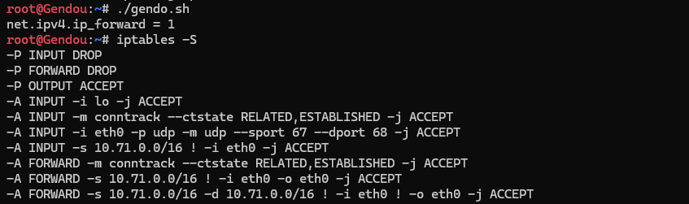

Dari Armisael, tiga ping berikut menguji akses ke internet, ke Gendo, dan antar-LAN menuju Lilith:

```sh
ping -c 3 8.8.8.8
ping -c 3 10.71.4.105
ping -c 3 10.71.4.82
```

Ketiga pengujian menerima balasan untuk 3 dari 3 paket.


## Soal 6

### Tujuan

Setiap node non-router diberi IP statis dan gateway sesuai aturan alamat pada glosarium. Konfigurasi disimpan di `/etc/network/interfaces` agar diterapkan kembali saat container Debinet dimulai ulang. DNS `8.8.8.8` juga disetel melalui konfigurasi interface.

Alamat gateway pada setiap LAN adalah usable pertama. Host memakai alamat usable setelah gateway, mengikuti urutan node pada topologi.

### Tabel alamat node

| Switch / LAN | Node | IP statis | Gateway |
|---|---|---|---|
| Quarters | Quarters | `10.71.0.2/23` | `10.71.0.1` |
| Comm | Comm-Net | `10.71.2.2/24` | `10.71.2.1` |
| Hangar | Hangar-Crew | `10.71.3.2/25` | `10.71.3.1` |
| Bunker | Sachiel | `10.71.3.130/26` | `10.71.3.129` |
| Medic | Pen-Pen | `10.71.3.194/27` | `10.71.3.193` |
| Medic | Medic-Bay | `10.71.3.195/27` | `10.71.3.193` |
| Relay | Relay-Node | `10.71.3.226/27` | `10.71.3.225` |
| Garden | Garden-Staff | `10.71.4.2/27` | `10.71.4.1` |
| Dock | Dock-Crew | `10.71.4.34/28` | `10.71.4.33` |
| Lab | Entry-Plug | `10.71.4.50/29` | `10.71.4.49` |
| Lab | Dummy-Plug | `10.71.4.51/29` | `10.71.4.49` |
| Terminal | Magi-Casper | `10.71.4.66/29` | `10.71.4.65` |
| Terminal | Magi-Balthasar | `10.71.4.67/29` | `10.71.4.65` |
| Terminal | Magi-Melchior | `10.71.4.68/29` | `10.71.4.65` |
| Cage | Unit-01 | `10.71.4.74/29` | `10.71.4.73` |
| Cage | Unit-02 | `10.71.4.75/29` | `10.71.4.73` |
| Cage | Unit-00 | `10.71.4.76/29` | `10.71.4.73` |
| Dogma | Lilith | `10.71.4.82/29` | `10.71.4.81` |
| Dogma | Adam | `10.71.4.83/29` | `10.71.4.81` |
| Monolith | Zeruel | `10.71.4.90/29` | `10.71.4.89` |
| Monolith | Armisael | `10.71.4.91/29` | `10.71.4.89` |
| Radar | Radar-Array | `10.71.4.58/29` | `10.71.4.57` |
| Archive | Archive-Vault | `10.71.4.98/30` | `10.71.4.97` |
| Intel | Spy | `10.71.4.102/30` | `10.71.4.101` |
| Cmd | Tokyo3-Core | `10.71.4.106/30` | `10.71.4.105` |

Contoh konfigurasi persisten untuk Unit-01:

```text
auto lo
iface lo inet loopback

auto eth0
iface eth0 inet static
    address 10.71.4.74
    netmask 255.255.255.248
    gateway 10.71.4.73
    up echo "nameserver 8.8.8.8" > /etc/resolv.conf
```

Skrip konfigurasi node tersedia per host di `script/soal-6/`. Setiap skrip menulis konfigurasi statis ke `/etc/network/interfaces`, lalu menerapkannya kembali pada `eth0`. Salin skrip node yang sesuai ke container, kemudian jalankan sebagai root:

```sh
chmod +x /root/unit-01.sh
/root/unit-01.sh
```

### Uji persistensi Unit-01

Unit-01 dihentikan lalu dimulai kembali di GNS3. Setelah restart, `ip -br a` menampilkan `10.71.4.74/29` pada `eth0`; ping tiga kali ke gateway Misato `10.71.4.73` berhasil tanpa packet loss.

```sh
ip -br a && ping -c 3 10.71.4.73
```


## Soal 7

### Tujuan

Menyiapkan layanan TCP pada node MAGI menggunakan `netcat-traditional`. Magi-Casper dan Magi-Melchior menerima koneksi pada port `5000`, sedangkan Magi-Balthasar menerima koneksi pada port `5000` dan `5001`. Setiap listener dijalankan di latar belakang dan menyimpan pesan yang diterima ke log di `/root/`.

### Skrip listener MAGI

Jalankan skrip pada masing-masing container MAGI terlebih dahulu. Skrip memeriksa apakah `iptables` dan `nc` sudah tersedia. Jika belum, skrip mengambil waktu dari header HTTP `Date` di `deb.debian.org`, menyetel waktu container sebelum `apt-get update`, lalu memasang `iptables` dan `netcat-traditional`. Setelah itu, listener lama pada port terkait dihentikan dan listener baru dijalankan.

**Magi-Casper** — `script/soal-7/magi-casper.sh`:

```sh
#!/bin/sh
if ! command -v iptables >/dev/null 2>&1 || ! command -v nc >/dev/null 2>&1; then
    DATE_STR=$(wget -S --spider http://deb.debian.org 2>&1 | awk -F': ' '/^  Date:/{print $2; exit}')
    [ -n "$DATE_STR" ] && date -s "$DATE_STR"
    apt-get update -qq && DEBIAN_FRONTEND=noninteractive apt-get install -y -qq iptables netcat-traditional
fi

pkill -f "[n]c -l -p 5000" 2>/dev/null || true
nohup nc -l -p 5000 >/root/casper-5000.log 2>&1 &
```

**Magi-Balthasar** — `script/soal-7/magi-balthasar.sh`:

```sh
#!/bin/sh
if ! command -v iptables >/dev/null 2>&1 || ! command -v nc >/dev/null 2>&1; then
    DATE_STR=$(wget -S --spider http://deb.debian.org 2>&1 | awk -F': ' '/^  Date:/{print $2; exit}')
    [ -n "$DATE_STR" ] && date -s "$DATE_STR"
    apt-get update -qq && DEBIAN_FRONTEND=noninteractive apt-get install -y -qq iptables netcat-traditional
fi

pkill -f "[n]c -l -p 5000" 2>/dev/null || true
pkill -f "[n]c -l -p 5001" 2>/dev/null || true
nohup nc -l -p 5000 >/root/balthasar-5000.log 2>&1 &
nohup nc -l -p 5001 >/root/balthasar-5001.log 2>&1 &
```

**Magi-Melchior** — `script/soal-7/magi-melchior.sh`:

```sh
#!/bin/sh
if ! command -v iptables >/dev/null 2>&1 || ! command -v nc >/dev/null 2>&1; then
    DATE_STR=$(wget -S --spider http://deb.debian.org 2>&1 | awk -F': ' '/^  Date:/{print $2; exit}')
    [ -n "$DATE_STR" ] && date -s "$DATE_STR"
    apt-get update -qq && DEBIAN_FRONTEND=noninteractive apt-get install -y -qq iptables netcat-traditional
fi

pkill -f "[n]c -l -p 5000" 2>/dev/null || true
nohup nc -l -p 5000 >/root/melchior-5000.log 2>&1 &
```

Salin dan jalankan setiap skrip sebagai root di container MAGI yang sesuai. Pastikan skrip dijalankan pada ketiga node sebelum mengirim pesan dari Lilith.

```sh
# Di Magi-Casper
chmod +x /root/magi-casper.sh && /root/magi-casper.sh

# Di Magi-Balthasar
chmod +x /root/magi-balthasar.sh && /root/magi-balthasar.sh

# Di Magi-Melchior
chmod +x /root/magi-melchior.sh && /root/magi-melchior.sh
```

Setelah listener aktif, kirim pesan dari Lilith (`10.71.4.82`):

```sh
echo "Pesan dari Lilith ke Magi-Casper (5000)" | nc -w 2 10.71.4.66 5000
echo "Pesan dari Lilith ke Magi-Balthasar (5000)" | nc -w 2 10.71.4.67 5000
echo "Pesan dari Lilith ke Magi-Balthasar (5001)" | nc -w 2 10.71.4.67 5001
echo "Pesan dari Lilith ke Magi-Melchior (5000)" | nc -w 2 10.71.4.68 5000
```

### Bukti pesan diterima

Pesan diterima dan tersimpan di log listener masing-masing node:

**Magi-Casper** — `/root/casper-5000.log`:

```sh
cat /root/casper-5000.log
```


**Magi-Balthasar** — `/root/balthasar-5000.log` dan `/root/balthasar-5001.log`:

```sh
cat /root/balthasar-5000.log
cat /root/balthasar-5001.log
```

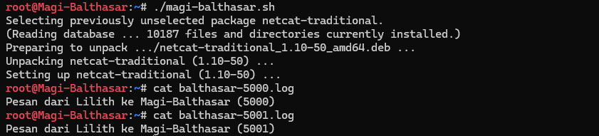

**Magi-Melchior** — `/root/melchior-5000.log`:

```sh
cat /root/melchior-5000.log
```

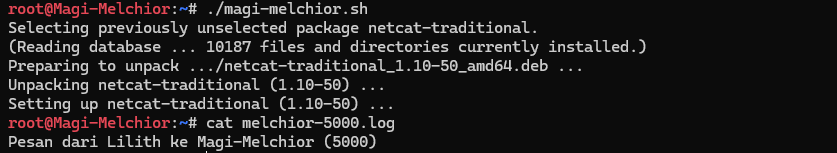

**Pengiriman dari Lilith:**

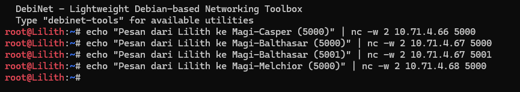

## Soal 8

### Tujuan

Menjalankan layanan TCP pada Pen-Pen dan Tokyo3-Core. Pen-Pen menjawab koneksi pada port `80` dengan `Welcome to {hostname}`. Tokyo3-Core menggunakan jawaban yang sama pada port `80` dan mengirim `syifa imutz` pada port `8080`. Pengujian dari Lilith juga memastikan koneksi ke port `22` yang tidak dilayani gagal dalam batas waktu, bukan menunggu tanpa akhir.

### Skrip listener

Kedua skrip memeriksa ketersediaan `iptables` dan `nc`. Jika salah satunya belum tersedia, waktu container diselaraskan menggunakan header HTTP `Date`, lalu `iptables` dan `netcat-openbsd` dipasang. Listener dijalankan berulang agar siap menerima koneksi berikutnya, dan output disimpan ke log di `/root/`.

**Pen-Pen** — `script/soal-8/pen-pen.sh`:

```sh
#!/bin/sh
if ! command -v iptables >/dev/null 2>&1 || ! command -v nc >/dev/null 2>&1; then
    DATE_STR=$(wget -S --spider http://deb.debian.org 2>&1 | awk -F': ' '/^  Date:/{print $2; exit}')
    [ -n "$DATE_STR" ] && date -s "$DATE_STR"
    apt-get update -qq && DEBIAN_FRONTEND=noninteractive apt-get install -y -qq iptables netcat-openbsd
fi

pkill -f "[n]c -l 80" 2>/dev/null || true

while true; do
    printf "Welcome to %s\n" "$(hostname)" | nc -l 80 >>/root/penpen-80.log 2>&1 || sleep 1
done &
```

**Tokyo3-Core** — `script/soal-8/tokyo3-core.sh`:

```sh
#!/bin/sh
if ! command -v iptables >/dev/null 2>&1 || ! command -v nc >/dev/null 2>&1; then
    DATE_STR=$(wget -S --spider http://deb.debian.org 2>&1 | awk -F': ' '/^  Date:/{print $2; exit}')
    [ -n "$DATE_STR" ] && date -s "$DATE_STR"
    apt-get update -qq && DEBIAN_FRONTEND=noninteractive apt-get install -y -qq iptables netcat-openbsd
fi

pkill -f "[n]c -l 80" 2>/dev/null || true
pkill -f "[n]c -l 8080" 2>/dev/null || true

while true; do
    printf "Welcome to %s\n" "$(hostname)" | nc -l 80 >>/root/tokyo3-80.log 2>&1 || sleep 1
done &

while true; do
    printf "syifa imutz\n" | nc -l 8080 >>/root/tokyo3-8080.log 2>&1 || sleep 1
done &
```

Salin dan jalankan masing-masing skrip sebagai root di container yang sesuai:

```sh
# Di Pen-Pen
chmod +x /root/pen-pen.sh && /root/pen-pen.sh

# Di Tokyo3-Core
chmod +x /root/tokyo3-core.sh && /root/tokyo3-core.sh
```

### Pengujian

Pastikan listener aktif. Pen-Pen seharusnya menampilkan port `80` berstatus `LISTEN`; Tokyo3-Core menampilkan port `80` dan `8080`.

```sh
ss -tulpn
```

Dari Lilith, uji ketiga layanan:

```sh
nc -w 2 10.71.3.194 80
nc -w 2 10.71.4.106 80
nc -w 2 10.71.4.106 8080
```

Jawaban yang diharapkan adalah `Welcome to Pen-Pen`, `Welcome to Tokyo3-Core`, dan `syifa imutz`.

Port `22` tidak memiliki listener. Uji dengan verbose mode dan batas waktu dua detik agar kegagalan koneksi terlihat langsung:

```sh
nc -v -w 2 10.71.3.194 22
nc -v -w 2 10.71.4.106 22
```

### Bukti pengujian

Di Pen-Pen, `ss -tulpn` menunjukkan listener pada port `80`:


Di Tokyo3-Core, listener aktif pada port `80` dan `8080`:

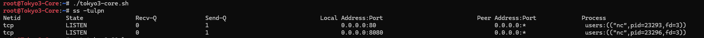

Pengujian dari Lilith menerima respons yang diharapkan pada ketiga port layanan. Koneksi ke port `22` pada kedua host ditolak dengan `Connection refused`:

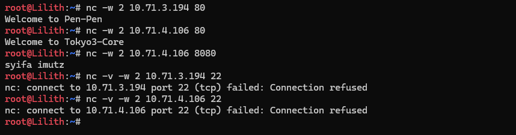

### Menghentikan listener

Untuk menghentikan loop dan proses `nc` di Pen-Pen:

```sh
pkill -f "pen-pen.sh" 2>/dev/null || true
pkill -f "[n]c -l 80" 2>/dev/null || true
pkill -f "sleep 1" 2>/dev/null || true
```

Untuk menghentikan listener di Tokyo3-Core:

```sh
pkill -f "tokyo3-core.sh" 2>/dev/null || true
pkill -f "[n]c -l 80" 2>/dev/null || true
pkill -f "[n]c -l 8080" 2>/dev/null || true
pkill -f "sleep 1" 2>/dev/null || true
```

## Soal 9

### Analisis sabotase routing

Setelah `break_routing.sh` dijalankan di Shigeru, empat perubahan mengganggu forwarding dan pemilihan rute. Armisael masih dapat ping gateway `10.71.4.89` karena alamat itu dimiliki langsung oleh Shigeru. Paket yang harus diteruskan melewati Shigeru terkena konfigurasi forwarding, policy routing, dan rute yang telah disabotase.

| No. | Perubahan sabotase | Dampak | Hubungan dengan gejala |
|---:|---|---|---|
| 1 | `echo 0 > /proc/sys/net/ipv4/ip_forward` | IP forwarding di Shigeru dimatikan. | Paket yang ditujukan ke alamat Shigeru sendiri tetap dapat dijawab, tetapi paket transit antara LAN Monolith dan jaringan lain tidak diteruskan. |
| 2 | `ip route replace default via 10.71.4.146 dev eth2` | Default route diarahkan ke Makoto, bukan ke Gendo (`10.71.4.113` melalui `eth0`). | Paket yang membutuhkan rute default dikirim ke arah cabang Radar, bukan menuju core router. |
| 3 | `ip route add blackhole 10.71.4.72/29` | Subnet Cage dibuang diam-diam oleh tabel routing utama. | Tujuan pada prefix tersebut tidak dapat dicapai dari Shigeru. |
| 4 | `ip route add unreachable default table 100` dan `ip rule add iif eth1 lookup 100 priority 90` | Paket yang masuk dari `eth1` (Switch-Monolith) dipilihkan tabel 100, yang hanya memiliki rute `unreachable default`. | Paket dari Armisael gagal sebelum memakai tabel utama, sehingga trafik menuju Lilith tidak dapat diteruskan. |

Untuk gejala ping Lilith ke Armisael, permintaan dari Lilith masuk ke Shigeru lewat `eth0`; `ip_forward=0` menghentikan paket sebelum diteruskan ke `eth1`. Jika balasan Armisael masuk ke Shigeru lewat `eth1`, rule PBR prioritas 90 memilih tabel 100 dan menghasilkan `unreachable`. Default route yang salah juga akan mengirim trafik tanpa rute yang lebih spesifik ke Makoto, bukan Gendo. Blackhole `10.71.4.72/29` adalah sabotase tambahan pada subnet Cage, tetapi bukan penyebab langsung ping antara Lilith dan Armisael karena Lilith berada di subnet Dogma `10.71.4.80/29`.

### Gejala saat kondisi rusak

Jalankan sabotase, lalu periksa forwarding dan tabel routing di Shigeru. Perintah pertama berikut adalah skrip yang dijalankan pada bukti:

```bash
./break_routing.sh
sysctl net.ipv4.ip_forward
ip rule show
ip route show
ip route show table 100
```

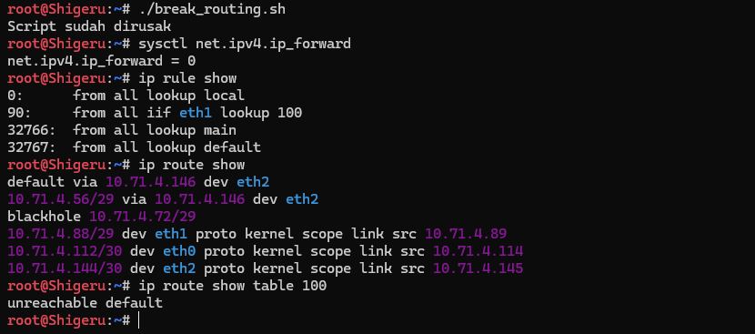

Di Armisael, ping pertama menguji gateway Shigeru dan ping kedua menguji Lilith:

```bash
ping -c 3 10.71.4.89
ping -c 3 10.71.4.82
```

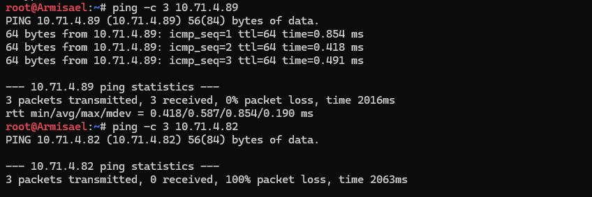

Di Lilith, jalankan ping berikut untuk menguji jalur balik ke Armisael:

```bash
ping -c 3 10.71.4.91
```


### Perbaikan di Shigeru

Skrip berikut mengaktifkan kembali forwarding, menghapus rule dan tabel policy routing, menghapus rute blackhole, serta memulihkan default route ke Gendo dan rute Radar melalui Makoto.

```bash
#!/bin/sh

sysctl -w net.ipv4.ip_forward=1

ip rule del iif eth1 lookup 100 priority 90 2>/dev/null || true
ip route flush table 100 2>/dev/null || true
ip route del blackhole 10.71.4.72/29 2>/dev/null || true

ip route replace default via 10.71.4.113 dev eth0
ip route replace 10.71.4.56/29 via 10.71.4.146 dev eth2
```

Skrip tersedia di `script/soal-9/repair-shigeru.sh`. Salin ke Shigeru dan jalankan sebagai root:

```bash
chmod +x /root/repair-shigeru.sh
/root/repair-shigeru.sh
```

Pastikan konfigurasi persisten `/etc/network/interfaces` tetap mengikuti konfigurasi Soal 3 agar rute normal kembali setelah restart.

### Verifikasi setelah perbaikan

Periksa forwarding, policy rule, dan tabel routing di Shigeru:

```bash
sysctl net.ipv4.ip_forward
ip rule show
ip route show
```

Pastikan forwarding bernilai `1`, rule `lookup 100` serta rute `blackhole` sudah tidak ada, dan default route mengarah ke Gendo melalui `eth0`. Setelah itu, ping Lilith ke Armisael harus kembali menerima balasan:

```bash
ping -c 3 10.71.4.91
```

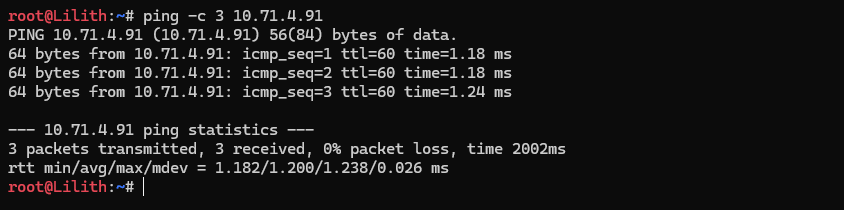

## Soal 10

### Tujuan Soal

Soal ini meminta kita menemukan seluruh penyebab gangguan NAT setelah `break_nat.sh` dijalankan, menjelaskan hubungan setiap aturan yang rusak dengan gejala jaringan, lalu memperbaikinya dan menguji kembali konektivitas. Pemeriksaan mencakup akses internet dari jaringan Cage, pembanding dari Spy di jaringan Intel, serta komunikasi internal dari Unit-01 ke Lilith. Dengan membandingkan hasil tersebut dan aturan `POSTROUTING` di Misato serta Gendou, kita dapat menentukan aturan sabotase mana yang memengaruhi tiap jalur.

### Jalankan sabotase

Jalankan skrip `break_nat.sh` pada **Misato** dan **Gendou** untuk menerapkan kondisi yang diuji:

```bash
# Di Misato
./break_nat.sh

# Di Gendou
./break_nat.sh
```

### Pemeriksaan sebelum perbaikan

Di Unit-01, jalankan ping berikut untuk merekam gagalnya akses internet:

```bash
ping -c 2 8.8.8.8
```


Di Spy pada subnet Intel, jalankan perintah yang sama sebagai pembanding:

```bash
ping -c 2 8.8.8.8
```

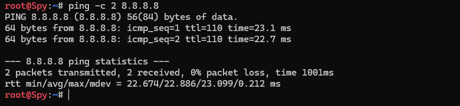

Di Unit-01, uji tujuan internet dan Lilith secara berurutan:

```bash
ping -c 2 8.8.8.8
ping -c 2 10.71.4.82
```

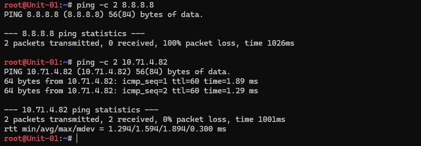

Periksa rantai `POSTROUTING` pada kedua router:

```bash
# Di Misato
iptables -t nat -L POSTROUTING -n -v --line-numbers

# Di Gendou
iptables -t nat -L POSTROUTING -n -v --line-numbers
```

Di Misato, bukti menunjukkan rule berikut pada baris pertama:

```text
SNAT  source 10.71.4.72/29  destination !10.71.0.0/16  out eth0  to:172.31.99.1
```

Rule ini mengubah sumber paket Cage menjadi `172.31.99.1` ketika tujuan berada di luar jaringan internal. Alamat tersebut bukan alamat sumber WAN Gendou yang dapat dipakai untuk menerima balasan internet. Karena itu, balasan dari `8.8.8.8` tidak kembali ke Unit-01.

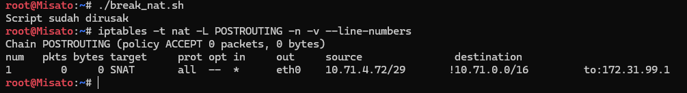

Di Gendou, bukti menunjukkan `RETURN` di baris pertama, sebelum rule `MASQUERADE`:

```text
RETURN      source 10.71.4.64/29  out eth0
MASQUERADE  source 10.71.0.0/16   out eth0
```

`RETURN` menghentikan pemrosesan lebih lanjut pada chain `POSTROUTING` untuk sumber `10.71.4.64/29`. **Rentang tersebut adalah Switch-Terminal, bukan Cage**; alamat Cage adalah `10.71.4.72/29`. Jadi berdasarkan output yang terekam, rule Gendou mengganggu NAT untuk Terminal, tetapi tidak mencocokkan paket Unit-01. Penyebab langsung kegagalan ping Cage yang terlihat adalah rule SNAT di Misato.

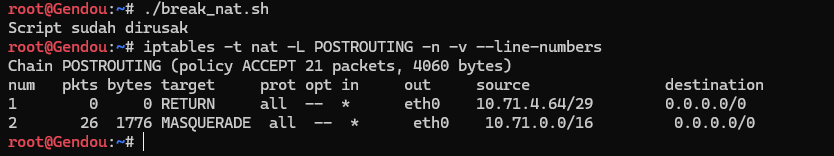

### Mengapa Intel dan komunikasi internal tetap berjalan

- Rule SNAT Misato mencocokkan sumber Cage (`10.71.4.72/29`), sehingga tidak mengenai Spy di subnet Intel (`10.71.4.100/30`). Spy tetap keluar melalui rule `MASQUERADE` Gendou.
- Ping dari Cage ke Lilith tetap berjalan karena Lilith (`10.71.4.82`) berada di dalam jaringan internal `10.71.0.0/16`; kondisi tujuan `! -d 10.71.0.0/16` pada rule SNAT tidak terpenuhi.

### Perbaikan

Hapus rule sabotase pada kedua router. Berdasarkan bukti, rule yang perlu dihapus berada di nomor baris pertama pada masing-masing chain:

**Di Gendou**, hapus `RETURN` dan biarkan `MASQUERADE`:

```bash
iptables -t nat -D POSTROUTING 1
iptables -t nat -L POSTROUTING -n -v --line-numbers
```

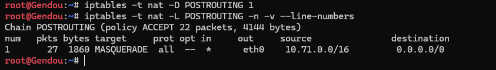

**Di Misato**, hapus rule `SNAT` menuju alamat bogus:

```bash
iptables -t nat -D POSTROUTING 1
iptables -t nat -L POSTROUTING -n -v --line-numbers
```


### Verifikasi setelah perbaikan

Periksa kembali tabel NAT pada kedua router:

```bash
iptables -t nat -L POSTROUTING -n -v --line-numbers
```

Pada Gendou, rule `MASQUERADE` internal melalui `eth0` kembali menjadi satu-satunya rule yang diperlukan. Pada Misato, rantai `POSTROUTING` sudah kosong.

Uji kembali Unit-01 menuju Seele (`8.8.8.8`):

```bash
ping -c 3 8.8.8.8
```

Ping berhasil setelah perbaikan. Alamat sumber diterjemahkan di **Gendou** oleh rule `MASQUERADE` pada chain `POSTROUTING` tabel `nat`, saat paket keluar melalui `eth0` ke NAT1.

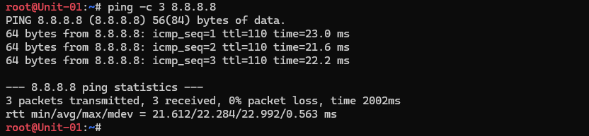

## Soal 11

### Tujuan Soal

Soal ini meminta Magi-Casper (`10.71.4.66/29`) dibuat tidak membalas ping dari node lain, baik dari Magi-Balthasar yang satu switch maupun dari Lilith di subnet berbeda. Pada saat yang sama, Casper harus tetap dapat memulai ping ke node lain dan menerima balasannya, serta tetap menyediakan layanan TCP port `5000`.

Solusinya adalah menjalankan skrip `script/soal-11/magi-casper.sh` langsung di Magi-Casper. Ini penting karena trafik Balthasar ke Casper pada Switch-Terminal tidak melewati router. Skrip membersihkan rule `INPUT` lama, menerima paket `ESTABLISHED,RELATED` agar balasan koneksi yang dimulai Casper bisa masuk, lalu membuang ICMP `echo-request` yang ditujukan ke Casper. Skrip juga menyalakan kembali listener `nc` port `5000`, sehingga pengujian TCP tetap berhasil walaupun ping masuk gagal.

### Skrip Magi-Casper

Skrip tersedia di `script/soal-11/magi-casper.sh`. Jalankan sebagai root di Magi-Casper:

```bash
#!/bin/sh
if ! command -v iptables >/dev/null 2>&1 || ! command -v nc >/dev/null 2>&1; then
    DATE_STR=$(wget -S --spider http://deb.debian.org 2>&1 | awk -F': ' '/^  Date:/{print $2; exit}')
    [ -n "$DATE_STR" ] && date -s "$DATE_STR"
    apt-get update -qq && DEBIAN_FRONTEND=noninteractive apt-get install -y -qq iptables netcat-openbsd
fi

# Bersihkan aturan INPUT lama agar tidak menumpuk saat skrip dijalankan ulang.
iptables -F INPUT

# Izinkan balasan untuk koneksi yang dimulai Casper.
iptables -A INPUT -m conntrack --ctstate ESTABLISHED,RELATED -j ACCEPT

# Buang semua ping masuk.
iptables -A INPUT -p icmp --icmp-type echo-request -j DROP

# Jalankan kembali listener TCP 5000.
pkill -f "[n]c -l 5000" 2>/dev/null || true
pkill -f "[n]c -l -p 5000" 2>/dev/null || true
nohup nc -l 5000 >/root/casper-5000.log 2>&1 &
```

```bash
chmod +x /root/magi-casper.sh
/root/magi-casper.sh
```

### Verifikasi firewall dan ping

Periksa rule `INPUT` dan pastikan listener TCP port `5000` aktif:

```bash
./magi-casper.sh
iptables -L INPUT -n -v
ss -tulpn | grep 5000
```


Di Magi-Balthasar, ping ke Casper harus gagal meskipun keduanya terhubung ke switch yang sama:

```bash
ping -c 3 10.71.4.66
```

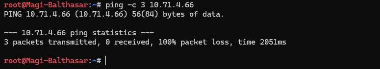

Di Lilith, ulangi pengujian dari subnet lain:

```bash
ping -c 3 10.71.4.66
```


Sebaliknya, ping yang dimulai dari Casper ke Magi-Balthasar dan Lilith harus berhasil. Balasan echo-reply diterima karena rule `ESTABLISHED,RELATED` berada sebelum rule DROP:

```bash
# Dari Magi-Casper
ping -c 3 10.71.4.67
ping -c 3 10.71.4.82
```

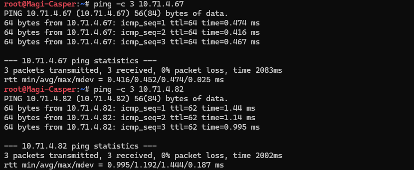

### Verifikasi TCP 5000

Di Lilith, ping ke Casper tetap gagal, tetapi koneksi TCP ke port `5000` berhasil:

```bash
ping -c 3 10.71.4.66
echo "Cek TCP 5000 Casper" | nc -w 2 10.71.4.66 5000
```


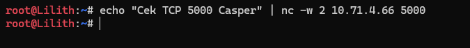

Periksa pesan pada Casper:

```bash
cat /root/casper-5000.log
```


## Soal 12

### Tujuan Soal

Soal ini meminta kita menemukan **semua penyebab** gangguan setelah `break_fw.sh` dijalankan di Magi-Casper, menghubungkan setiap rule yang rusak dengan gejalanya, lalu memperbaiki firewall tanpa menghilangkan perilaku “hantu” dari Soal 11. Target akhirnya: Casper dapat ping ke internet dan menjalankan `apt-get update`, Unit-00 dapat terhubung ke layanan TCP port `5000`, tetapi ping masuk ke Casper tetap ditolak.

Karena gangguan dapat berasal dari beberapa chain sekaligus, pemeriksaan harus mencakup rule `INPUT` dan `OUTPUT`, bukan hanya mengubah satu rule berdasarkan satu gejala. Rule `INPUT` yang di-flush menghilangkan izin untuk balasan koneksi dan layanan TCP `5000`; rule DROP UDP port `53` di `OUTPUT` memutus kueri DNS; dan rule DROP ICMP di `INPUT` tanpa pengecualian `ESTABLISHED,RELATED` juga membuang echo-reply untuk ping yang dimulai Casper. Perbaikan di bawah mempertahankan policy `INPUT DROP` dan penolakan echo-request, sambil memulihkan trafik balasan, DNS/akses keluar, dan layanan TCP.

### Pemeriksaan kondisi rusak

Pemeriksaan sebelum perbaikan:

```bash
./break_fw.sh
iptables -L INPUT -n -v --line-numbers
iptables -L OUTPUT -n -v --line-numbers
ping -c 3 8.8.8.8
apt-get update
```

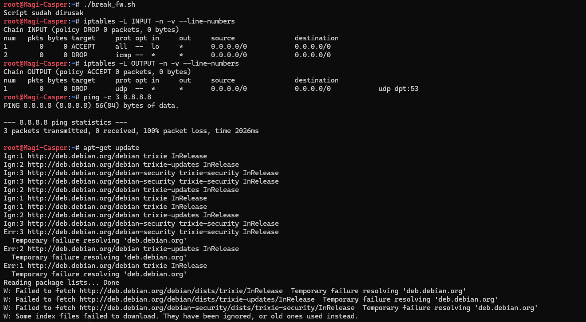

### Penyebab yang ditemukan

| Penyebab | Efek | Gejala |
|---|---|---|
| Rule `INPUT` lama dihapus oleh `iptables -F INPUT`, sementara policy `INPUT` tetap `DROP`. Rule `ESTABLISHED,RELATED` dan izin TCP port `5000` ikut hilang. | Balasan koneksi Casper sendiri dan koneksi masuk ke port layanan tidak memiliki rule `ACCEPT`. | Echo-reply dari `8.8.8.8`, balasan layanan apt, dan SYN ke TCP 5000 dibuang di `INPUT`. |
| `iptables -A OUTPUT -p udp --dport 53 -j DROP`. | Kueri DNS UDP keluar dibuang. | `apt-get update` gagal me-resolve `deb.debian.org`. |
| `iptables -A INPUT -p icmp -j DROP` tanpa rule `ESTABLISHED,RELATED` yang lebih dahulu menerima balasan. | Semua ICMP masuk dibuang, termasuk echo-reply untuk ping yang dimulai Casper. | Ping masuk tetap ditolak sesuai tujuan Casper sebagai “hantu”; ping keluar Casper juga tidak menerima balasan. |

Di Unit-00, ping ke Casper gagal dan percobaan koneksi ke TCP port `5000` mengalami timeout:

```bash
ping -c 3 10.71.4.66
echo "Tes sebelum fix" | nc -v -w 2 10.71.4.66 5000
```


### Perbaikan di Magi-Casper

Perintah berikut memulihkan koneksi yang dimulai Casper dan layanan port `5000`, sambil mempertahankan policy `INPUT DROP` serta penolakan ping masuk. `OUTPUT ACCEPT` juga menghapus blokir DNS keluar setelah chain `OUTPUT` dibersihkan.

```bash
# Pertahankan policy ketat untuk trafik masuk; izinkan trafik keluar.
iptables -P INPUT DROP
iptables -P OUTPUT ACCEPT

# Bersihkan rule yang rusak.
iptables -F INPUT
iptables -F OUTPUT

# Izinkan loopback dan balasan koneksi yang sudah dimulai.
iptables -A INPUT -i lo -j ACCEPT
iptables -A INPUT -m conntrack --ctstate ESTABLISHED,RELATED -j ACCEPT

# Izinkan layanan Casper, lalu tetap tolak ping masuk.
iptables -A INPUT -p tcp --dport 5000 -m conntrack --ctstate NEW,ESTABLISHED -j ACCEPT
iptables -A INPUT -p icmp --icmp-type echo-request -j DROP
```

Pastikan listener TCP port `5000` berjalan. Jika belum aktif, mulai ulang:

```bash
ss -tulpn | grep 5000
nohup nc -l 5000 >/root/casper-5000.log 2>&1 &
```


### Verifikasi setelah perbaikan

Pastikan policy `INPUT` tetap `DROP` dan rule pemulihan terpasang:

```bash
ss -tulpn | grep 5000
nohup nc -l 5000 >/root/casper-5000.log 2>&1 &
ss -tulpn | grep 5000
iptables -L INPUT -n -v --line-numbers
```

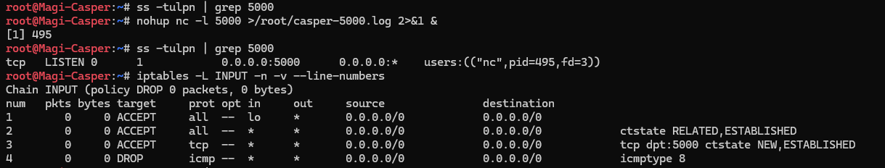

Jalankan `apt-get update` di Casper. Ini menguji resolusi DNS dan komunikasi keluar beserta balasannya:

```bash
apt-get update
```


Dari Unit-00, ping ke Casper harus tetap gagal karena echo-request masuk masih dibuang:

```bash
ping -c 3 10.71.4.66
```


TCP port `5000` dari Unit-00 harus berhasil. Gambar berikut juga menampilkan ping masuk yang tetap ditolak:

```bash
ping -c 3 10.71.4.66
echo "Halo dari Unit-00 ke Casper 5000" | nc -w 2 10.71.4.66 5000
```

Di Magi-Casper, periksa payload yang diterima:

```bash
cat /root/casper-5000.log
```


## Soal 13

### Tujuan

Membatasi akses layanan TCP **5000** dan **5001** di Magi-Balthasar. Hanya **Magi-Casper** dan semua **Pilot** (Unit-01, Unit-02, Unit-00, Sachiel) yang boleh tersambung. Node lain, termasuk tetangga satu switch, harus **langsung ditolak** tanpa menggantung sampai timeout. Lalu lintas lain tidak boleh terganggu, dan Balthasar tetap harus bisa ping 8.8.8.8.

### Alamat yang Digunakan

| Peran | Node | IP |
|---|---|---|
| Target | Magi-Balthasar | 10.71.4.67 |
| Diizinkan | Magi-Casper | 10.71.4.66 |
| Diizinkan | Unit-01, Unit-02 | 10.71.4.74, 10.71.4.75 (digabung `10.71.4.74/31`) |
| Diizinkan | Unit-00 | 10.71.4.76 |
| Diizinkan | Sachiel | 10.71.3.130 |
| Uji (ditolak) | Lilith | 10.71.4.82 |
| Uji (ditolak) | Magi-Melchior | 10.71.4.68 |

### Analisis

1. **Rule dipasang di Balthasar (chain INPUT), bukan di router.**
   Melchior berada di switch yang sama (Switch-Terminal), sehingga paketnya langsung lewat switch tanpa melewati router Fuyutsuki. Satu-satunya titik yang pasti dilewati semua paket ke Balthasar adalah Balthasar sendiri.

2. **Menggunakan `REJECT --reject-with tcp-reset`, bukan `DROP`.**
   `DROP` membuang paket diam-diam sehingga pengirim menunggu sampai timeout. `REJECT` dengan `tcp-reset` membalas paket RST sehingga pengirim langsung tahu koneksinya ditolak.

3. **ACCEPT ditempatkan di atas REJECT.**
   iptables membaca rule dari atas ke bawah dan berhenti di rule pertama yang cocok. Jika REJECT diletakkan di atas, sumber yang diizinkan juga ikut ditolak.

4. **Menggunakan `/31` untuk Unit-01 dan Unit-02.**
   Blok `10.71.4.74/31` hanya mencakup .74 dan .75. Jika menggunakan seluruh subnet Switch-Cage (`10.71.4.72/29`), router Misato (10.71.4.73) ikut terizinkan, padahal Misato bukan Pilot.

5. **Policy INPUT tetap ACCEPT.**
   Rule hanya mengenai TCP port 5000 dan 5001, sehingga ping dan lalu lintas lain tidak terganggu.

### Langkah Pengerjaan

#### 1. Cek kondisi awal Balthasar

```sh
ip -br a
iptables -S
ps aux | grep "nc -l"
```

Memastikan IP Balthasar 10.71.4.67/29, iptables masih kosong, dan listener port 5000/5001 berjalan.

#### 2. Menyalakan listener (jika belum berjalan)

```sh
while true; do nc -l -p 5000 >> /root/log5000.txt; done &
while true; do nc -l -p 5001 >> /root/log5001.txt; done &
```

Listener dijalankan dalam loop agar tetap hidup setelah menerima koneksi, dan pesan yang diterima dicatat ke file log.

#### 3. Membuat script `/root/balthasar.sh`

```sh
cat > /root/balthasar.sh << 'EOF'
#!/bin/sh
add() { iptables -C INPUT "$@" 2>/dev/null || iptables -A INPUT "$@"; }

P="-p tcp -m multiport --dports 5000,5001"
add $P -s 10.71.4.66   -j ACCEPT
add $P -s 10.71.4.74/31 -j ACCEPT
add $P -s 10.71.4.76   -j ACCEPT
add $P -s 10.71.3.130  -j ACCEPT
add $P -j REJECT --reject-with tcp-reset
EOF
chmod +x /root/balthasar.sh
```

Fungsi `add` memeriksa rule dengan `iptables -C` terlebih dahulu, sehingga script aman dijalankan berkali-kali tanpa membuat rule dobel.

#### 4. Menjalankan script dan memeriksa rule

```sh
./balthasar.sh
iptables -L INPUT -n -v --line-numbers
```

Hasil:

```
num   pkts bytes target     prot opt in     out     source               destination
1        0     0 ACCEPT     tcp  --  *      *       10.71.4.66           0.0.0.0/0            multiport dports 5000,5001
2        0     0 ACCEPT     tcp  --  *      *       10.71.4.74/31        0.0.0.0/0            multiport dports 5000,5001
3        0     0 ACCEPT     tcp  --  *      *       10.71.4.76           0.0.0.0/0            multiport dports 5000,5001
4        0     0 ACCEPT     tcp  --  *      *       10.71.3.130          0.0.0.0/0            multiport dports 5000,5001
5        0     0 REJECT     tcp  --  *      *       0.0.0.0/0            0.0.0.0/0            multiport dports 5000,5001 reject-with tcp-reset
```

#### 5. Membersihkan log sebelum pengujian

```sh
> /root/log5000.txt
> /root/log5001.txt
```

### Pengujian

#### Unit-01 (harus berhasil)

```sh
echo dari-unit01 | nc -w 3 10.71.4.67 5000; echo "exit: $?"
echo dari-unit01 | nc -w 3 10.71.4.67 5001; echo "exit: $?"
```

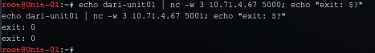

#### Lilith dan Magi-Melchior (harus ditolak seketika)

```sh
time (echo x | nc -w 3 10.71.4.67 5000); echo "exit: $?"
time (echo x | nc -w 3 10.71.4.67 5001); echo "exit: $?"
```

Exit code bukan 0 dan waktu `real` mendekati 0 detik, yang membuktikan koneksi ditolak seketika, bukan menggantung.

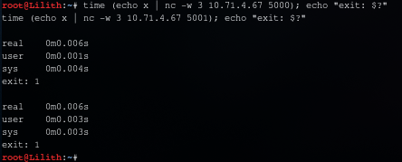
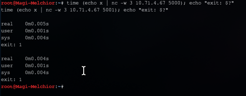
#### Hasil di Balthasar

```sh
cat /root/log5000.txt /root/log5001.txt
iptables -L INPUT -n -v --line-numbers
ping -c 3 8.8.8.8
```

Hasil:

```
dari-unit01
dari-unit01

num   pkts bytes target     prot opt in     out     source               destination
1        0     0 ACCEPT     tcp  --  *      *       10.71.4.66           0.0.0.0/0            multiport dports 5000,5001
2       10   560 ACCEPT     tcp  --  *      *       10.71.4.74/31        0.0.0.0/0            multiport dports 5000,5001
3        0     0 ACCEPT     tcp  --  *      *       10.71.4.76           0.0.0.0/0            multiport dports 5000,5001
4        0     0 ACCEPT     tcp  --  *      *       10.71.3.130          0.0.0.0/0            multiport dports 5000,5001
5        4   240 REJECT     tcp  --  *      *       0.0.0.0/0            0.0.0.0/0            multiport dports 5000,5001 reject-with tcp-reset

3 packets transmitted, 3 received, 0% packet loss
```

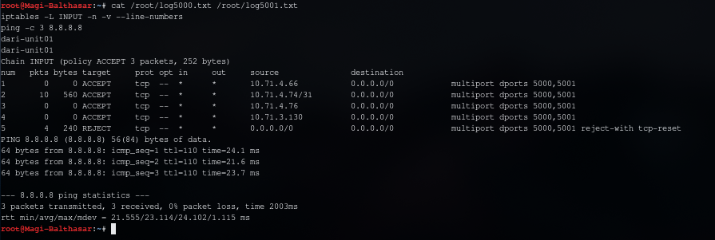

## Soal 14

### Tujuan

Membatasi **ping** dan koneksi **TCP 80** ke Pen-Pen sesuai jadwal tiap kelompok, dari mana pun asalnya, tanpa mengubah jam komputer. Jadwal disimpan sebagai variabel di awal script Pen-Pen.

### Kelompok dan Jadwal

| Kelompok | Node | IP | Jadwal (WIB) | Jadwal (UTC, dibaca iptables) |
|---|---|---|---|---|
| Target | Pen-Pen | 10.71.3.194 | – | – |
| Pilot | Unit-01, Unit-02, Unit-00, Sachiel | 10.71.4.74, 10.71.4.75, 10.71.4.76, 10.71.3.130 | 08.00–16.00, Senin–Jumat | 01:00–09:00, Mon–Fri |
| Staf Geofront | Lilith, Adam | 10.71.4.82, 10.71.4.83 | 17.00–23.00, setiap hari | 10:00–16:00 |
| Terduga Dummy System | Entry-Plug, Dummy-Plug, Spy | 10.71.4.50, 10.71.4.51, 10.71.4.102 | tidak pernah | – |
| Lainnya | node lain | – | bebas | – |

### Analisis

1. **Rule dipasang di Pen-Pen (chain INPUT).**
   Soal meminta jadwal berlaku "dari mana pun asalnya", termasuk node satu switch seperti Medic-Bay yang tidak melewati router. Karena itu filter dipasang di Pen-Pen sendiri.

2. **Hanya `echo-request` dan TCP port 80 yang disaring.**
   Jika semua ICMP disaring, balasan ping yang dikirim Pen-Pen ke luar (`echo-reply`) juga bisa ikut terblokir. Dengan hanya menyaring `echo-request`, Pen-Pen tetap bebas melakukan ping ke luar.

3. **Konversi WIB ke UTC.**
   Modul `time` iptables membaca jam UTC, sedangkan jadwal di soal dalam WIB (UTC+7). Variabel di script ditulis dalam WIB agar mudah dibaca, lalu fungsi `to_utc` mengurangi 7 jam secara otomatis. Untuk jadwal Pilot (08.00–16.00 WIB = 01:00–09:00 UTC), hari dalam WIB dan UTC tetap sama, jadi `--weekdays` tidak perlu digeser.

4. **Custom chain `PENPEN`.**
   Setiap kali script dijalankan, chain `PENPEN` dikosongkan (`-F`) lalu diisi ulang. Dengan begitu, saat variabel jadwal diubah untuk pengujian, rule lama tidak menumpuk. Rule yang mengarahkan paket dari INPUT ke `PENPEN` diperiksa dengan `-C` agar hanya ditambahkan sekali.

5. **Urutan rule.**
   Terduga di-DROP paling awal. Pilot dan Staf di-ACCEPT jika jam cocok, lalu di-DROP jika tidak cocok. Kelompok Lainnya tidak terkena rule apa pun di `PENPEN`, sehingga diterima oleh policy INPUT (ACCEPT).

### Langkah Pengerjaan

#### 1. Cek kondisi awal Pen-Pen

```sh
ip -br a
date -u
ps aux | grep "nc -l"
```

`date -u` digunakan sebagai patokan jam pengujian karena jam di GNS3 bisa berbeda dengan jam laptop. Pada saat pengerjaan, jam GNS3 menunjukkan `Wed Nov 25 10:09:57 UTC 2026` (17:09 WIB).

#### 2. Menyalakan listener port 80

```sh
while true; do echo "Welcome to $(hostname)" | nc -l -p 80; done &
```

Pengujian sebelum rule dipasang, dari Lilith:

```sh
nc -w 3 10.71.3.194 80
```

```
Welcome to Pen-Pen
```

#### 3. Membuat script `/root/penpen.sh`

```sh
#!/bin/sh
# ===== Jadwal (WIB) =====
PILOT_START="08:00"
PILOT_STOP="16:00"
PILOT_DAYS="Mon,Tue,Wed,Thu,Fri"
STAF_START="17:00"
STAF_STOP="23:00"

# ===== Anggota kelompok =====
PILOT="10.71.4.74,10.71.4.75,10.71.4.76,10.71.3.130"
STAF="10.71.4.82,10.71.4.83"
TERDUGA="10.71.4.50,10.71.4.51,10.71.4.102"

# WIB -> UTC (dikurangi 7 jam)
to_utc() { h=${1%%:*}; m=${1#*:}; h=${h#0}; printf "%02d:%s" $(( (h + 17) % 24 )) "$m"; }

# Chain khusus, dikosongkan setiap script dijalankan
iptables -N PENPEN 2>/dev/null
iptables -F PENPEN

# Arahkan ping masuk dan TCP 80 ke chain PENPEN (sekali saja)
iptables -C INPUT -p icmp --icmp-type echo-request -j PENPEN 2>/dev/null || \
  iptables -A INPUT -p icmp --icmp-type echo-request -j PENPEN
iptables -C INPUT -p tcp --dport 80 -j PENPEN 2>/dev/null || \
  iptables -A INPUT -p tcp --dport 80 -j PENPEN

# Terduga: selalu ditolak
iptables -A PENPEN -s $TERDUGA -j DROP

# Pilot: hanya sesuai jadwal
iptables -A PENPEN -s $PILOT -m time --timestart $(to_utc $PILOT_START) \
  --timestop $(to_utc $PILOT_STOP) --weekdays $PILOT_DAYS -j ACCEPT
iptables -A PENPEN -s $PILOT -j DROP

# Staf: hanya sesuai jadwal
iptables -A PENPEN -s $STAF -m time --timestart $(to_utc $STAF_START) \
  --timestop $(to_utc $STAF_STOP) -j ACCEPT
iptables -A PENPEN -s $STAF -j DROP

# Lainnya: tidak kena rule apa pun, jadi diterima policy INPUT
```

#### 4. Menjalankan script dan memeriksa rule

```sh
chmod +x /root/penpen.sh
./penpen.sh
iptables -L INPUT -n -v --line-numbers
iptables -L PENPEN -n -v --line-numbers
```

Hasil:

```
Chain INPUT (policy ACCEPT 0 packets, 0 bytes)
num   pkts bytes target     prot opt in     out     source               destination
1        0     0 PENPEN     icmp --  *      *       0.0.0.0/0            0.0.0.0/0            icmptype 8
2        0     0 PENPEN     tcp  --  *      *       0.0.0.0/0            0.0.0.0/0            tcp dpt:80

Chain PENPEN (2 references)
num   pkts bytes target     prot opt in     out     source               destination
1        0     0 DROP       all  --  *      *       10.71.4.50           0.0.0.0/0
2        0     0 DROP       all  --  *      *       10.71.4.51           0.0.0.0/0
3        0     0 DROP       all  --  *      *       10.71.4.102          0.0.0.0/0
4        0     0 ACCEPT     all  --  *      *       10.71.4.74           0.0.0.0/0            TIME from 01:00:00 to 09:00:00 on Mon,Tue,Wed,Thu,Fri UTC
5        0     0 ACCEPT     all  --  *      *       10.71.4.75           0.0.0.0/0            TIME from 01:00:00 to 09:00:00 on Mon,Tue,Wed,Thu,Fri UTC
6        0     0 ACCEPT     all  --  *      *       10.71.4.76           0.0.0.0/0            TIME from 01:00:00 to 09:00:00 on Mon,Tue,Wed,Thu,Fri UTC
7        0     0 ACCEPT     all  --  *      *       10.71.3.130          0.0.0.0/0            TIME from 01:00:00 to 09:00:00 on Mon,Tue,Wed,Thu,Fri UTC
8        0     0 DROP       all  --  *      *       10.71.4.74           0.0.0.0/0
9        0     0 DROP       all  --  *      *       10.71.4.75           0.0.0.0/0
10       0     0 DROP       all  --  *      *       10.71.4.76           0.0.0.0/0
11       0     0 DROP       all  --  *      *       10.71.3.130          0.0.0.0/0
12       0     0 ACCEPT     all  --  *      *       10.71.4.82           0.0.0.0/0            TIME from 10:00:00 to 16:00:00 UTC
13       0     0 ACCEPT     all  --  *      *       10.71.4.83           0.0.0.0/0            TIME from 10:00:00 to 16:00:00 UTC
14       0     0 DROP       all  --  *      *       10.71.4.82           0.0.0.0/0
15       0     0 DROP       all  --  *      *       10.71.4.83           0.0.0.0/0
```

iptables memecah daftar IP yang dipisah koma menjadi satu rule per IP, sehingga chain `PENPEN` berisi 15 rule.

### Pengujian

Pengujian dilakukan pada hari Rabu sekitar pukul 10:15 UTC (17:15 WIB, berdasarkan `date -u` di Pen-Pen). Dari Unit-01 (Pilot), Lilith (Staf), dan Spy (Terduga) dijalankan:

```sh
ping -c 3 10.71.3.194
nc -w 3 10.71.3.194 80
```

#### Kondisi A – jadwal cocok dengan jam sekarang

Jadwal Pilot diubah menjadi 17.00–23.00 WIB. Jadwal Staf (17.00–23.00 WIB) sudah cocok dengan jam sekarang.

```sh
sed -i 's/^PILOT_START=.*/PILOT_START="17:00"/; s/^PILOT_STOP=.*/PILOT_STOP="23:00"/' /root/penpen.sh
./penpen.sh
iptables -L PENPEN -n --line-numbers | grep TIME
```

```
4    ACCEPT     all  --  10.71.4.74           0.0.0.0/0            TIME from 10:00:00 to 16:00:00 on Mon,Tue,Wed,Thu,Fri UTC
5    ACCEPT     all  --  10.71.4.75           0.0.0.0/0            TIME from 10:00:00 to 16:00:00 on Mon,Tue,Wed,Thu,Fri UTC
6    ACCEPT     all  --  10.71.4.76           0.0.0.0/0            TIME from 10:00:00 to 16:00:00 on Mon,Tue,Wed,Thu,Fri UTC
7    ACCEPT     all  --  10.71.3.130          0.0.0.0/0            TIME from 10:00:00 to 16:00:00 on Mon,Tue,Wed,Thu,Fri UTC
12   ACCEPT     all  --  10.71.4.82           0.0.0.0/0            TIME from 10:00:00 to 16:00:00 UTC
13   ACCEPT     all  --  10.71.4.83           0.0.0.0/0            TIME from 10:00:00 to 16:00:00 UTC
```

Hasil Unit-01:

```
3 packets transmitted, 3 received, 0% packet loss, time 2002ms
Welcome to Pen-Pen
```

Hasil Lilith:

```
3 packets transmitted, 3 received, 0% packet loss, time 2002ms
Welcome to Pen-Pen
```

Hasil Spy:

```
3 packets transmitted, 0 received, 100% packet loss, time 2037ms
```

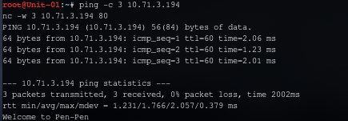
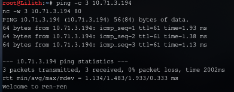
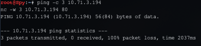

#### Kondisi B – jadwal tidak cocok dengan jam sekarang

Jadwal Pilot dikembalikan ke 08.00–16.00 WIB dan jadwal Staf diubah menjadi 08.00–16.00 WIB (01:00–09:00 UTC), sehingga keduanya tidak mencakup jam sekarang.

```sh
sed -i 's/^PILOT_START=.*/PILOT_START="08:00"/; s/^PILOT_STOP=.*/PILOT_STOP="16:00"/; s/^STAF_START=.*/STAF_START="08:00"/; s/^STAF_STOP=.*/STAF_STOP="16:00"/' /root/penpen.sh
./penpen.sh
```

Hasil Unit-01, Lilith, dan Spy:

```
3 packets transmitted, 0 received, 100% packet loss
```

Tidak ada balasan `Welcome to Pen-Pen` dari ketiga node.

Counter rule setelah pengujian Kondisi B:

```
num   pkts bytes target     prot opt in     out     source               destination
3        6   432 DROP       all  --  *      *       10.71.4.102          0.0.0.0/0
4        0     0 ACCEPT     all  --  *      *       10.71.4.74           0.0.0.0/0            TIME from 01:00:00 to 09:00:00 on Mon,Tue,Wed,Thu,Fri UTC
8        6   432 DROP       all  --  *      *       10.71.4.74           0.0.0.0/0
12       0     0 ACCEPT     all  --  *      *       10.71.4.82           0.0.0.0/0            TIME from 01:00:00 to 09:00:00 UTC
14       6   432 DROP       all  --  *      *       10.71.4.82           0.0.0.0/0
```

Setiap 6 paket terdiri dari 3 paket ping dan 3 paket SYN TCP. Paket SYN berjumlah 3 karena `nc` mencoba mengirim ulang selama 3 detik saat tidak mendapat balasan.

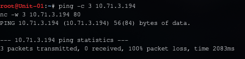
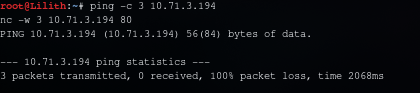
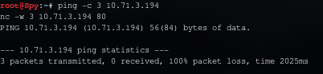
.png)

#### Mengembalikan jadwal asli

```sh
sed -i 's/^STAF_START=.*/STAF_START="17:00"/; s/^STAF_STOP=.*/STAF_STOP="23:00"/' /root/penpen.sh
./penpen.sh
grep -E "^(PILOT|STAF)_" /root/penpen.sh
```

```
PILOT_START="08:00"
PILOT_STOP="16:00"
PILOT_DAYS="Mon,Tue,Wed,Thu,Fri"
STAF_START="17:00"
STAF_STOP="23:00"
```

## Soal 15

### Tujuan

Membatasi Tokyo3-Core (10.71.4.106) agar hanya menjawab **maksimal 5 ping per detik** dan membuang kelebihannya. Aturan ini tidak boleh mengganggu ping di bawah batas, dan tidak boleh membatasi ping yang dikirim Tokyo3-Core sendiri.

### Analisis

1. **Hanya `echo-request` yang dibatasi.**
   Ping yang masuk ke Tokyo3-Core berupa ICMP `echo-request` (type 8). Ketika Tokyo3-Core sendiri melakukan ping ke luar, balasan yang diterimanya berupa `echo-reply` (type 0). Dengan hanya mencocokkan `--icmp-type echo-request`, ping keluar milik Tokyo3-Core tidak ikut dibatasi.

2. **Pola ACCEPT dengan limit, lalu DROP.**
   Modul `limit` bekerja seperti ember token. Selama token masih tersedia, paket cocok dengan rule ACCEPT. Paket yang datang saat token habis tidak cocok dan jatuh ke rule DROP di bawahnya. Tanpa rule DROP, kelebihan paket tetap diterima oleh policy INPUT (ACCEPT), sehingga limit tidak berpengaruh.

3. **`--limit 5/second --limit-burst 5`.**
   Token bertambah 5 per detik, dengan kapasitas ember maksimal 5. Ping biasa dengan jeda 3 detik selalu mendapat ember yang sudah penuh lagi, sehingga tidak pernah terkena DROP.

4. **Jump dipasang di posisi paling atas INPUT (`-I INPUT 1`).**
   Conntrack menganggap ping kedua dan seterusnya dalam satu sesi `ping` sebagai **ESTABLISHED**. Jika di atasnya terdapat rule seperti `-m state --state ESTABLISHED,RELATED -j ACCEPT`, banjir ping akan lolos sebelum sampai ke rule limit. Dengan memasang jump di baris pertama, setiap ping masuk dipastikan melewati pembatasan terlebih dahulu.

5. **Custom chain `PINGLIMIT`.**
   Chain dikosongkan dan diisi ulang setiap kali script dijalankan, dan jump dari INPUT diperiksa dengan `-C`, sehingga script aman dijalankan berkali-kali tanpa rule dobel.

### Langkah Pengerjaan

#### 1. Cek kondisi awal Tokyo3-Core

```sh
ip -br a
iptables -L INPUT -n -v --line-numbers
```

```
eth0             UNKNOWN        10.71.4.106/30 ...
Chain INPUT (policy ACCEPT 0 packets, 0 bytes)
num   pkts bytes target     prot opt in     out     source               destination
```

IP Tokyo3-Core 10.71.4.106/30 dan chain INPUT masih kosong.

#### 2. Membuat script `/root/tokyo3.sh`

```sh
#!/bin/sh
# Soal 15: batas ping ke Tokyo3-Core
LIMIT="5/second"
BURST="5"

iptables -N PINGLIMIT 2>/dev/null
iptables -F PINGLIMIT
iptables -A PINGLIMIT -m limit --limit $LIMIT --limit-burst $BURST -j ACCEPT
iptables -A PINGLIMIT -j DROP

# Jump dipasang di posisi paling atas INPUT, hanya untuk ping masuk
iptables -C INPUT -p icmp --icmp-type echo-request -j PINGLIMIT 2>/dev/null || iptables -I INPUT 1 -p icmp --icmp-type echo-request -j PINGLIMIT
```

#### 3. Menjalankan script dan memeriksa rule

```sh
chmod +x /root/tokyo3.sh
./tokyo3.sh
iptables -L INPUT -n -v --line-numbers
iptables -L PINGLIMIT -n -v --line-numbers
```

```
Chain INPUT (policy ACCEPT 0 packets, 0 bytes)
num   pkts bytes target     prot opt in     out     source               destination
1        0     0 PINGLIMIT  icmp --  *      *       0.0.0.0/0            0.0.0.0/0            icmptype 8

Chain PINGLIMIT (1 references)
num   pkts bytes target     prot opt in     out     source               destination
1        0     0 ACCEPT     all  --  *      *       0.0.0.0/0            0.0.0.0/0            limit: avg 5/sec burst 5
2        0     0 DROP       all  --  *      *       0.0.0.0/0            0.0.0.0/0
```

### Pengujian

Sebelum setiap pengujian, counter chain dinolkan di Tokyo3-Core:

```sh
iptables -Z PINGLIMIT
```

#### Tes 1 – Ping rapat dari Lilith (sebagian harus hilang)

```sh
ping -i 0.1 -c 50 10.71.4.106
```

```
64 bytes from 10.71.4.106: icmp_seq=1 ttl=61 time=2.50 ms
...
64 bytes from 10.71.4.106: icmp_seq=9 ttl=61 time=0.752 ms
64 bytes from 10.71.4.106: icmp_seq=11 ttl=61 time=0.706 ms
64 bytes from 10.71.4.106: icmp_seq=13 ttl=61 time=0.862 ms
64 bytes from 10.71.4.106: icmp_seq=15 ttl=61 time=1.71 ms
...
64 bytes from 10.71.4.106: icmp_seq=48 ttl=61 time=0.976 ms
64 bytes from 10.71.4.106: icmp_seq=50 ttl=61 time=1.85 ms

--- 10.71.4.106 ping statistics ---
50 packets transmitted, 30 received, 40% packet loss, time 5083ms
```

Counter di Tokyo3-Core:

```
Chain PINGLIMIT (1 references)
num   pkts bytes target     prot opt in     out     source               destination
1       30  2520 ACCEPT     all  --  *      *       0.0.0.0/0            0.0.0.0/0            limit: avg 5/sec burst 5
2       20  1680 DROP       all  --  *      *       0.0.0.0/0            0.0.0.0/0
```

Penjelasan pola hasil:
- `icmp_seq` 1–9 lolos semua karena 5 paket pertama memakai burst, ditambah token yang terisi ulang selama ping berjalan.
- Setelah itu yang lolos hanya selang-seling (11, 13, 15, …), karena ping datang 10 per detik sementara token hanya bertambah 5 per detik.
- Total yang diterima 30 = 5 (burst) + sekitar 5 × 5 detik. Sisanya, 20 paket, dibuang oleh rule DROP.

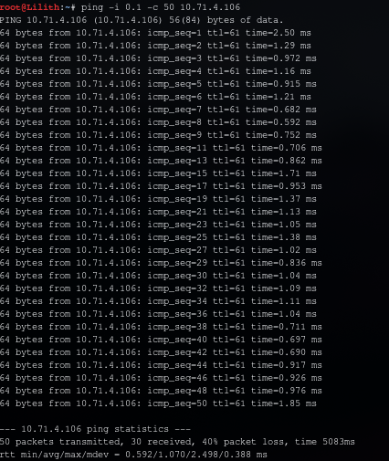 -->

#### Tes 2 – Ping biasa dari Lilith dengan jeda 3 detik (semua harus berhasil)

```sh
ping -i 3 -c 5 10.71.4.106
```

```
64 bytes from 10.71.4.106: icmp_seq=1 ttl=61 time=1.89 ms
64 bytes from 10.71.4.106: icmp_seq=2 ttl=61 time=0.991 ms
64 bytes from 10.71.4.106: icmp_seq=3 ttl=61 time=0.714 ms
64 bytes from 10.71.4.106: icmp_seq=4 ttl=61 time=1.69 ms
64 bytes from 10.71.4.106: icmp_seq=5 ttl=61 time=0.733 ms

--- 10.71.4.106 ping statistics ---
5 packets transmitted, 5 received, 0% packet loss, time 12031ms
```

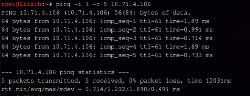

#### Tes 3 – Ping keluar dari Tokyo3-Core tidak dibatasi

```sh
iptables -Z PINGLIMIT
ping -i 0.1 -c 50 10.71.4.82
iptables -L PINGLIMIT -n -v --line-numbers
```

```
--- 10.71.4.82 ping statistics ---
50 packets transmitted, 50 received, 0% packet loss, time 5024ms

Chain PINGLIMIT (1 references)
num   pkts bytes target     prot opt in     out     source               destination
1        0     0 ACCEPT     all  --  *      *       0.0.0.0/0            0.0.0.0/0            limit: avg 5/sec burst 5
2        0     0 DROP       all  --  *      *       0.0.0.0/0            0.0.0.0/0
```

Ping rapat dari Tokyo3-Core ke Lilith berhasil 100%, dan counter `PINGLIMIT` tetap 0, karena balasan dari Lilith berupa `echo-reply`, bukan `echo-request`.

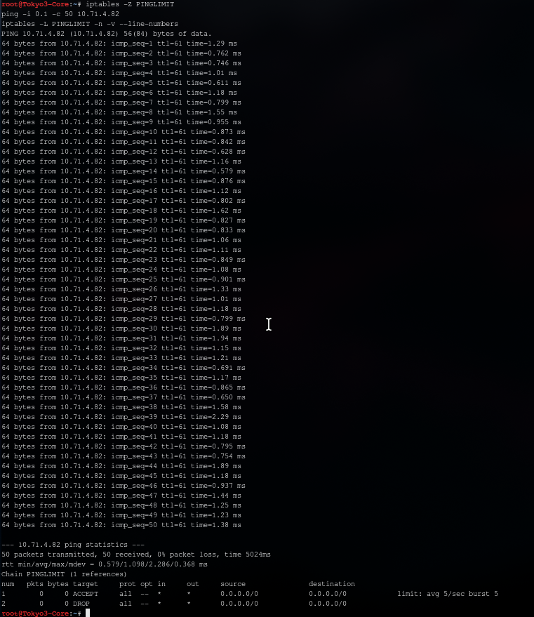

## Soal 16

### Tujuan

Di Tokyo3-Core (10.71.4.106), setiap koneksi TCP dari **Dummy-Plug** (10.71.4.51) ke port **22, 23, dan 3306** harus dicatat di log dengan prefix `SCAN-NERV:`, lalu **ditolak seketika**. Port 80 dan 8080 tetap bisa diakses, dan klien lain tidak boleh terganggu.

### Alamat yang Digunakan

| Peran | Node | IP |
|---|---|---|
| Target | Tokyo3-Core | 10.71.4.106 |
| Pemindai | Dummy-Plug | 10.71.4.51 |
| Klien lain (uji) | Lilith | 10.71.4.82 |

### Analisis

1. **Rule dipasang di Tokyo3-Core (chain INPUT).**
   Tokyo3-Core adalah tujuan paket, sehingga pencatatan dan penolakan cukup dilakukan di sana.

2. **Rule spesifik: TCP dari Dummy-Plug ke port 22, 23, 3306.**
   Jump ke chain `SCANNERV` hanya mencocokkan sumber `10.71.4.51` dan port tujuan `22,23,3306`. Port 80/8080 serta klien lain tidak terkena rule ini sama sekali.

3. **LOG sebelum REJECT.**
   Target `LOG` hanya mencatat paket lalu meneruskannya ke rule berikutnya, sedangkan `REJECT` menghentikan paket. Jika urutannya dibalik, paket sudah berhenti di REJECT sebelum sempat dicatat.

4. **LOG hanya untuk paket SYN (`--syn`).**
   Setiap koneksi TCP diawali tepat satu paket SYN. Dengan hanya mencatat SYN, satu percobaan koneksi menghasilkan tepat satu catatan log.

5. **`REJECT --reject-with tcp-reset`.**
   Dummy-Plug langsung menerima paket RST sehingga koneksinya gagal seketika, bukan menggantung sampai timeout.

6. **Counter sebagai bukti.**
   Log kernel tidak dapat dibaca dari dalam container (`dmesg` kosong), sehingga counter `pkts` pada rule LOG digunakan untuk membuktikan bahwa setiap percobaan tercatat.

7. **Digabung dengan script soal 15.**
   Soal 15 dan 16 sama-sama dikerjakan di Tokyo3-Core, sehingga keduanya disimpan di satu script `/root/tokyo3.sh`. Fungsinya tetap terpisah: soal 15 menangani ICMP di chain `PINGLIMIT`, sedangkan soal 16 menangani TCP di chain `SCANNERV`. Jump `PINGLIMIT` tetap berada di baris 1 INPUT, dan jump `SCANNERV` ditambahkan di bawahnya.

### Langkah Pengerjaan

#### 1. Cek kondisi Tokyo3-Core dan menyalakan listener

```sh
iptables -L INPUT -n -v --line-numbers
ps aux | grep "nc -l"
```

Listener port 80 dan 8080 dari soal 8 dinyalakan kembali:

```sh
while true; do echo "Welcome to $(hostname)" | nc -l -p 80; done &
while true; do echo "syifa imutz" | nc -l -p 8080; done &
```

Pengujian dari Lilith:

```
Welcome to Tokyo3-Core
syifa imutz
```

#### 2. Script `/root/tokyo3.sh` (soal 15 dan 16)

```sh
#!/bin/sh
# Soal 15: batas ping ke Tokyo3-Core
LIMIT="5/second"
BURST="5"

iptables -N PINGLIMIT 2>/dev/null
iptables -F PINGLIMIT
iptables -A PINGLIMIT -m limit --limit $LIMIT --limit-burst $BURST -j ACCEPT
iptables -A PINGLIMIT -j DROP

# Jump dipasang di posisi paling atas INPUT, hanya untuk ping masuk
iptables -C INPUT -p icmp --icmp-type echo-request -j PINGLIMIT 2>/dev/null || iptables -I INPUT 1 -p icmp --icmp-type echo-request -j PINGLIMIT

# Soal 16: catat dan tolak scan dari Dummy-Plug
DUMMY="10.71.4.51"
SCAN_PORTS="22,23,3306"

iptables -N SCANNERV 2>/dev/null
iptables -F SCANNERV
iptables -A SCANNERV -p tcp --syn -j LOG --log-prefix "SCAN-NERV: "
iptables -A SCANNERV -p tcp -j REJECT --reject-with tcp-reset

iptables -C INPUT -p tcp -s $DUMMY -m multiport --dports $SCAN_PORTS -j SCANNERV 2>/dev/null || iptables -A INPUT -p tcp -s $DUMMY -m multiport --dports $SCAN_PORTS -j SCANNERV
```

#### 3. Menjalankan script dan memeriksa rule

```sh
./tokyo3.sh
iptables -L INPUT -n -v --line-numbers
iptables -L SCANNERV -n -v --line-numbers
```

```
Chain INPUT (policy ACCEPT 60 packets, 4736 bytes)
num   pkts bytes target     prot opt in     out     source               destination
1       55  4620 PINGLIMIT  icmp --  *      *       0.0.0.0/0            0.0.0.0/0            icmptype 8
2        0     0 SCANNERV   tcp  --  *      *       10.71.4.51           0.0.0.0/0            multiport dports 22,23,3306

Chain SCANNERV (1 references)
num   pkts bytes target     prot opt in     out     source               destination
1        0     0 LOG        tcp  --  *      *       0.0.0.0/0            0.0.0.0/0            tcp flags:0x17/0x02 LOG flags 0 level 4 prefix "SCAN-NERV: "
2        0     0 REJECT     tcp  --  *      *       0.0.0.0/0            0.0.0.0/0            reject-with tcp-reset
```

Script dijalankan lebih dari sekali, dan jumlah rule di INPUT serta SCANNERV tetap 2 baris, yang membuktikan tidak ada rule dobel.

### Pengujian

Sebelum pengujian, counter chain dinolkan di Tokyo3-Core:

```sh
iptables -Z SCANNERV
```

#### Tes 1 – Dummy-Plug ke port 22, 23, 3306 (harus ditolak seketika)

Karena nc versi busybox tidak mencetak pesan error, bukti diambil dari exit code dan durasi koneksi:

```sh
for p in 22 23 3306; do
  start=$(date +%s)
  nc -w 3 10.71.4.106 $p
  rc=$?
  echo "port $p: exit=$rc, durasi=$(( $(date +%s) - start )) detik"
done
```

```
port 22: exit=1, durasi=0 detik
port 23: exit=1, durasi=0 detik
port 3306: exit=1, durasi=0 detik
```

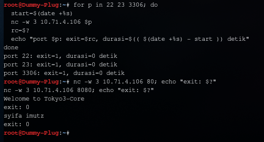

#### Tes 2 – Dummy-Plug ke port 80 dan 8080 (harus berhasil)

```sh
nc -w 3 10.71.4.106 80; echo "exit: $?"
nc -w 3 10.71.4.106 8080; echo "exit: $?"
```

```
Welcome to Tokyo3-Core
exit: 0
syifa imutz
exit: 0
```

#### Tes 3 – Counter rule pencatatan di Tokyo3-Core

```sh
iptables -L SCANNERV -n -v --line-numbers
dmesg 2>/dev/null | grep SCAN-NERV
```

```
Chain SCANNERV (1 references)
num   pkts bytes target     prot opt in     out     source               destination
1        3   180 LOG        tcp  --  *      *       0.0.0.0/0            0.0.0.0/0            tcp flags:0x17/0x02 LOG flags 0 level 4 prefix "SCAN-NERV: "
2        3   180 REJECT     tcp  --  *      *       0.0.0.0/0            0.0.0.0/0            reject-with tcp-reset
```

Counter LOG dan REJECT sama-sama 3, satu untuk setiap percobaan ke port 22, 23, dan 3306. Artinya setiap percobaan dicatat terlebih dahulu, lalu ditolak. Output `dmesg` kosong karena log kernel tidak dapat dibaca dari dalam container.

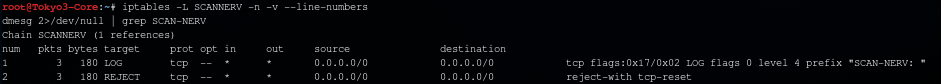

#### Tes 4 – Klien lain tidak terganggu

```sh
iptables -Z SCANNERV          # di Tokyo3-Core
```

Dari Lilith:

```sh
nc -w 3 10.71.4.106 22; echo "exit: $?"
nc -w 3 10.71.4.106 80; echo "exit: $?"
```

```
exit: 1
Welcome to Tokyo3-Core
exit: 0
```

Counter di Tokyo3-Core:

```
Chain SCANNERV (1 references)
num   pkts bytes target     prot opt in     out     source               destination
1        0     0 LOG        tcp  --  *      *       0.0.0.0/0            0.0.0.0/0            tcp flags:0x17/0x02 LOG flags 0 level 4 prefix "SCAN-NERV: "
2        0     0 REJECT     tcp  --  *      *       0.0.0.0/0            0.0.0.0/0            reject-with tcp-reset
```

Koneksi Lilith ke port 22 tetap gagal karena memang tidak ada layanan di port tersebut (penolakan berasal dari kernel, bukan dari rule). Counter `SCANNERV` tetap 0, yang membuktikan Lilith tidak tercatat sebagai pemindai. Akses Lilith ke port 80 tetap berhasil.

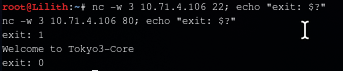
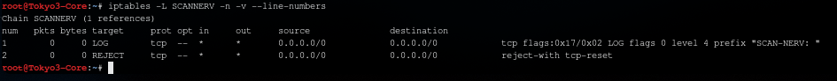

## Soal 17

### Tujuan

Di **Fuyutsuki** (gateway Switch-Terminal), setiap koneksi TCP dari **Magi-Casper** ke **Zeruel** dialihkan diam-diam ke **Pen-Pen**. Casper tidak boleh sadar: balasan yang ia terima harus tetap terlihat datang dari Zeruel. Ping tidak ikut dialihkan.

### Alamat yang Digunakan

| Peran | Node | IP |
|---|---|---|
| Router pengalih | Fuyutsuki | eth1 10.71.4.65 (gateway Switch-Terminal) |
| Pengirim | Magi-Casper | 10.71.4.66 |
| Tujuan asli | Zeruel | 10.71.4.90 |
| Tujuan pengalihan | Pen-Pen | 10.71.3.194 |

### Analisis

1. **DNAT di tabel `nat`, chain `PREROUTING`.**
   DNAT mengganti alamat **tujuan** paket. PREROUTING diproses sebelum router memutuskan rute, sehingga setelah alamat tujuan diganti menjadi Pen-Pen, Fuyutsuki langsung meneruskan paket ke arah Pen-Pen.

2. **Dipasang di Fuyutsuki.**
   Semua paket dari Casper menuju subnet lain pasti melewati gateway-nya, yaitu Fuyutsuki. Karena itu Fuyutsuki adalah titik yang tepat untuk membelokkan koneksi.

3. **Casper tetap melihat balasan dari Zeruel.**
   Conntrack di Fuyutsuki mencatat penggantian alamat tersebut. Balasan dari Pen-Pen kembali melalui Fuyutsuki (Pen-Pen → Maya → Fuyutsuki → Casper), dan conntrack otomatis mengembalikan alamat sumber balasan menjadi Zeruel (10.71.4.90). Dari sisi Casper, lawan bicaranya tetap Zeruel. Mekanisme ini hanya bekerja karena balasan Pen-Pen pasti melewati Fuyutsuki, mengikuti default route Maya.

4. **Hanya `-p tcp`.**
   Soal meminta ping tidak dialihkan, sehingga rule dibatasi ke protokol TCP. Port tujuan tidak diubah, jadi koneksi ke port 9000 tetap sampai di port 9000 Pen-Pen.

5. **Counter DNAT hanya bertambah untuk paket pertama.**
   Tabel `nat` hanya diperiksa untuk paket pertama sebuah koneksi (SYN). Paket berikutnya, termasuk balasan, ditangani langsung oleh conntrack berdasarkan entry yang sudah tercatat.

### Langkah Pengerjaan

#### 1. Cek Fuyutsuki dan memasang conntrack

```sh
ip -br a
iptables -t nat -L PREROUTING -n -v --line-numbers
which conntrack
```

```
eth0             UNKNOWN        10.71.4.110/30 ...
eth1             UNKNOWN        10.71.4.65/29 ...
eth2             UNKNOWN        10.71.4.137/30 ...
eth3             UNKNOWN        10.71.4.141/30 ...
Chain PREROUTING (policy ACCEPT 0 packets, 0 bytes)
num   pkts bytes target     prot opt in     out     source               destination
```

Tool `conntrack` belum terpasang, dan instalasi awalnya gagal karena `/etc/resolv.conf` Fuyutsuki kosong sehingga nama domain tidak bisa di-resolve (padahal ping 8.8.8.8 berhasil). Setelah DNS server ditambahkan, conntrack berhasil dipasang:

```sh
echo "nameserver 8.8.8.8" > /etc/resolv.conf
apt-get update && apt-get install -y conntrack
which conntrack
```

```
/usr/sbin/conntrack
```

#### 2. Menyalakan listener port 9000 di Zeruel dan Pen-Pen

```sh
> /root/log9000.txt
while true; do nc -l -p 9000 >> /root/log9000.txt; done &
```

#### 3. Pengujian sebelum rule dipasang

Dari Magi-Casper:

```sh
echo sebelum-dialihkan | nc -w 3 10.71.4.90 9000
```

| Node | Isi `/root/log9000.txt` |
|---|---|
| Zeruel | `sebelum-dialihkan` |
| Pen-Pen | kosong |

Sebelum rule dipasang, pesan Casper sampai ke Zeruel yang asli.

<!--  -->
<!--  -->

#### 4. Membuat script `/root/fuyutsuki.sh`

```sh
#!/bin/sh
# DNS dan tool conntrack
echo "nameserver 8.8.8.8" > /etc/resolv.conf
which conntrack >/dev/null || (apt-get update && apt-get install -y conntrack)

# Soal 17: alihkan setiap koneksi TCP Casper -> Zeruel ke Pen-Pen
CASPER="10.71.4.66"
ZERUEL="10.71.4.90"
PENPEN="10.71.3.194"

iptables -t nat -C PREROUTING -p tcp -s $CASPER -d $ZERUEL -j DNAT --to-destination $PENPEN 2>/dev/null || iptables -t nat -A PREROUTING -p tcp -s $CASPER -d $ZERUEL -j DNAT --to-destination $PENPEN
```

Script juga berisi instalasi conntrack sesuai peraturan praktikum (script instalasi aplikasi diletakkan di `/root`). Instalasi hanya dilakukan jika conntrack belum ada, dan rule DNAT diperiksa dengan `-C` agar tidak dobel.

#### 5. Menjalankan script dan memeriksa rule

```sh
chmod +x /root/fuyutsuki.sh
./fuyutsuki.sh
iptables -t nat -L PREROUTING -n -v --line-numbers
```

```
Chain PREROUTING (policy ACCEPT 0 packets, 0 bytes)
num   pkts bytes target     prot opt in     out     source               destination
1        0     0 DNAT       tcp  --  *      *       10.71.4.66           10.71.4.90           to:10.71.3.194
```

### Pengujian

Sebelum pengujian, log di Zeruel dan Pen-Pen dikosongkan (`> /root/log9000.txt`), dan counter di Fuyutsuki dinolkan:

```sh
iptables -t nat -Z PREROUTING
```

#### Tes 1 – Casper mengirim pesan ke IP Zeruel port 9000

Di Magi-Casper, koneksi dibiarkan terbuka 5 detik agar bisa dilihat dengan `ss`:

```sh
(echo setelah-dialihkan; sleep 5) | nc -w 6 10.71.4.90 9000 &
sleep 1; ss -tn | grep 9000
```

```
ESTAB 0      0         10.71.4.66:48992   10.71.4.90:9000
```

Dari sisi Casper, koneksi tercatat ke `10.71.4.90:9000` (Zeruel). Casper tidak menyadari bahwa koneksinya dibelokkan.

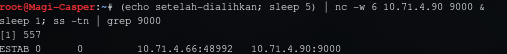

Tabel conntrack dan counter di Fuyutsuki:

```sh
conntrack -L -p tcp --dport 9000
iptables -t nat -L PREROUTING -n -v --line-numbers
```

```
tcp      6 109 TIME_WAIT src=10.71.4.66 dst=10.71.4.90 sport=48992 dport=9000 src=10.71.3.194 dst=10.71.4.66 sport=9000 dport=48992 [ASSURED] mark=0 use=1
conntrack v1.4.8 (conntrack-tools): 1 flow entries have been shown.

Chain PREROUTING (policy ACCEPT 0 packets, 0 bytes)
num   pkts bytes target     prot opt in     out     source               destination
1        1    60 DNAT       tcp  --  *      *       10.71.4.66           10.71.4.90           to:10.71.3.194
```

Penjelasan entry conntrack:
- **Arah asli**: `src=10.71.4.66 dst=10.71.4.90 dport=9000`, yaitu Casper mengirim ke Zeruel.
- **Arah balasan**: `src=10.71.3.194 dst=10.71.4.66 sport=9000`, yaitu yang sebenarnya menjawab adalah Pen-Pen.

Counter DNAT bernilai 1 paket (60 byte = satu paket SYN), karena tabel `nat` hanya memproses paket pertama koneksi.

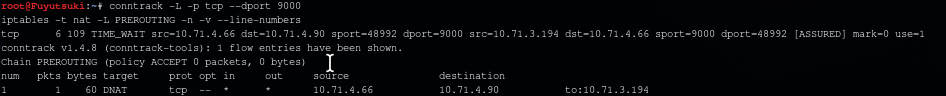

Log listener:

```sh
cat /root/log9000.txt
```

| Node | Isi `/root/log9000.txt` |
|---|---|
| Zeruel | kosong |
| Pen-Pen | `setelah-dialihkan` |

Pesan yang dikirim Casper ke IP Zeruel muncul di Pen-Pen, bukan di Zeruel.

#### Tes 2 – Ping tidak dialihkan

```sh
iptables -t nat -Z PREROUTING        # di Fuyutsuki
ping -c 3 10.71.4.90                 # di Magi-Casper
```

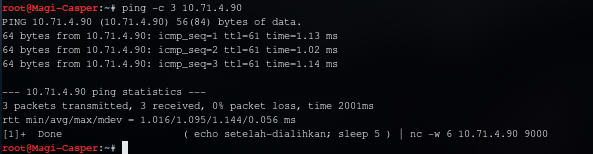

Di Fuyutsuki:

```sh
iptables -t nat -L PREROUTING -n -v --line-numbers
conntrack -L -p icmp
```

```
Chain PREROUTING (policy ACCEPT 1 packets, 84 bytes)
num   pkts bytes target     prot opt in     out     source               destination
1        0     0 DNAT       tcp  --  *      *       10.71.4.66           10.71.4.90           to:10.71.3.194

icmp     1 21 src=10.71.4.66 dst=10.71.4.90 type=8 code=0 id=35230 src=10.71.4.90 dst=10.71.4.66 type=0 code=0 id=35230 mark=0 use=1
conntrack v1.4.8 (conntrack-tools): 1 flow entries have been shown.
```

- Counter DNAT tetap 0, karena ping (ICMP) tidak cocok dengan rule yang hanya untuk TCP.
- Policy PREROUTING mencatat 1 paket berukuran 84 byte, yaitu paket ping pertama yang melewati tabel `nat` tanpa diubah.
- Balasan ping (`type=0`, echo-reply) datang dari `src=10.71.4.90`, yaitu Zeruel yang asli.

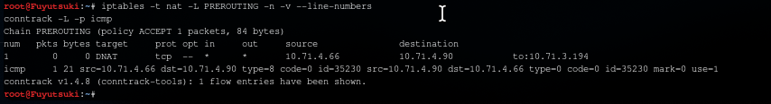

## Soal 18

### Tujuan

Di **Shigeru**, lindungi zona sensitif **Monolith** dan **Radar**:
- Node di dalam zona boleh memulai koneksi ke mana saja, dan balasannya tetap sampai.
- Node di luar zona tidak boleh memulai koneksi ke dalam zona.
- Satu pengecualian: ping dari subnet **Terminal** boleh masuk.
- Penolakan dilakukan berdasarkan arah datang, yaitu dari sisi Shigeru yang menghadap Gendo, tanpa menulis subnet luar satu per satu.

### Alamat dan Interface

| Item | Nilai |
|---|---|
| Shigeru eth0 (menghadap Gendo) | 10.71.4.114/30 |
| Shigeru eth1 (gateway Switch-Monolith) | 10.71.4.89/29 |
| Shigeru eth2 (link ke Makoto) | 10.71.4.145/30 |
| Zona Monolith | 10.71.4.88/29 (Zeruel 10.71.4.90, Armisael 10.71.4.91) |
| Zona Radar | 10.71.4.56/29 (Radar-Array 10.71.4.58), di bawah Makoto |
| Subnet Terminal (pengecualian ping) | 10.71.4.64/29 (Magi-Casper 10.71.4.66) |
| Node luar untuk uji | Lilith 10.71.4.82 |

### Analisis

1. **Rule dipasang di chain `FORWARD`.**
   Paket dari luar menuju Zeruel atau Radar-Array tidak ditujukan ke Shigeru sendiri, melainkan diteruskan oleh Shigeru. Paket seperti ini melewati chain FORWARD, bukan INPUT.

2. **Penolakan berdasarkan interface masuk (`-i eth0`).**
   Semua paket dari luar zona pasti masuk ke Shigeru melalui eth0, yang menghadap Gendo. Dengan mencocokkan interface masuk, tidak perlu menulis subnet luar satu per satu, dan subnet baru yang ditambahkan kelak otomatis ikut terblokir.

3. **`ESTABLISHED,RELATED` ditempatkan paling atas.**
   Balasan untuk koneksi yang dimulai dari dalam zona juga masuk melalui eth0. Jika semua paket dari eth0 langsung di-DROP, balasan tersebut ikut terbuang. Karena itu rule ESTABLISHED harus berada di atas rule DROP.

4. **Pengecualian hanya untuk ping dari Terminal.**
   Hanya ICMP `echo-request` dari `10.71.4.64/29` yang diizinkan masuk. Koneksi lain dari Terminal, misalnya TCP, tetap ditolak.

5. **Koneksi keluar dari zona tidak dibatasi.**
   Paket dari dalam zona masuk ke Shigeru melalui eth1 (Monolith) atau eth2 (Makoto/Radar), bukan eth0, sehingga tidak terkena rule DROP dan diterima oleh policy FORWARD (ACCEPT).

6. **Custom chain `ZONA`.**
   Chain dikosongkan dan diisi ulang setiap kali script dijalankan, dan jump dari FORWARD diperiksa dengan `-C`, sehingga script aman dijalankan berkali-kali tanpa rule dobel.

Urutan rule di chain `ZONA`:

```
1. ESTABLISHED,RELATED             → ACCEPT   (balasan untuk koneksi dari dalam zona)
2. dari eth0, ping dari Terminal   → ACCEPT   (pengecualian)
3. dari eth0, apa pun              → DROP     (semua koneksi baru dari luar)
```

### Langkah Pengerjaan

#### 1. Cek kondisi Shigeru

```sh
ip -br a
iptables -L FORWARD -n -v --line-numbers
```

```
eth0             UNKNOWN        10.71.4.114/30 ...
eth1             UNKNOWN        10.71.4.89/29 ...
eth2             UNKNOWN        10.71.4.145/30 ...
Chain FORWARD (policy ACCEPT 0 packets, 0 bytes)
num   pkts bytes target     prot opt in     out     source               destination
```

#### 2. Pengujian sebelum rule dipasang

```sh
ping -c 3 10.71.4.90      # dari Magi-Casper dan dari Lilith
```

Sebelum rule dipasang, ping dari Casper maupun Lilith ke Zeruel sama-sama berhasil (0% packet loss).

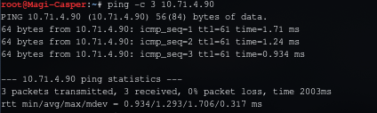
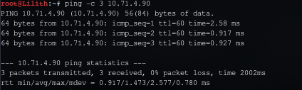

#### 3. Membuat script `/root/shigeru.sh`

```sh
#!/bin/sh
# Soal 18: gerbang zona Monolith dan Radar
UPLINK="eth0"                # interface Shigeru yang menghadap Gendo
TERMINAL="10.71.4.64/29"     # subnet Switch-Terminal

iptables -N ZONA 2>/dev/null
iptables -F ZONA
iptables -A ZONA -m conntrack --ctstate ESTABLISHED,RELATED -j ACCEPT
iptables -A ZONA -i $UPLINK -s $TERMINAL -p icmp --icmp-type echo-request -j ACCEPT
iptables -A ZONA -i $UPLINK -j DROP

iptables -C FORWARD -j ZONA 2>/dev/null || iptables -A FORWARD -j ZONA
```

#### 4. Menjalankan script dan memeriksa rule

```sh
chmod +x /root/shigeru.sh
./shigeru.sh
iptables -L FORWARD -n -v --line-numbers
iptables -L ZONA -n -v --line-numbers
```

```
Chain FORWARD (policy ACCEPT 0 packets, 0 bytes)
num   pkts bytes target     prot opt in     out     source               destination
1        0     0 ZONA       all  --  *      *       0.0.0.0/0            0.0.0.0/0

Chain ZONA (1 references)
num   pkts bytes target     prot opt in     out     source               destination
1        0     0 ACCEPT     all  --  *      *       0.0.0.0/0            0.0.0.0/0            ctstate RELATED,ESTABLISHED
2        0     0 ACCEPT     icmp --  eth0   *       10.71.4.64/29        0.0.0.0/0            icmptype 8
3        0     0 DROP       all  --  eth0   *       0.0.0.0/0            0.0.0.0/0
```

### Pengujian

Sebelum pengujian, counter chain dinolkan di Shigeru:

```sh
iptables -Z ZONA
```

#### Tes 1 – Ping Casper ke Zeruel (harus berhasil)

```sh
ping -c 3 10.71.4.90      # di Magi-Casper
```

```
3 packets transmitted, 3 received, 0% packet loss, time 2047ms
```

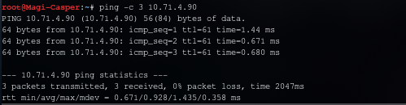

#### Tes 2 – Ping Lilith ke Zeruel (harus gagal)

```sh
ping -c 3 10.71.4.90      # di Lilith
```

```
3 packets transmitted, 0 received, 100% packet loss, time 2027ms
```

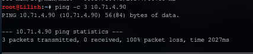

#### Tes 3 – Node di dalam zona tetap bisa memulai koneksi keluar

```sh
ping -c 3 8.8.8.8         # di Zeruel
ping -c 3 10.71.4.82      # di Zeruel, ke Lilith
```

```
--- 8.8.8.8 ping statistics ---
3 packets transmitted, 3 received, 0% packet loss, time 2003ms

--- 10.71.4.82 ping statistics ---
3 packets transmitted, 3 received, 0% packet loss, time 2003ms
```

Zeruel bisa memulai ping ke internet dan ke Lilith, dan balasannya tetap sampai melalui rule ESTABLISHED. Sebaliknya, Lilith tidak bisa memulai ping ke Zeruel (Tes 2).

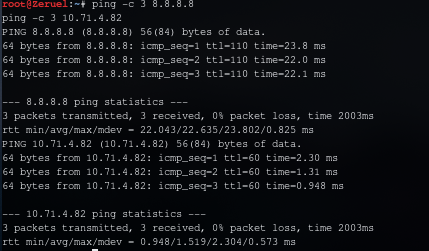

#### Tes 4 – Zona Radar juga terlindungi

```sh
ping -c 3 10.71.4.58      # di Lilith dan di Magi-Casper
```

| Pengirim | Hasil |
|---|---|
| Lilith | 3 packets transmitted, 0 received, 100% packet loss |
| Magi-Casper | 3 packets transmitted, 3 received, 0% packet loss |

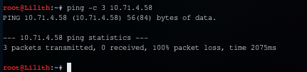
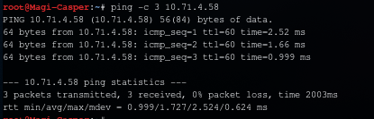

#### Counter di Shigeru

```sh
iptables -L ZONA -n -v --line-numbers
```

```
Chain ZONA (1 references)
num   pkts bytes target     prot opt in     out     source               destination
1       20  1680 ACCEPT     all  --  *      *       0.0.0.0/0            0.0.0.0/0            ctstate RELATED,ESTABLISHED
2        2   168 ACCEPT     icmp --  eth0   *       10.71.4.64/29        0.0.0.0/0            icmptype 8
3        6   504 DROP       all  --  eth0   *       0.0.0.0/0            0.0.0.0/0
```

| Baris | Counter | Asal paket |
|---|---|---|
| 1. ESTABLISHED | 20 | 4 sesi ping yang berhasil (Casper→Zeruel, Casper→Radar-Array, Zeruel→8.8.8.8, Zeruel→Lilith), masing-masing 2 request lanjutan + 3 balasan = 5 paket |
| 2. Ping dari Terminal | 2 | paket pertama ping Casper ke Zeruel dan ke Radar-Array |
| 3. DROP | 6 | 3 ping Lilith ke Zeruel + 3 ping Lilith ke Radar-Array |

Ping Casper hanya melewati baris 2 pada paket pertama. Paket berikutnya dalam sesi yang sama sudah tercatat sebagai ESTABLISHED oleh conntrack, sehingga lolos di baris 1.

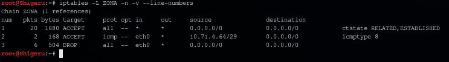

## Soal 19

### Tujuan

Mengisolasi **Armisael** sepenuhnya: semua lalu lintas masuk dan keluar Armisael diblokir, termasuk ke gateway (Shigeru) dan ke tetangga satu switch (Zeruel). Isolasi tidak boleh dikerjakan di dalam Armisael, dan **Zeruel tidak boleh ikut terhukum**.

### Alamat yang Digunakan

| Peran | Node | IP |
|---|---|---|
| Diisolasi | Armisael | 10.71.4.91 |
| Tetangga satu switch | Zeruel | 10.71.4.90 |
| Gateway Switch-Monolith | Shigeru (eth1) | 10.71.4.89 |
| Node luar | Lilith | 10.71.4.82 |
| Seele (internet) | – | 8.8.8.8 (uji nc ke TCP 53) |

### Analisis

Lalu lintas Armisael melewati tiga jalur yang berbeda, dan masing-masing membutuhkan penanganan sendiri:

| Jalur | Contoh | Lewat mana | Diblokir di |
|---|---|---|---|
| Armisael ↔ luar subnet | ke Lilith, ke Seele | **diteruskan** oleh Shigeru | Shigeru, chain **FORWARD** |
| Armisael ↔ gateway | ke Shigeru sendiri | **ditujukan** ke Shigeru | Shigeru, chain **INPUT** dan **OUTPUT** |
| Armisael ↔ Zeruel | satu switch | langsung lewat switch, **tidak lewat Shigeru** | **Zeruel**, chain INPUT dan OUTPUT |

1. **Jalur satu switch tidak melewati router.**
   Zeruel dan Armisael berada di Switch-Monolith yang sama, sehingga paket di antara keduanya langsung diteruskan oleh switch tanpa menyentuh Shigeru. Hal ini terbukti dari pengujian sebelum rule dipasang: ping Armisael ke Zeruel memiliki `ttl=64` (tidak berkurang, tidak melewati router), sedangkan ke Lilith `ttl=60` (melewati 4 router). Karena isolasi tidak boleh dikerjakan di Armisael, satu-satunya tempat untuk menolak jalur ini adalah Zeruel.

2. **Zeruel tidak ikut terhukum.**
   Rule di Zeruel hanya menolak lalu lintas dari dan ke Armisael. Semua koneksi Zeruel yang lain tetap berjalan normal.

3. **Paket ke gateway tidak melewati FORWARD.**
   Paket dari Armisael ke Shigeru ditujukan ke Shigeru sendiri, sehingga diproses di chain INPUT. Balasan dari Shigeru diproses di chain OUTPUT. Karena itu chain ISOLASI juga dipasang di INPUT dan OUTPUT, bukan hanya di FORWARD.

4. **ISOLASI di atas ZONA (soal 18).**
   Chain ZONA berisi rule `ESTABLISHED,RELATED -j ACCEPT` di baris pertama. Jika ISOLASI diletakkan di bawah ZONA, lalu lintas Armisael yang sudah terlanjur berjalan bisa lolos. Karena itu jump ke ISOLASI dipasang dengan `-I ... 1`.

5. **Blokir dua arah dengan DROP.**
   Rule mencocokkan Armisael sebagai sumber (`-s`) maupun tujuan (`-d`), sehingga lalu lintas masuk dan keluar sama-sama terputus. DROP dipilih agar Armisael tidak mendapat informasi apa pun; koneksinya hanya menggantung sampai timeout.

### Langkah Pengerjaan

#### 1. Menyalakan listener TCP 9000 di Armisael, Zeruel, dan Lilith

```sh
> /root/log9000.txt
while true; do nc -l -p 9000 >> /root/log9000.txt; done &
```

Listener hanya dinyalakan jika belum berjalan (dicek dengan `ps aux | grep "nc -l"`).

#### 2. Pengujian sebelum isolasi

Dari Armisael:

```sh
ping -c 2 8.8.8.8
ping -c 2 10.71.4.90
ping -c 2 10.71.4.82
echo test | nc -w 3 8.8.8.8 53; echo "seele exit: $?"
echo dari-armisael | nc -w 3 10.71.4.90 9000; echo "zeruel exit: $?"
echo dari-armisael | nc -w 3 10.71.4.82 9000; echo "lilith exit: $?"
```

```
--- 8.8.8.8 ping statistics ---
2 packets transmitted, 2 received, 0% packet loss, time 1002ms
64 bytes from 10.71.4.90: icmp_seq=1 ttl=64 time=2.41 ms
--- 10.71.4.90 ping statistics ---
2 packets transmitted, 2 received, 0% packet loss, time 1002ms
64 bytes from 10.71.4.82: icmp_seq=1 ttl=60 time=5.91 ms
--- 10.71.4.82 ping statistics ---
2 packets transmitted, 2 received, 0% packet loss, time 1001ms
seele exit: 0
zeruel exit: 0
lilith exit: 0
```

Sebelum isolasi, Armisael masih bebas berkomunikasi ke Seele, Zeruel, dan Lilith.

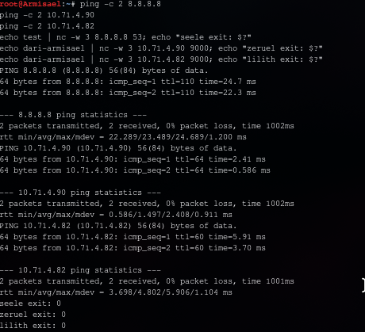

#### 3. Menambahkan isolasi ke `/root/shigeru.sh`

Bagian soal 19 ditambahkan di bawah bagian soal 18 pada script yang sama:

```sh
# Soal 19: isolasi Armisael (jalur lewat Shigeru: ke luar subnet dan ke gateway)
ARMISAEL="10.71.4.91"

iptables -N ISOLASI 2>/dev/null
iptables -F ISOLASI
iptables -A ISOLASI -s $ARMISAEL -j DROP
iptables -A ISOLASI -d $ARMISAEL -j DROP

# Jump di posisi paling atas, di atas ZONA (soal 18)
for CH in FORWARD INPUT OUTPUT; do
  iptables -C $CH -j ISOLASI 2>/dev/null || iptables -I $CH 1 -j ISOLASI
done
```

Menjalankan dan memeriksa:

```sh
./shigeru.sh
iptables -L FORWARD -n -v --line-numbers
iptables -L INPUT -n -v --line-numbers
iptables -L OUTPUT -n -v --line-numbers
iptables -L ISOLASI -n -v --line-numbers
```

```
Chain FORWARD (policy ACCEPT 6 packets, 456 bytes)
num   pkts bytes target     prot opt in     out     source               destination
1        0     0 ISOLASI    all  --  *      *       0.0.0.0/0            0.0.0.0/0
2       54  4075 ZONA       all  --  *      *       0.0.0.0/0            0.0.0.0/0

Chain INPUT (policy ACCEPT 0 packets, 0 bytes)
num   pkts bytes target     prot opt in     out     source               destination
1        0     0 ISOLASI    all  --  *      *       0.0.0.0/0            0.0.0.0/0

Chain OUTPUT (policy ACCEPT 0 packets, 0 bytes)
num   pkts bytes target     prot opt in     out     source               destination
1        0     0 ISOLASI    all  --  *      *       0.0.0.0/0            0.0.0.0/0

Chain ISOLASI (3 references)
num   pkts bytes target     prot opt in     out     source               destination
1        0     0 DROP       all  --  *      *       10.71.4.91           0.0.0.0/0
2        0     0 DROP       all  --  *      *       0.0.0.0/0            10.71.4.91
```

#### 4. Membuat `/root/zeruel.sh`

```sh
#!/bin/sh
# Soal 19: tolak semua lalu lintas dengan Armisael (tetangga satu switch, tidak lewat Shigeru)
ARMISAEL="10.71.4.91"
iptables -C INPUT -s $ARMISAEL -j DROP 2>/dev/null || iptables -I INPUT 1 -s $ARMISAEL -j DROP
iptables -C OUTPUT -d $ARMISAEL -j DROP 2>/dev/null || iptables -I OUTPUT 1 -d $ARMISAEL -j DROP
```

Menjalankan dan memeriksa:

```sh
chmod +x /root/zeruel.sh
./zeruel.sh
iptables -L INPUT -n -v --line-numbers
iptables -L OUTPUT -n -v --line-numbers
```

```
Chain INPUT (policy ACCEPT 0 packets, 0 bytes)
num   pkts bytes target     prot opt in     out     source               destination
1        0     0 DROP       all  --  *      *       10.71.4.91           0.0.0.0/0

Chain OUTPUT (policy ACCEPT 0 packets, 0 bytes)
num   pkts bytes target     prot opt in     out     source               destination
1        0     0 DROP       all  --  *      *       0.0.0.0/0            10.71.4.91
```

### Pengujian

Persiapan sebelum pengujian:

| Node | Perintah |
|---|---|
| Shigeru | `iptables -Z ISOLASI` |
| Zeruel | `iptables -Z INPUT` dan `> /root/log9000.txt` |
| Lilith | `> /root/log9000.txt` |

#### Tes 1 – Armisael ke Seele, Zeruel, Lilith, dan gateway (harus gagal)

```sh
ping -c 2 8.8.8.8
ping -c 2 10.71.4.90
ping -c 2 10.71.4.82
ping -c 2 10.71.4.89
echo test | nc -w 3 8.8.8.8 53; echo "seele exit: $?"
echo dari-armisael | nc -w 3 10.71.4.90 9000; echo "zeruel exit: $?"
echo dari-armisael | nc -w 3 10.71.4.82 9000; echo "lilith exit: $?"
```

```
--- 8.8.8.8 ping statistics ---
2 packets transmitted, 0 received, 100% packet loss, time 1060ms
--- 10.71.4.90 ping statistics ---
2 packets transmitted, 0 received, 100% packet loss, time 1004ms
--- 10.71.4.82 ping statistics ---
2 packets transmitted, 0 received, 100% packet loss, time 1006ms
--- 10.71.4.89 ping statistics ---
2 packets transmitted, 0 received, 100% packet loss, time 1003ms
seele exit: 1
zeruel exit: 1
lilith exit: 1
```

| Tujuan | Ping | nc | Diblokir di |
|---|---|---|---|
| Seele (8.8.8.8) | 100% loss | exit 1 | Shigeru, FORWARD |
| Zeruel (10.71.4.90) | 100% loss | exit 1 | Zeruel, INPUT |
| Lilith (10.71.4.82) | 100% loss | exit 1 | Shigeru, FORWARD |
| Gateway Shigeru (10.71.4.89) | 100% loss | – | Shigeru, INPUT |


#### Tes 2 – Zeruel ke Seele dan Lilith (harus berhasil)

```sh
ping -c 2 8.8.8.8
ping -c 2 10.71.4.82
echo test | nc -w 3 8.8.8.8 53; echo "seele exit: $?"
echo dari-zeruel | nc -w 3 10.71.4.82 9000; echo "lilith exit: $?"
```

```
--- 8.8.8.8 ping statistics ---
2 packets transmitted, 2 received, 0% packet loss, time 1001ms
--- 10.71.4.82 ping statistics ---
2 packets transmitted, 2 received, 0% packet loss, time 1000ms
seele exit: 0
lilith exit: 0
```

Zeruel tetap bisa berkomunikasi dengan Seele dan Lilith, sehingga tidak ikut terhukum.


#### Tes 3 – Log dan counter

Log listener:

| Node | Isi `/root/log9000.txt` |
|---|---|
| Zeruel | kosong |
| Lilith | `dari-zeruel` |

Pesan `dari-armisael` tidak pernah sampai ke Zeruel maupun Lilith, sedangkan pesan dari Zeruel tetap sampai ke Lilith.

Counter di Zeruel:

```
Chain INPUT (policy ACCEPT 11 packets, 716 bytes)
num   pkts bytes target     prot opt in     out     source               destination
1        5   348 DROP       all  --  *      *       10.71.4.91           0.0.0.0/0
```

Counter di Shigeru:

```
Chain ISOLASI (3 references)
num   pkts bytes target     prot opt in     out     source               destination
1       12   864 DROP       all  --  *      *       10.71.4.91           0.0.0.0/0
2        0     0 DROP       all  --  *      *       0.0.0.0/0            10.71.4.91
```

| Rule | Counter | Asal paket |
|---|---|---|
| DROP di Zeruel | 5 paket, 348 byte | 2 ping (2 × 84) + 3 SYN nc (3 × 60), langsung lewat switch |
| ISOLASI baris 1 di Shigeru | 12 paket, 864 byte | 6 ping ke Seele, Lilith, dan gateway (6 × 84 = 504) + 6 SYN nc ke Seele dan Lilith (6 × 60 = 360) |
| ISOLASI baris 2 di Shigeru | 0 | tidak ada node yang mencoba menghubungi Armisael selama pengujian |

Jumlah byte yang cocok membuktikan bahwa setiap percobaan Armisael diblokir di tempat yang benar: jalur satu switch di Zeruel, sedangkan jalur ke luar subnet dan ke gateway di Shigeru.


## Soal 20

### Tujuan

Membuktikan bahwa konfigurasi NERV bisa dibangun ulang dengan cepat. Di tiga node pilihan (minimal satu router):
1. Simpan rule dengan `iptables-save` ke `/root/<nama>.rules`.
2. Hapus semua rule iptables, termasuk tabel nat, dan hapus rute yang ditambahkan sendiri.
3. Pulihkan rule dengan `iptables-restore` dan rute dengan `/root/<nama>.sh`.
4. Lakukan pemulihan **dua kali berturut-turut**. Hasilnya harus sama: rule dan rute tidak dobel, dan node berfungsi seperti semula.

### Node yang Dipilih

| Node | Jenis | Alasan dipilih |
|---|---|---|
| **Shigeru** | router | memiliki banyak rule filter (chain ZONA soal 18 dan ISOLASI soal 19) serta rute statis ke zona Radar |
| **Fuyutsuki** | router | memiliki rule di **tabel nat** (DNAT soal 17), sehingga pengecekan `iptables -t nat -S` bermakna |
| **Tokyo3-Core** | host | memiliki rule filter (PINGLIMIT soal 15 dan SCANNERV soal 16) serta default route |

### Analisis

1. **Rule dipulihkan dengan `iptables-save` dan `iptables-restore`.**
   `iptables-restore` mengosongkan tabel yang ada di file sebelum mengisinya kembali, sehingga menjalankannya dua kali tetap menghasilkan rule yang sama tanpa dobel.

2. **`iptables-save` hanya menyimpan tabel yang berisi rule.**
   File `.rules` Shigeru dan Tokyo3-Core hanya berisi bagian `*filter`, sedangkan file Fuyutsuki hanya berisi `*nat`. Tabel lainnya hanya berisi policy bawaan, dan setelah penghapusan memang kembali ke kondisi bawaan tersebut.

3. **Rute dipulihkan lewat `/root/<nama>.sh` menggunakan `ip route replace`.**
   `ip route add` akan gagal dengan error `File exists` jika rute sudah ada, sedangkan `ip route replace` membuat rute jika belum ada dan menimpanya jika sudah ada. Dengan begitu script aman dijalankan berkali-kali.

4. **Bagian iptables di script `.sh` juga aman dijalankan ulang.**
   Saat `<nama>.sh` dijalankan setelah `iptables-restore`, bagian iptables-nya ikut berjalan. Karena setiap script mengosongkan chain buatannya sendiri (`-F`) dan memeriksa jump dengan `-C` sebelum menambahkannya, tidak ada rule yang dobel.

5. **Rute `proto kernel` tidak dihapus.**
   Rute tersebut dibuat otomatis oleh kernel dari alamat IP interface, bukan rute yang ditambahkan sendiri.

### Kondisi Awal

```sh
ip route
echo "filter=$(iptables -S | wc -l) nat=$(iptables -t nat -S | wc -l) route=$(ip route | wc -l)"
```

**Shigeru**

```
default via 10.71.4.113 dev eth0
10.71.4.56/29 via 10.71.4.146 dev eth2
10.71.4.88/29 dev eth1 proto kernel scope link src 10.71.4.89
10.71.4.112/30 dev eth0 proto kernel scope link src 10.71.4.114
10.71.4.144/30 dev eth2 proto kernel scope link src 10.71.4.145
filter=14 nat=4 route=5
```

**Fuyutsuki**

```
default via 10.71.4.109 dev eth0
10.71.3.192/27 via 10.71.4.138 dev eth2
10.71.4.64/29 dev eth1 proto kernel scope link src 10.71.4.65
10.71.4.80/29 via 10.71.4.142 dev eth3
10.71.4.108/30 dev eth0 proto kernel scope link src 10.71.4.110
10.71.4.136/30 dev eth2 proto kernel scope link src 10.71.4.137
10.71.4.140/30 dev eth3 proto kernel scope link src 10.71.4.141
filter=3 nat=5 route=7
```

**Tokyo3-Core**

```
default via 10.71.4.105 dev eth0
10.71.4.104/30 dev eth0 proto kernel scope link src 10.71.4.106
filter=11 nat=4 route=2
```

| Node | `iptables -S` | `iptables -t nat -S` | `ip route` | Rute buatan sendiri |
|---|---|---|---|---|
| Shigeru | 14 | 4 | 5 | `default via 10.71.4.113`, `10.71.4.56/29 via 10.71.4.146` |
| Fuyutsuki | 3 | 5 | 7 | `default via 10.71.4.109`, `10.71.3.192/27 via 10.71.4.138`, `10.71.4.80/29 via 10.71.4.142` |
| Tokyo3-Core | 11 | 4 | 2 | `default via 10.71.4.105` |

Nilai 3 pada filter dan 4 pada nat adalah baris policy bawaan (`-P INPUT ACCEPT`, dan seterusnya), yang selalu ada meskipun tabel kosong. Nat Fuyutsuki bernilai 5 karena berisi 4 policy ditambah 1 rule DNAT.

### Langkah Pengerjaan

#### 1. Menambahkan rute ke script masing-masing node

**`/root/shigeru.sh`** (ditambahkan di bawah bagian soal 18 dan 19):

```sh
# Rute statis (soal 3), dipakai juga untuk pemulihan soal 20
ip route replace 10.71.4.56/29 via 10.71.4.146 dev eth2
ip route replace default via 10.71.4.113 dev eth0
```

**`/root/fuyutsuki.sh`** (ditambahkan di bawah bagian soal 17):

```sh
# Rute statis (soal 3), dipakai juga untuk pemulihan soal 20
ip route replace 10.71.3.192/27 via 10.71.4.138 dev eth2
ip route replace 10.71.4.80/29 via 10.71.4.142 dev eth3
ip route replace default via 10.71.4.109 dev eth0
```

**`/root/tokyo3.sh`** (ditambahkan di bawah bagian soal 15 dan 16):

```sh
# Rute default, dipakai juga untuk pemulihan soal 20
ip route replace default via 10.71.4.105 dev eth0
```

Setiap script kemudian dijalankan sekali untuk memastikan jumlah baris tidak berubah dari kondisi awal:

```
root@Shigeru:~#     filter=14 nat=4 route=5
root@Fuyutsuki:~#   filter=3 nat=5 route=7
root@Tokyo3-Core:~# filter=11 nat=4 route=2
```

#### 2. Menyimpan rule dengan iptables-save

```sh
iptables-save > /root/shigeru.rules      # di Shigeru
iptables-save > /root/fuyutsuki.rules    # di Fuyutsuki
iptables-save > /root/tokyo3.rules       # di Tokyo3-Core
```

**`/root/shigeru.rules`**

```
*filter
:INPUT ACCEPT [0:0]
:FORWARD ACCEPT [10:744]
:OUTPUT ACCEPT [0:0]
:ISOLASI - [0:0]
:ZONA - [0:0]
-A INPUT -j ISOLASI
-A FORWARD -j ISOLASI
-A FORWARD -j ZONA
-A OUTPUT -j ISOLASI
-A ISOLASI -s 10.71.4.91/32 -j DROP
-A ISOLASI -d 10.71.4.91/32 -j DROP
-A ZONA -m conntrack --ctstate RELATED,ESTABLISHED -j ACCEPT
-A ZONA -s 10.71.4.64/29 -i eth0 -p icmp -m icmp --icmp-type 8 -j ACCEPT
-A ZONA -i eth0 -j DROP
COMMIT
```

**`/root/fuyutsuki.rules`**

```
*nat
:PREROUTING ACCEPT [12:960]
:INPUT ACCEPT [0:0]
:OUTPUT ACCEPT [0:0]
:POSTROUTING ACCEPT [0:0]
-A PREROUTING -s 10.71.4.66/32 -d 10.71.4.90/32 -p tcp -j DNAT --to-destination 10.71.3.194
COMMIT
```

**`/root/tokyo3.rules`**

```
*filter
:INPUT ACCEPT [76:5600]
:FORWARD ACCEPT [0:0]
:OUTPUT ACCEPT [0:0]
:PINGLIMIT - [0:0]
:SCANNERV - [0:0]
-A INPUT -p icmp -m icmp --icmp-type 8 -j PINGLIMIT
-A INPUT -s 10.71.4.51/32 -p tcp -m multiport --dports 22,23,3306 -j SCANNERV
-A PINGLIMIT -m limit --limit 5/sec -j ACCEPT
-A PINGLIMIT -j DROP
-A SCANNERV -p tcp -m tcp --tcp-flags FIN,SYN,RST,ACK SYN -j LOG --log-prefix "SCAN-NERV: "
-A SCANNERV -p tcp -j REJECT --reject-with tcp-reset
COMMIT
```

<!--  -->

#### 3. Menghapus, lalu memulihkan dua kali

Contoh untuk Shigeru (Fuyutsuki dan Tokyo3-Core sama, hanya berbeda nama file dan rute yang dihapus):

```sh
# HAPUS
iptables -F; iptables -X; iptables -t nat -F; iptables -t nat -X
iptables -P INPUT ACCEPT; iptables -P FORWARD ACCEPT; iptables -P OUTPUT ACCEPT
ip route del default
ip route del 10.71.4.56/29
echo "SETELAH HAPUS : filter=$(iptables -S | wc -l) nat=$(iptables -t nat -S | wc -l) route=$(ip route | wc -l)"

# PEMULIHAN 1
iptables-restore < /root/shigeru.rules
/root/shigeru.sh
echo "PEMULIHAN 1   : filter=$(iptables -S | wc -l) nat=$(iptables -t nat -S | wc -l) route=$(ip route | wc -l)"

# PEMULIHAN 2
iptables-restore < /root/shigeru.rules
/root/shigeru.sh
echo "PEMULIHAN 2   : filter=$(iptables -S | wc -l) nat=$(iptables -t nat -S | wc -l) route=$(ip route | wc -l)"
```

Rute yang dihapus di tiap node:

| Node | Rute yang dihapus |
|---|---|
| Shigeru | `ip route del default`, `ip route del 10.71.4.56/29` |
| Fuyutsuki | `ip route del default`, `ip route del 10.71.3.192/27`, `ip route del 10.71.4.80/29` |
| Tokyo3-Core | `ip route del default` |

### Hasil Pemulihan

**Shigeru**

```
SETELAH HAPUS : filter=3 nat=4 route=3
PEMULIHAN 1   : filter=14 nat=4 route=5
PEMULIHAN 2   : filter=14 nat=4 route=5
```

**Fuyutsuki**

```
SETELAH HAPUS : filter=3 nat=4 route=4
PEMULIHAN 1   : filter=3 nat=5 route=7
PEMULIHAN 2   : filter=3 nat=5 route=7
```

**Tokyo3-Core**

```
SETELAH HAPUS : filter=3 nat=4 route=1
PEMULIHAN 1   : filter=11 nat=4 route=2
PEMULIHAN 2   : filter=11 nat=4 route=2
```

<!--  -->
<!--  -->
<!--  -->

| Node | Awal | Setelah hapus | Pemulihan 1 | Pemulihan 2 |
|---|---|---|---|---|
| Shigeru | 14 / 4 / 5 | 3 / 4 / 3 | 14 / 4 / 5 | 14 / 4 / 5 |
| Fuyutsuki | 3 / 5 / 7 | 3 / 4 / 4 | 3 / 5 / 7 | 3 / 5 / 7 |
| Tokyo3-Core | 11 / 4 / 2 | 3 / 4 / 1 | 11 / 4 / 2 | 11 / 4 / 2 |

Urutan angka: filter / nat / route.

- **Setelah hapus**: filter dan nat kembali ke policy bawaan (3 dan 4), dan yang tersisa hanya rute `proto kernel`. Di Fuyutsuki, nat turun dari 5 ke 4 karena rule DNAT ikut terhapus.
- **Pemulihan 1 dan 2**: jumlah baris `iptables -S`, `iptables -t nat -S`, dan `ip route` sama persis, dan sama dengan kondisi awal. Tidak ada rule maupun rute yang dobel.

### Pengujian Fungsi Setelah Pemulihan

| Node yang diuji | Tes | Hasil | Fungsi yang terbukti pulih |
|---|---|---|---|
| Shigeru | ping Magi-Casper → Zeruel | 0% packet loss | pengecualian ping Terminal (ZONA) |
| Shigeru | ping Lilith → Zeruel | 100% packet loss | penolakan dari luar zona (ZONA) |
| Shigeru | ping Zeruel → 8.8.8.8 | 0% packet loss | default route Shigeru |
| Shigeru | ping Armisael → 8.8.8.8 | 100% packet loss | isolasi Armisael (ISOLASI) |
| Fuyutsuki | Magi-Casper kirim `setelah-pemulihan` ke 10.71.4.90:9000 | pesan muncul di log Pen-Pen | DNAT dan rute ke Switch-Medic |
| Fuyutsuki | ping Lilith → Magi-Balthasar (10.71.4.67) | 0% packet loss | rute ke Switch-Dogma |
| Fuyutsuki | ping Fuyutsuki → 8.8.8.8 | 0% packet loss | default route Fuyutsuki |
| Tokyo3-Core | ping Tokyo3-Core → 8.8.8.8 | 0% packet loss | default route Tokyo3-Core |
| Tokyo3-Core | `ping -i 0.1 -c 50` Lilith → Tokyo3-Core | 30 diterima, 40% packet loss | pembatasan ping (PINGLIMIT) |
| Tokyo3-Core | `nc -w 3` Dummy-Plug → port 22 | exit 1 | pencatatan dan penolakan scan (SCANNERV) |
| Tokyo3-Core | `nc -w 3` Dummy-Plug → port 80 | `Welcome to Tokyo3-Core` | layanan tetap dapat diakses |

Uji DNAT di Fuyutsuki:

```
root@Magi-Casper:~# echo setelah-pemulihan | nc -w 3 10.71.4.90 9000; echo "exit: $?"
exit: 0

root@Pen-Pen:~# cat /root/log9000.txt
setelah-pemulihan
```

Uji ping rapat ke Tokyo3-Core dari Lilith:

```
--- 10.71.4.106 ping statistics ---
50 packets transmitted, 30 received, 40% packet loss, time 5086ms
```

<!--  -->
<!--  -->
<!--  -->


