# Jarkom-Modul-5-2026-K-15

| Nama | NRP |
| ---  | --- |
| I Made Tobby Anantha Adiwijaya | 5027251064 |
| Rheza Pramudita Adi Putra | 5027251090 |

## Link Spreadsheet
[LINK SPREADSHEET]  
https://docs.google.com/spreadsheets/d/18GwsgmWs-proWGXiiE0mxKJJCFTqEr6b/edit?usp=sharing&ouid=107349481351496450500&rtpof=true&sd=true

## Topologi
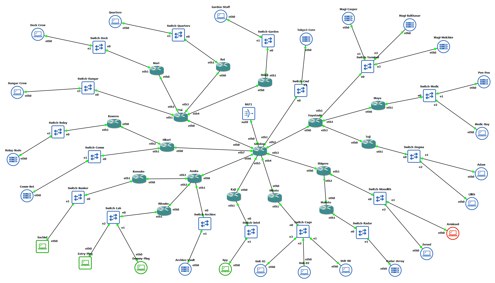

## Soal 1

### Perhitungan VLSM

Setiap LAN membutuhkan alamat untuk host sesuai tabel soal dan satu alamat untuk gateway. Prefix dipilih sebagai prefix terkecil yang masih menyediakan jumlah alamat usable yang cukup. Link point-to-point antar-router membutuhkan dua alamat usable.

Contoh perhitungan untuk **Switch-Quarters**:

- Kebutuhan host: 500 host + 1 gateway = 501 alamat usable.
- `2^9 - 2 = 510` alamat usable, sedangkan `2^8 - 2 = 254`; karena itu prefix terkecil yang cukup adalah `/23`.
- Network `10.71.0.0/23`, gateway `10.71.0.1`, dan broadcast `10.71.1.255`.
- Quarters memakai IP `10.71.0.2`. Sisa kapasitas untuk kebutuhan 501 alamat adalah 9 alamat usable.

### Tabel pembagian alamat

Sisa dihitung dari kapasitas usable dikurangi kebutuhan host dan gateway (atau dua ujung link). IP terpakai menunjukkan alamat yang diberikan kepada gateway dan node pada spreadsheet.

| No. | Segmen | Kebutuhan | Prefix | Network | Gateway / ujung pertama | IP node / ujung kedua | Broadcast | Sisa usable |
|---:|---|---:|---:|---|---|---|---|---:|
| 1 | Switch-Quarters (Rei) | 501 | /23 | 10.71.0.0 | 10.71.0.1 | Quarters: 10.71.0.2 | 10.71.1.255 | 9 |
| 2 | Switch-Comm (Hikari) | 201 | /24 | 10.71.2.0 | 10.71.2.1 | Comm-Net: 10.71.2.2 | 10.71.2.255 | 53 |
| 3 | Switch-Hangar (Yui) | 101 | /25 | 10.71.3.0 | 10.71.3.1 | Hangar-Crew: 10.71.3.2 | 10.71.3.127 | 25 |
| 4 | Switch-Bunker (Kensuke) | 56 | /26 | 10.71.3.128 | 10.71.3.129 | Sachiel: 10.71.3.130 | 10.71.3.191 | 6 |
| 5 | Switch-Medic (Maya) | 27 | /27 | 10.71.3.192 | 10.71.3.193 | Pen-Pen: .194; Medic-Bay: .195 | 10.71.3.223 | 3 |
| 6 | Switch-Relay (Kaworu) | 26 | /27 | 10.71.3.224 | 10.71.3.225 | Relay-Node: 10.71.3.226 | 10.71.3.255 | 4 |
| 7 | Switch-Garden (Shinji) | 15 | /27 | 10.71.4.0 | 10.71.4.1 | Garden-Staff: 10.71.4.2 | 10.71.4.31 | 15 |
| 8 | Switch-Dock (Mari) | 13 | /28 | 10.71.4.32 | 10.71.4.33 | Dock-Crew: 10.71.4.34 | 10.71.4.47 | 1 |
| 9 | Switch-Lab (Ritsuko) | 6 | /29 | 10.71.4.48 | 10.71.4.49 | Entry-Plug: .50; Dummy-Plug: .51 | 10.71.4.55 | 0 |
| 10 | Switch-Radar (Makoto) | 5 | /29 | 10.71.4.56 | 10.71.4.57 | Radar-Array: 10.71.4.58 | 10.71.4.63 | 1 |
| 11 | Switch-Terminal (Fuyutsuki) | 4 | /29 | 10.71.4.64 | 10.71.4.65 | Casper: .66; Balthasar: .67; Melchior: .68 | 10.71.4.71 | 2 |
| 12 | Switch-Cage (Misato) | 4 | /29 | 10.71.4.72 | 10.71.4.73 | Unit-01: .74; Unit-02: .75; Unit-00: .76 | 10.71.4.79 | 2 |
| 13 | Switch-Dogma (Toji) | 3 | /29 | 10.71.4.80 | 10.71.4.81 | Lilith: .82; Adam: .83 | 10.71.4.87 | 3 |
| 14 | Switch-Monolith (Shigeru) | 3 | /29 | 10.71.4.88 | 10.71.4.89 | Zeruel: .90; Armisael: .91 | 10.71.4.95 | 3 |
| 15 | Switch-Archive (Asuka) | 2 | /30 | 10.71.4.96 | 10.71.4.97 | Archive-Vault: 10.71.4.98 | 10.71.4.99 | 0 |
| 16 | Switch-Intel (Kaji) | 2 | /30 | 10.71.4.100 | 10.71.4.101 | Spy: 10.71.4.102 | 10.71.4.103 | 0 |
| 17 | Switch-Cmd (Gendo) | 2 | /30 | 10.71.4.104 | 10.71.4.105 | Tokyo3-Core: 10.71.4.106 | 10.71.4.107 | 0 |
| 18 | Link Gendo–Fuyutsuki | 2 | /30 | 10.71.4.108 | Gendo eth2: .109 | Fuyutsuki eth0: .110 | 10.71.4.111 | 0 |
| 19 | Link Gendo–Shigeru | 2 | /30 | 10.71.4.112 | Gendo eth3: .113 | Shigeru eth0: .114 | 10.71.4.115 | 0 |
| 20 | Link Gendo–Misato | 2 | /30 | 10.71.4.116 | Gendo eth4: .117 | Misato eth0: .118 | 10.71.4.119 | 0 |
| 21 | Link Gendo–Kaji | 2 | /30 | 10.71.4.120 | Gendo eth5: .121 | Kaji eth0: .122 | 10.71.4.123 | 0 |
| 22 | Link Gendo–Asuka | 2 | /30 | 10.71.4.124 | Gendo eth6: .125 | Asuka eth0: .126 | 10.71.4.127 | 0 |
| 23 | Link Gendo–Hikari | 2 | /30 | 10.71.4.128 | Gendo eth7: .129 | Hikari eth0: .130 | 10.71.4.131 | 0 |
| 24 | Link Gendo–Yui | 2 | /30 | 10.71.4.132 | Gendo eth8: .133 | Yui eth0: .134 | 10.71.4.135 | 0 |
| 25 | Link Fuyutsuki–Maya | 2 | /30 | 10.71.4.136 | Fuyutsuki eth2: .137 | Maya eth0: .138 | 10.71.4.139 | 0 |
| 26 | Link Fuyutsuki–Toji | 2 | /30 | 10.71.4.140 | Fuyutsuki eth3: .141 | Toji eth0: .142 | 10.71.4.143 | 0 |
| 27 | Link Shigeru–Makoto | 2 | /30 | 10.71.4.144 | Shigeru eth2: .145 | Makoto eth0: .146 | 10.71.4.147 | 0 |
| 28 | Link Asuka–Ritsuko | 2 | /30 | 10.71.4.148 | Asuka eth2: .149 | Ritsuko eth0: .150 | 10.71.4.151 | 0 |
| 29 | Link Asuka–Kensuke | 2 | /30 | 10.71.4.152 | Asuka eth3: .153 | Kensuke eth0: .154 | 10.71.4.155 | 0 |
| 30 | Link Hikari–Kaworu | 2 | /30 | 10.71.4.156 | Hikari eth2: .157 | Kaworu eth0: .158 | 10.71.4.159 | 0 |
| 31 | Link Yui–Mari | 2 | /30 | 10.71.4.160 | Yui eth2: .161 | Mari eth0: .162 | 10.71.4.163 | 0 |
| 32 | Link Yui–Rei | 2 | /30 | 10.71.4.164 | Yui eth3: .165 | Rei eth0: .166 | 10.71.4.167 | 0 |
| 33 | Link Yui–Shinji | 2 | /30 | 10.71.4.168 | Yui eth4: .169 | Shinji eth0: .170 | 10.71.4.171 | 0 |

### Pohon IP VLSM

Subnet dialokasikan dari kebutuhan terbesar ke terkecil. Jika kebutuhan sama, LAN didahulukan daripada link, lalu mengikuti urutan tabel soal. Lingkaran menandai subnet yang dilalui koneksi dari Dummy-Plug menuju Armisael.

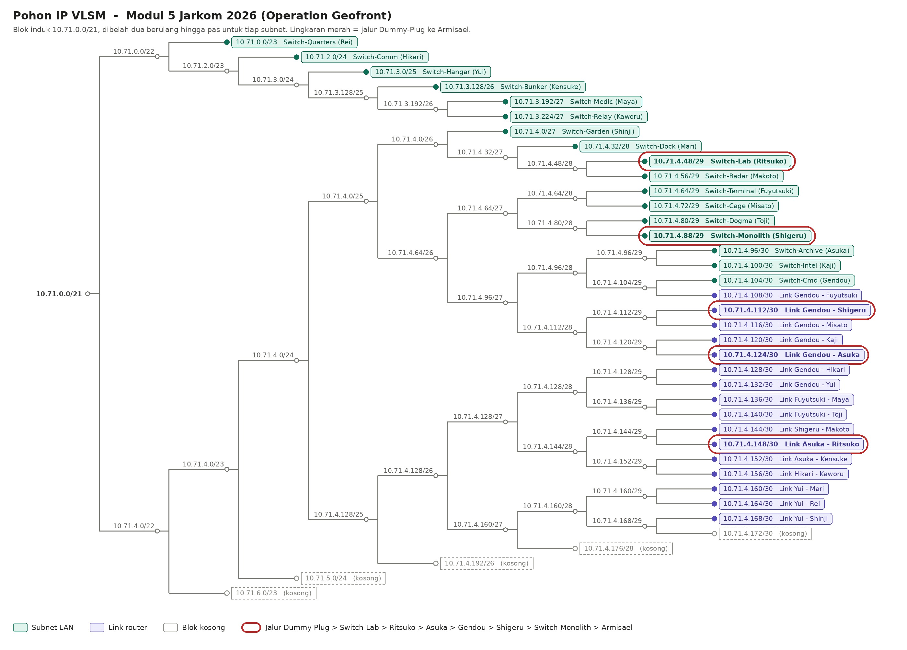

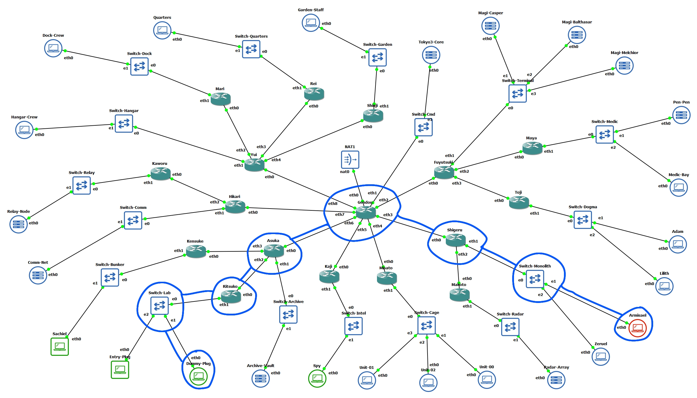

## Soal 2

### Tujuan

Soal ini memasang semua node pada topologi GNS3 dan memberi alamat IP pada interface router sesuai pembagian VLSM Soal 1. IP forwarding diaktifkan pada seluruh router agar router dapat meneruskan paket antar-subnet. Gendo menjadi satu-satunya router yang terhubung ke NAT1; interface Gendo yang mengarah ke NAT1 dikonfigurasi untuk memperoleh alamat melalui DHCP. Setiap link router-ke-router diuji dengan ping ke alamat di ujung link.

Konfigurasi persisten disimpan dalam `/etc/network/interfaces` oleh skrip masing-masing router di `script/soal-2/`. Skrip juga mengaktifkan IP forwarding dan menerapkan ulang konfigurasi interface.

### Bukti konfigurasi dan pengujian

Setiap bukti menampilkan `ip -br a`, status `net.ipv4.ip_forward`, serta ping ke router tetangga pada link yang terhubung.
### gendou

```bash
ip -br a && sysctl net.ipv4.ip_forward
ping -c 2 10.71.4.110  # Fuyutsuki
ping -c 2 10.71.4.114  # Shigeru
ping -c 2 10.71.4.118  # Misato
ping -c 2 10.71.4.122  # Kaji
ping -c 2 10.71.4.126  # Asuka
ping -c 2 10.71.4.130  # Hikari
ping -c 2 10.71.4.134  # Yui
```

Bukti konfigurasi dan ping: [tes-gendou.png](assets/soal-2/tes-gendou.png).

```sh
auto lo
iface lo inet loopback

auto eth0
iface eth0 inet dhcp
    up sysctl -w net.ipv4.ip_forward=1

auto eth1
iface eth1 inet static
    address 10.71.4.105
    netmask 255.255.255.252

auto eth2
iface eth2 inet static
    address 10.71.4.109
    netmask 255.255.255.252

auto eth3
iface eth3 inet static
    address 10.71.4.113
    netmask 255.255.255.252

auto eth4
iface eth4 inet static
    address 10.71.4.117
    netmask 255.255.255.252

auto eth5
iface eth5 inet static
    address 10.71.4.121
    netmask 255.255.255.252

auto eth6
iface eth6 inet static
    address 10.71.4.125
    netmask 255.255.255.252

auto eth7
iface eth7 inet static
    address 10.71.4.129
    netmask 255.255.255.252

auto eth8
iface eth8 inet static
    address 10.71.4.133
    netmask 255.255.255.252
```

### fuyutsuki

```bash
ip -br a && sysctl net.ipv4.ip_forward
ping -c 2 10.71.4.109  # Gendo
ping -c 2 10.71.4.138  # Maya
ping -c 2 10.71.4.142  # Toji
```

Bukti konfigurasi dan ping: [tes-fuyutsuki.png](assets/soal-2/tes-fuyutsuki.png).

```sh
auto lo
iface lo inet loopback

auto eth0
iface eth0 inet static
    address 10.71.4.110
    netmask 255.255.255.252
    up sysctl -w net.ipv4.ip_forward=1

auto eth1
iface eth1 inet static
    address 10.71.4.65
    netmask 255.255.255.248

auto eth2
iface eth2 inet static
    address 10.71.4.137
    netmask 255.255.255.252

auto eth3
iface eth3 inet static
    address 10.71.4.141
    netmask 255.255.255.252
```

### maya

```bash
ip -br a && sysctl net.ipv4.ip_forward
ping -c 2 10.71.4.137  # Fuyutsuki
```

Bukti konfigurasi dan ping: [tes-maya.png](assets/soal-2/tes-maya.png).

```sh
auto lo
iface lo inet loopback

auto eth0
iface eth0 inet static
    address 10.71.4.138
    netmask 255.255.255.252
    up sysctl -w net.ipv4.ip_forward=1

auto eth1
iface eth1 inet static
    address 10.71.3.193
    netmask 255.255.255.224
```

### toji

```bash
ip -br a && sysctl net.ipv4.ip_forward
ping -c 2 10.71.4.141  # Fuyutsuki
```

Bukti konfigurasi dan ping: [tes-toji.png](assets/soal-2/tes-toji.png).

```sh
auto lo
iface lo inet loopback

auto eth0
iface eth0 inet static
    address 10.71.4.142
    netmask 255.255.255.252
    up sysctl -w net.ipv4.ip_forward=1

auto eth1
iface eth1 inet static
    address 10.71.4.81
    netmask 255.255.255.248
```

### shigeru

```bash
ip -br a && sysctl net.ipv4.ip_forward
ping -c 2 10.71.4.113  # Gendo
ping -c 2 10.71.4.146  # Makoto
```

Bukti konfigurasi dan ping: [tes-shigeru.png](assets/soal-2/tes-shigeru.png).

```sh
auto lo
iface lo inet loopback

auto eth0
iface eth0 inet static
    address 10.71.4.114
    netmask 255.255.255.252
    up sysctl -w net.ipv4.ip_forward=1

auto eth1
iface eth1 inet static
    address 10.71.4.89
    netmask 255.255.255.248

auto eth2
iface eth2 inet static
    address 10.71.4.145
    netmask 255.255.255.252
```

### makoto

```bash
ip -br a && sysctl net.ipv4.ip_forward
ping -c 2 10.71.4.145  # Shigeru
```

Bukti konfigurasi dan ping: [tes-makoto.png](assets/soal-2/tes-makoto.png).

```sh
auto lo
iface lo inet loopback

auto eth0
iface eth0 inet static
    address 10.71.4.146
    netmask 255.255.255.252
    up sysctl -w net.ipv4.ip_forward=1

auto eth1
iface eth1 inet static
    address 10.71.4.57
    netmask 255.255.255.248
```

### misato

```bash
ip -br a && sysctl net.ipv4.ip_forward
ping -c 2 10.71.4.117  # Gendo
```

Bukti konfigurasi dan ping: [tes-misato.png](assets/soal-2/tes-misato.png).

```sh
auto lo
iface lo inet loopback

auto eth0
iface eth0 inet static
    address 10.71.4.118
    netmask 255.255.255.252
    up sysctl -w net.ipv4.ip_forward=1

auto eth1
iface eth1 inet static
    address 10.71.4.73
    netmask 255.255.255.248
```

### kaji

```bash
ip -br a && sysctl net.ipv4.ip_forward
ping -c 2 10.71.4.121  # Gendo
```

Bukti konfigurasi dan ping: [tes-kaji.png](assets/soal-2/tes-kaji.png).

```sh
auto lo
iface lo inet loopback

auto eth0
iface eth0 inet static
    address 10.71.4.122
    netmask 255.255.255.252
    up sysctl -w net.ipv4.ip_forward=1

auto eth1
iface eth1 inet static
    address 10.71.4.101
    netmask 255.255.255.252
```

### asuka

```bash
ip -br a && sysctl net.ipv4.ip_forward
ping -c 2 10.71.4.125  # Gendo
ping -c 2 10.71.4.150  # Ritsuko
ping -c 2 10.71.4.154  # Kensuke
```

Bukti konfigurasi dan ping: [tes-asuka.png](assets/soal-2/tes-asuka.png).

```sh
auto lo
iface lo inet loopback

auto eth0
iface eth0 inet static
    address 10.71.4.126
    netmask 255.255.255.252
    up sysctl -w net.ipv4.ip_forward=1

auto eth1
iface eth1 inet static
    address 10.71.4.97
    netmask 255.255.255.252

auto eth2
iface eth2 inet static
    address 10.71.4.149
    netmask 255.255.255.252

auto eth3
iface eth3 inet static
    address 10.71.4.153
    netmask 255.255.255.252
```

### ritsuko

```bash
ip -br a && sysctl net.ipv4.ip_forward
ping -c 2 10.71.4.149  # Asuka
```

Bukti konfigurasi dan ping: [tes-ritsuko.png](assets/soal-2/tes-ritsuko.png).

```sh
auto lo
iface lo inet loopback

auto eth0
iface eth0 inet static
    address 10.71.4.150
    netmask 255.255.255.252
    up sysctl -w net.ipv4.ip_forward=1

auto eth1
iface eth1 inet static
    address 10.71.4.49
    netmask 255.255.255.248
```

### kensuke

```bash
ip -br a && sysctl net.ipv4.ip_forward
ping -c 2 10.71.4.153  # Asuka
```

Bukti konfigurasi dan ping: [tes-kensuke.png](assets/soal-2/tes-kensuke.png).

```sh
auto lo
iface lo inet loopback

auto eth0
iface eth0 inet static
    address 10.71.4.154
    netmask 255.255.255.252
    up sysctl -w net.ipv4.ip_forward=1

auto eth1
iface eth1 inet static
    address 10.71.3.129
    netmask 255.255.255.192
```

### hikari

```bash
ip -br a && sysctl net.ipv4.ip_forward
ping -c 2 10.71.4.129  # Gendo
ping -c 2 10.71.4.158  # Kaworu
```

Bukti konfigurasi dan ping: [tes-hikari.png](assets/soal-2/tes-hikari.png).

```sh
auto lo
iface lo inet loopback

auto eth0
iface eth0 inet static
    address 10.71.4.130
    netmask 255.255.255.252
    up sysctl -w net.ipv4.ip_forward=1

auto eth1
iface eth1 inet static
    address 10.71.2.1
    netmask 255.255.255.0

auto eth2
iface eth2 inet static
    address 10.71.4.157
    netmask 255.255.255.252
```

### kaworu

```bash
ip -br a && sysctl net.ipv4.ip_forward
ping -c 2 10.71.4.157  # Hikari
```

Bukti konfigurasi dan ping: [tes-kaworu.png](assets/soal-2/tes-kaworu.png).

```sh
auto lo
iface lo inet loopback

auto eth0
iface eth0 inet static
    address 10.71.4.158
    netmask 255.255.255.252
    up sysctl -w net.ipv4.ip_forward=1

auto eth1
iface eth1 inet static
    address 10.71.3.225
    netmask 255.255.255.224
```

### yui

```bash
ip -br a && sysctl net.ipv4.ip_forward
ping -c 2 10.71.4.133  # Gendo
ping -c 2 10.71.4.162  # Mari
ping -c 2 10.71.4.166  # Rei
ping -c 2 10.71.4.170  # Shinji
```

Bukti konfigurasi dan ping: [tes-yui.png](assets/soal-2/tes-yui.png).

```sh
auto lo
iface lo inet loopback

auto eth0
iface eth0 inet static
    address 10.71.4.134
    netmask 255.255.255.252
    up sysctl -w net.ipv4.ip_forward=1

auto eth1
iface eth1 inet static
    address 10.71.3.1
    netmask 255.255.255.128

auto eth2
iface eth2 inet static
    address 10.71.4.161
    netmask 255.255.255.252

auto eth3
iface eth3 inet static
    address 10.71.4.165
    netmask 255.255.255.252

auto eth4
iface eth4 inet static
    address 10.71.4.169
    netmask 255.255.255.252
```

### mari

```bash
ip -br a && sysctl net.ipv4.ip_forward
ping -c 2 10.71.4.161  # Yui
```

Bukti konfigurasi dan ping: [tes-mari.png](assets/soal-2/tes-mari.png).

```sh
auto lo
iface lo inet loopback

auto eth0
iface eth0 inet static
    address 10.71.4.162
    netmask 255.255.255.252
    up sysctl -w net.ipv4.ip_forward=1

auto eth1
iface eth1 inet static
    address 10.71.4.33
    netmask 255.255.255.240
```

### rei

```bash
ip -br a && sysctl net.ipv4.ip_forward
ping -c 2 10.71.4.165  # Yui
```

Bukti konfigurasi dan ping: [tes-rei.png](assets/soal-2/tes-rei.png).

```sh
auto lo
iface lo inet loopback

auto eth0
iface eth0 inet static
    address 10.71.4.166
    netmask 255.255.255.252
    up sysctl -w net.ipv4.ip_forward=1

auto eth1
iface eth1 inet static
    address 10.71.0.1
    netmask 255.255.254.0
```

### shinji

```bash
ip -br a && sysctl net.ipv4.ip_forward
ping -c 2 10.71.4.169  # Yui
```

Bukti konfigurasi dan ping: [tes-shinji.png](assets/soal-2/tes-shinji.png).

```sh
auto lo
iface lo inet loopback

auto eth0
iface eth0 inet static
    address 10.71.4.170
    netmask 255.255.255.252
    up sysctl -w net.ipv4.ip_forward=1

auto eth1
iface eth1 inet static
    address 10.71.4.1
    netmask 255.255.255.224
```

## Soal 3

### Tujuan

Soal ini menghubungkan seluruh subnet menggunakan routing statis. Router non-pusat memakai satu default route menuju router induk dan menambahkan rute untuk jaringan cabang di bawahnya. Rute beberapa subnet diringkas ketika rentang alamatnya tepat membentuk satu CIDR. Gendo menjadi router pusat dan menggunakan default route yang diperoleh dari NAT1 melalui DHCP.

Konfigurasi berikut diterapkan pada container **Debinet** melalui `/etc/network/interfaces`. Perintah `up ip route replace` membuat rute statis diterapkan saat interface aktif; `replace` juga membuat penerapan ulang bersifat idempoten.

### Konfigurasi sementara node uji

Alamat dan gateway berikut dipasang sementara pada empat node untuk pengujian routing:

```sh
# Armisael
ip addr flush dev eth0 && ip addr add 10.71.4.91/29 dev eth0 && ip link set eth0 up && ip route replace default via 10.71.4.89

# Lilith
ip addr flush dev eth0 && ip addr add 10.71.4.82/29 dev eth0 && ip link set eth0 up && ip route replace default via 10.71.4.81

# Sachiel
ip addr flush dev eth0 && ip addr add 10.71.3.130/26 dev eth0 && ip link set eth0 up && ip route replace default via 10.71.3.129

# Comm-Net
ip addr flush dev eth0 && ip addr add 10.71.2.2/24 dev eth0 && ip link set eth0 up && ip route replace default via 10.71.2.1
```

### Bukti uji ping

Dari Armisael, ping tiga tujuan dilakukan masing-masing tiga kali. Bukti menunjukkan ketiganya menerima balasan tanpa packet loss.

Uji ping dari Armisael ke Lilith, Sachiel, dan Comm-Net.
```sh
ping -c 3 10.71.4.82    # Lilith
ping -c 3 10.71.3.130   # Sachiel
ping -c 3 10.71.2.2     # Comm-Net
```

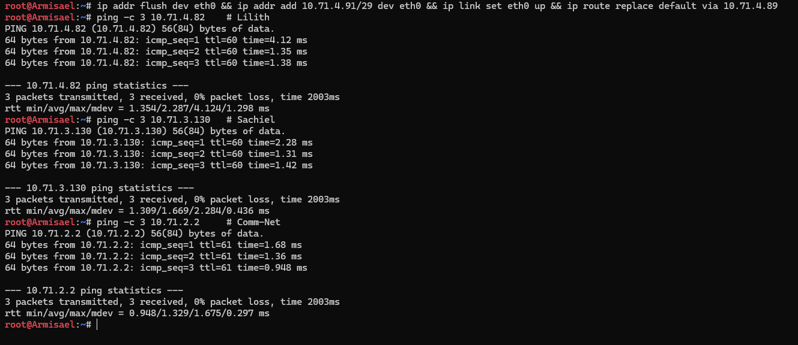

### Konfigurasi interface dan routing statis router
### gendou

```sh
auto lo
iface lo inet loopback

auto eth0
iface eth0 inet dhcp
    up sysctl -w net.ipv4.ip_forward=1

auto eth1
iface eth1 inet static
    address 10.71.4.105
    netmask 255.255.255.252

auto eth2
iface eth2 inet static
    address 10.71.4.109
    netmask 255.255.255.252
    up ip route replace 10.71.4.64/29 via 10.71.4.110
    up ip route replace 10.71.3.192/27 via 10.71.4.110
    up ip route replace 10.71.4.80/29 via 10.71.4.110
    up ip route replace 10.71.4.136/29 via 10.71.4.110

auto eth3
iface eth3 inet static
    address 10.71.4.113
    netmask 255.255.255.252
    up ip route replace 10.71.4.88/29 via 10.71.4.114
    up ip route replace 10.71.4.56/29 via 10.71.4.114
    up ip route replace 10.71.4.144/30 via 10.71.4.114

auto eth4
iface eth4 inet static
    address 10.71.4.117
    netmask 255.255.255.252
    up ip route replace 10.71.4.72/29 via 10.71.4.118

auto eth5
iface eth5 inet static
    address 10.71.4.121
    netmask 255.255.255.252
    up ip route replace 10.71.4.100/30 via 10.71.4.122

auto eth6
iface eth6 inet static
    address 10.71.4.125
    netmask 255.255.255.252
    up ip route replace 10.71.4.96/30 via 10.71.4.126
    up ip route replace 10.71.4.48/29 via 10.71.4.126
    up ip route replace 10.71.3.128/26 via 10.71.4.126
    up ip route replace 10.71.4.148/30 via 10.71.4.126
    up ip route replace 10.71.4.152/30 via 10.71.4.126

auto eth7
iface eth7 inet static
    address 10.71.4.129
    netmask 255.255.255.252
    up ip route replace 10.71.2.0/24 via 10.71.4.130
    up ip route replace 10.71.3.224/27 via 10.71.4.130
    up ip route replace 10.71.4.156/30 via 10.71.4.130

auto eth8
iface eth8 inet static
    address 10.71.4.133
    netmask 255.255.255.252
    up ip route replace 10.71.3.0/25 via 10.71.4.134
    up ip route replace 10.71.4.32/28 via 10.71.4.134
    up ip route replace 10.71.0.0/23 via 10.71.4.134
    up ip route replace 10.71.4.0/27 via 10.71.4.134
    up ip route replace 10.71.4.160/29 via 10.71.4.134
    up ip route replace 10.71.4.168/30 via 10.71.4.134
```

### fuyutsuki

```sh
auto lo
iface lo inet loopback

auto eth0
iface eth0 inet static
    address 10.71.4.110
    netmask 255.255.255.252
    up sysctl -w net.ipv4.ip_forward=1
    up ip route replace default via 10.71.4.109

auto eth1
iface eth1 inet static
    address 10.71.4.65
    netmask 255.255.255.248

auto eth2
iface eth2 inet static
    address 10.71.4.137
    netmask 255.255.255.252
    up ip route replace 10.71.3.192/27 via 10.71.4.138

auto eth3
iface eth3 inet static
    address 10.71.4.141
    netmask 255.255.255.252
    up ip route replace 10.71.4.80/29 via 10.71.4.142
```

### maya

```sh
auto lo
iface lo inet loopback

auto eth0
iface eth0 inet static
    address 10.71.4.138
    netmask 255.255.255.252
    up sysctl -w net.ipv4.ip_forward=1
    up ip route replace default via 10.71.4.137

auto eth1
iface eth1 inet static
    address 10.71.3.193
    netmask 255.255.255.224
```

### toji

```sh
auto lo
iface lo inet loopback

auto eth0
iface eth0 inet static
    address 10.71.4.142
    netmask 255.255.255.252
    up sysctl -w net.ipv4.ip_forward=1
    up ip route replace default via 10.71.4.141

auto eth1
iface eth1 inet static
    address 10.71.4.81
    netmask 255.255.255.248
```

### shigeru

```sh
auto lo
iface lo inet loopback

auto eth0
iface eth0 inet static
    address 10.71.4.114
    netmask 255.255.255.252
    up sysctl -w net.ipv4.ip_forward=1
    up ip route replace default via 10.71.4.113

auto eth1
iface eth1 inet static
    address 10.71.4.89
    netmask 255.255.255.248

auto eth2
iface eth2 inet static
    address 10.71.4.145
    netmask 255.255.255.252
    up ip route replace 10.71.4.56/29 via 10.71.4.146
```

### makoto

```sh
auto lo
iface lo inet loopback

auto eth0
iface eth0 inet static
    address 10.71.4.146
    netmask 255.255.255.252
    up sysctl -w net.ipv4.ip_forward=1
    up ip route replace default via 10.71.4.145

auto eth1
iface eth1 inet static
    address 10.71.4.57
    netmask 255.255.255.248
```

### misato

```sh
auto lo
iface lo inet loopback

auto eth0
iface eth0 inet static
    address 10.71.4.118
    netmask 255.255.255.252
    up sysctl -w net.ipv4.ip_forward=1
    up ip route replace default via 10.71.4.117

auto eth1
iface eth1 inet static
    address 10.71.4.73
    netmask 255.255.255.248
```

### kaji

```sh
auto lo
iface lo inet loopback

auto eth0
iface eth0 inet static
    address 10.71.4.122
    netmask 255.255.255.252
    up sysctl -w net.ipv4.ip_forward=1
    up ip route replace default via 10.71.4.121

auto eth1
iface eth1 inet static
    address 10.71.4.101
    netmask 255.255.255.252
```

### asuka

```sh
auto lo
iface lo inet loopback

auto eth0
iface eth0 inet static
    address 10.71.4.126
    netmask 255.255.255.252
    up sysctl -w net.ipv4.ip_forward=1
    up ip route replace default via 10.71.4.125

auto eth1
iface eth1 inet static
    address 10.71.4.97
    netmask 255.255.255.252

auto eth2
iface eth2 inet static
    address 10.71.4.149
    netmask 255.255.255.252
    up ip route replace 10.71.4.48/29 via 10.71.4.150

auto eth3
iface eth3 inet static
    address 10.71.4.153
    netmask 255.255.255.252
    up ip route replace 10.71.3.128/26 via 10.71.4.154
```

### ritsuko

```sh
auto lo
iface lo inet loopback

auto eth0
iface eth0 inet static
    address 10.71.4.150
    netmask 255.255.255.252
    up sysctl -w net.ipv4.ip_forward=1
    up ip route replace default via 10.71.4.149

auto eth1
iface eth1 inet static
    address 10.71.4.49
    netmask 255.255.255.248
```

### kensuke

```sh
auto lo
iface lo inet loopback

auto eth0
iface eth0 inet static
    address 10.71.4.154
    netmask 255.255.255.252
    up sysctl -w net.ipv4.ip_forward=1
    up ip route replace default via 10.71.4.153

auto eth1
iface eth1 inet static
    address 10.71.3.129
    netmask 255.255.255.192
```

### hikari

```sh
auto lo
iface lo inet loopback

auto eth0
iface eth0 inet static
    address 10.71.4.130
    netmask 255.255.255.252
    up sysctl -w net.ipv4.ip_forward=1
    up ip route replace default via 10.71.4.129

auto eth1
iface eth1 inet static
    address 10.71.2.1
    netmask 255.255.255.0

auto eth2
iface eth2 inet static
    address 10.71.4.157
    netmask 255.255.255.252
    up ip route replace 10.71.3.224/27 via 10.71.4.158
```

### kaworu

```sh
auto lo
iface lo inet loopback

auto eth0
iface eth0 inet static
    address 10.71.4.158
    netmask 255.255.255.252
    up sysctl -w net.ipv4.ip_forward=1
    up ip route replace default via 10.71.4.157

auto eth1
iface eth1 inet static
    address 10.71.3.225
    netmask 255.255.255.224
```

### yui

```sh
auto lo
iface lo inet loopback

auto eth0
iface eth0 inet static
    address 10.71.4.134
    netmask 255.255.255.252
    up sysctl -w net.ipv4.ip_forward=1
    up ip route replace default via 10.71.4.133

auto eth1
iface eth1 inet static
    address 10.71.3.1
    netmask 255.255.255.128

auto eth2
iface eth2 inet static
    address 10.71.4.161
    netmask 255.255.255.252
    up ip route replace 10.71.4.32/28 via 10.71.4.162

auto eth3
iface eth3 inet static
    address 10.71.4.165
    netmask 255.255.255.252
    up ip route replace 10.71.0.0/23 via 10.71.4.166

auto eth4
iface eth4 inet static
    address 10.71.4.169
    netmask 255.255.255.252
    up ip route replace 10.71.4.0/27 via 10.71.4.170
```

### mari

```sh
auto lo
iface lo inet loopback

auto eth0
iface eth0 inet static
    address 10.71.4.162
    netmask 255.255.255.252
    up sysctl -w net.ipv4.ip_forward=1
    up ip route replace default via 10.71.4.161

auto eth1
iface eth1 inet static
    address 10.71.4.33
    netmask 255.255.255.240
```

### rei

```sh
auto lo
iface lo inet loopback

auto eth0
iface eth0 inet static
    address 10.71.4.166
    netmask 255.255.255.252
    up sysctl -w net.ipv4.ip_forward=1
    up ip route replace default via 10.71.4.165

auto eth1
iface eth1 inet static
    address 10.71.0.1
    netmask 255.255.254.0
```

### shinji

```sh
auto lo
iface lo inet loopback

auto eth0
iface eth0 inet static
    address 10.71.4.170
    netmask 255.255.255.252
    up sysctl -w net.ipv4.ip_forward=1
    up ip route replace default via 10.71.4.169

auto eth1
iface eth1 inet static
    address 10.71.4.1
    netmask 255.255.255.224
```

## Soal 4

### Tujuan

Memberikan akses internet untuk jaringan internal melalui NAT1 yang terhubung ke Gendo. Rule `MASQUERADE` hanya berlaku bagi sumber `10.71.0.0/16` yang keluar melalui `eth0`, sehingga IP NAT1 yang diperoleh via DHCP dapat berubah tanpa perlu mengubah rule. Traffic antar-LAN keluar lewat interface internal dan tetap menggunakan alamat sumber aslinya. DNS resolver dipasang pada node uji agar nama domain dapat di-resolve.

### NAT di Gendo

Skrip NAT membersihkan rule lama di chain `POSTROUTING`, lalu memasang satu rule `MASQUERADE` dengan batasan source dan interface keluar.

```sh
#!/bin/sh
# Bersihkan rule NAT lama agar rule tidak terduplikasi.
iptables -t nat -F POSTROUTING

# NAT hanya untuk jaringan internal yang keluar menuju NAT1 melalui eth0.
iptables -t nat -A POSTROUTING -s 10.71.0.0/16 -o eth0 -j MASQUERADE
```

Simpan skrip tersebut sebagai `/root/nat.sh` di Gendo, lalu jalankan:

```sh
chmod +x /root/nat.sh
/root/nat.sh
```

Agar rule dipasang lagi saat Gendo boot, interface `eth0` di `/etc/network/interfaces` menjalankan skrip setelah interface aktif dan IP forwarding dinyalakan:

```text
auto eth0
iface eth0 inet dhcp
    up sysctl -w net.ipv4.ip_forward=1
    up /root/nat.sh
```

Salinan skrip tersedia di [script/soal-4/nat.sh](script/soal-4/nat.sh).

### DNS pada node uji

Resolver `8.8.8.8` dan `1.1.1.1` ditambahkan ke `/etc/resolv.conf` di Armisael dan Lilith:

```sh
cat << 'EOF' > /etc/resolv.conf
nameserver 8.8.8.8
nameserver 1.1.1.1
EOF
```

### Pengujian dan bukti

Armisael (`10.71.4.91`) dan Lilith (`10.71.4.82`) masing-masing menguji koneksi ke `8.8.8.8` dan resolusi nama `deb.debian.org`:

```sh
ping -c 3 8.8.8.8
ping -c 3 deb.debian.org
```

**Rule NAT dan counter di Gendo:** screenshot memperlihatkan rule `MASQUERADE` untuk source `10.71.0.0/16` dengan interface keluar `eth0`; counternya menunjukkan 8 paket dan 604 byte.

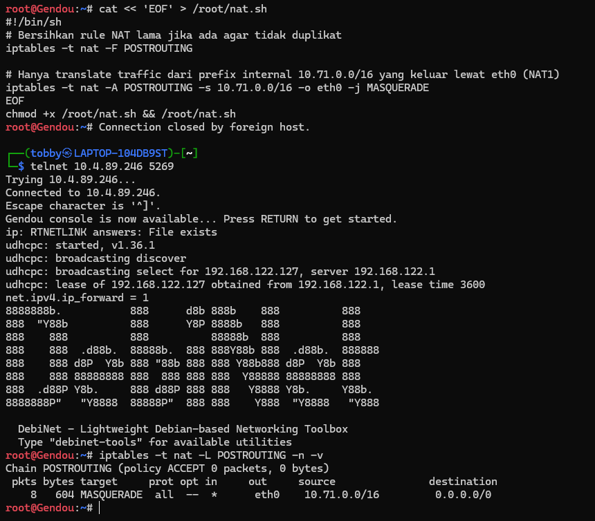

**Armisael:** kedua pengujian berhasil, masing-masing menerima balasan untuk 3 dari 3 paket.

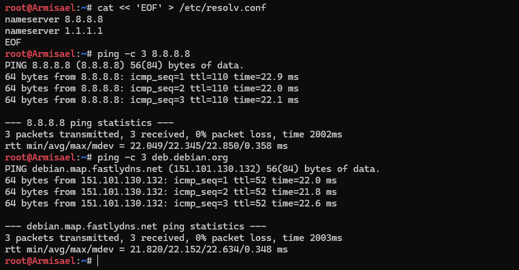

**Lilith:** kedua pengujian berhasil, masing-masing menerima balasan untuk 3 dari 3 paket.


## Soal 5

### Tujuan dan kebijakan firewall

Konfigurasi Gendo dari Soal 2–5 dipertahankan bersama dalam satu skrip: IP forwarding, rute statis menuju cabang, NAT ke NAT1, dan firewall stateful. Policy `INPUT` dan `FORWARD` dibuat `DROP`, sedangkan `OUTPUT` tetap `ACCEPT` agar Gendo dapat mengirim DHCP dan balasan koneksi.

Rule firewall kemudian memberi izin secara terarah:

- Loopback tetap diizinkan.
- Balasan koneksi `ESTABLISHED,RELATED` diizinkan pada `INPUT` dan `FORWARD`.
- DHCP reply dari NAT1 diizinkan masuk melalui `eth0` (UDP sumber port 67 ke tujuan port 68).
- Paket dari prefix internal `10.71.0.0/16` dapat menuju Gendo dan diteruskan ke internet lewat `eth0`.
- Paket antar-LAN dengan sumber dan tujuan di `10.71.0.0/16` dapat diteruskan melalui interface internal.
- Tidak ada izin untuk koneksi baru yang masuk dari `eth0`, sehingga koneksi baru dari NAT1 mengikuti policy `DROP`.

### Skrip gabungan Gendo

Simpan skrip berikut sebagai `/root/gendo.sh` pada container Debinet Gendo. Skrip mengaktifkan forwarding, memasang ulang rute dengan `ip route replace`, menerapkan NAT, lalu menyusun ulang rule filter. `replace` membuat pemasangan rute dapat diulang tanpa membuat entri duplikat.

```sh
#!/bin/sh
set -eu

sleep 2

# Soal 2: aktifkan IP forwarding.
sysctl -w net.ipv4.ip_forward=1

# Soal 3: rute statis dan ringkasan subnet.
# Cabang Fuyutsuki.
ip route replace 10.71.4.64/29 via 10.71.4.110
ip route replace 10.71.3.192/27 via 10.71.4.110
ip route replace 10.71.4.80/29 via 10.71.4.110
ip route replace 10.71.4.136/29 via 10.71.4.110

# Cabang Shigeru.
ip route replace 10.71.4.88/29 via 10.71.4.114
ip route replace 10.71.4.56/29 via 10.71.4.114
ip route replace 10.71.4.144/30 via 10.71.4.114

# Cabang Misato dan Kaji.
ip route replace 10.71.4.72/29 via 10.71.4.118
ip route replace 10.71.4.100/30 via 10.71.4.122

# Cabang Asuka.
ip route replace 10.71.4.96/30 via 10.71.4.126
ip route replace 10.71.4.48/29 via 10.71.4.126
ip route replace 10.71.3.128/26 via 10.71.4.126
ip route replace 10.71.4.148/30 via 10.71.4.126
ip route replace 10.71.4.152/30 via 10.71.4.126

# Cabang Hikari.
ip route replace 10.71.2.0/24 via 10.71.4.130
ip route replace 10.71.3.224/27 via 10.71.4.130
ip route replace 10.71.4.156/30 via 10.71.4.130

# Cabang Yui.
ip route replace 10.71.3.0/25 via 10.71.4.134
ip route replace 10.71.4.32/28 via 10.71.4.134
ip route replace 10.71.0.0/23 via 10.71.4.134
ip route replace 10.71.4.0/27 via 10.71.4.134
ip route replace 10.71.4.160/29 via 10.71.4.134
ip route replace 10.71.4.168/30 via 10.71.4.134

# Soal 4: NAT hanya untuk jaringan internal menuju NAT1 melalui eth0.
iptables -t nat -F
iptables -t nat -A POSTROUTING -s 10.71.0.0/16 -o eth0 -j MASQUERADE

# Soal 5: reset rule filter, lalu gunakan policy default yang ketat.
iptables -F
iptables -X
iptables -P INPUT DROP
iptables -P FORWARD DROP
iptables -P OUTPUT ACCEPT

# INPUT: loopback, balasan koneksi, DHCP reply, dan akses dari LAN ke Gendo.
iptables -A INPUT -i lo -j ACCEPT
iptables -A INPUT -m conntrack --ctstate ESTABLISHED,RELATED -j ACCEPT
iptables -A INPUT -i eth0 -p udp --sport 67 --dport 68 -j ACCEPT
iptables -A INPUT ! -i eth0 -s 10.71.0.0/16 -j ACCEPT

# FORWARD: balasan koneksi, LAN ke internet, dan komunikasi antar-LAN.
iptables -A FORWARD -m conntrack --ctstate ESTABLISHED,RELATED -j ACCEPT
iptables -A FORWARD ! -i eth0 -s 10.71.0.0/16 -o eth0 -j ACCEPT
iptables -A FORWARD ! -i eth0 -s 10.71.0.0/16 ! -o eth0 -d 10.71.0.0/16 -j ACCEPT
```

File lokal skrip tersedia di [script/soal-5/gendo.sh](script/soal-5/gendo.sh). Jalankan sebagai root di Gendo:

```sh
chmod +x /root/gendo.sh
/root/gendo.sh
```

### Menjalankan skrip saat Gendo boot

Alamat interface statis tetap dikonfigurasi seperti Soal 2. Letakkan `post-up /root/gendo.sh` pada blok `eth8`, yaitu interface terakhir Gendo yang diaktifkan. Dengan begitu, interface router sudah aktif sebelum rute, NAT, dan firewall dipasang.

```text
auto eth0
iface eth0 inet dhcp

auto eth1
iface eth1 inet static
    address 10.71.4.105
    netmask 255.255.255.252

auto eth2
iface eth2 inet static
    address 10.71.4.109
    netmask 255.255.255.252

auto eth3
iface eth3 inet static
    address 10.71.4.113
    netmask 255.255.255.252

auto eth4
iface eth4 inet static
    address 10.71.4.117
    netmask 255.255.255.252

auto eth5
iface eth5 inet static
    address 10.71.4.121
    netmask 255.255.255.252

auto eth6
iface eth6 inet static
    address 10.71.4.125
    netmask 255.255.255.252

auto eth7
iface eth7 inet static
    address 10.71.4.129
    netmask 255.255.255.252

auto eth8
iface eth8 inet static
    address 10.71.4.133
    netmask 255.255.255.252
    post-up /root/gendo.sh
```

### Pengujian dan bukti

Aturan aktif diperiksa di Gendo dengan `iptables -S`. Output menampilkan policy `INPUT DROP`, `FORWARD DROP`, `OUTPUT ACCEPT`, serta izin loopback, koneksi established/related, DHCP, LAN ke Gendo, LAN ke internet, dan antar-LAN.


Dari Armisael, tiga ping berikut menguji akses ke internet, ke Gendo, dan antar-LAN menuju Lilith:

```sh
ping -c 3 8.8.8.8
ping -c 3 10.71.4.105
ping -c 3 10.71.4.82
```

Ketiga pengujian menerima balasan untuk 3 dari 3 paket.

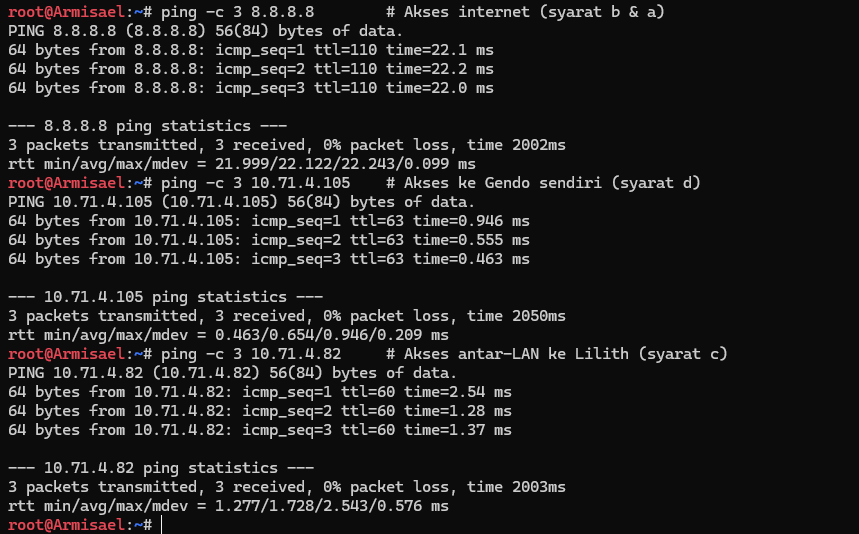

## Soal 6

### Tujuan

Setiap node non-router diberi IP statis dan gateway sesuai aturan alamat pada glosarium. Konfigurasi disimpan di `/etc/network/interfaces` agar diterapkan kembali saat container Debinet dimulai ulang. DNS `8.8.8.8` juga disetel melalui konfigurasi interface.

Alamat gateway pada setiap LAN adalah usable pertama. Host memakai alamat usable setelah gateway, mengikuti urutan node pada topologi.

### Tabel alamat node

| Switch / LAN | Node | IP statis | Gateway |
|---|---|---|---|
| Quarters | Quarters | `10.71.0.2/23` | `10.71.0.1` |
| Comm | Comm-Net | `10.71.2.2/24` | `10.71.2.1` |
| Hangar | Hangar-Crew | `10.71.3.2/25` | `10.71.3.1` |
| Bunker | Sachiel | `10.71.3.130/26` | `10.71.3.129` |
| Medic | Pen-Pen | `10.71.3.194/27` | `10.71.3.193` |
| Medic | Medic-Bay | `10.71.3.195/27` | `10.71.3.193` |
| Relay | Relay-Node | `10.71.3.226/27` | `10.71.3.225` |
| Garden | Garden-Staff | `10.71.4.2/27` | `10.71.4.1` |
| Dock | Dock-Crew | `10.71.4.34/28` | `10.71.4.33` |
| Lab | Entry-Plug | `10.71.4.50/29` | `10.71.4.49` |
| Lab | Dummy-Plug | `10.71.4.51/29` | `10.71.4.49` |
| Terminal | Magi-Casper | `10.71.4.66/29` | `10.71.4.65` |
| Terminal | Magi-Balthasar | `10.71.4.67/29` | `10.71.4.65` |
| Terminal | Magi-Melchior | `10.71.4.68/29` | `10.71.4.65` |
| Cage | Unit-01 | `10.71.4.74/29` | `10.71.4.73` |
| Cage | Unit-02 | `10.71.4.75/29` | `10.71.4.73` |
| Cage | Unit-00 | `10.71.4.76/29` | `10.71.4.73` |
| Dogma | Lilith | `10.71.4.82/29` | `10.71.4.81` |
| Dogma | Adam | `10.71.4.83/29` | `10.71.4.81` |
| Monolith | Zeruel | `10.71.4.90/29` | `10.71.4.89` |
| Monolith | Armisael | `10.71.4.91/29` | `10.71.4.89` |
| Radar | Radar-Array | `10.71.4.58/29` | `10.71.4.57` |
| Archive | Archive-Vault | `10.71.4.98/30` | `10.71.4.97` |
| Intel | Spy | `10.71.4.102/30` | `10.71.4.101` |
| Cmd | Tokyo3-Core | `10.71.4.106/30` | `10.71.4.105` |

Contoh konfigurasi persisten untuk Unit-01:

```text
auto lo
iface lo inet loopback

auto eth0
iface eth0 inet static
    address 10.71.4.74
    netmask 255.255.255.248
    gateway 10.71.4.73
    up echo "nameserver 8.8.8.8" > /etc/resolv.conf
```

Skrip konfigurasi node tersedia per host di `script/soal-6/`. Setiap skrip menulis konfigurasi statis ke `/etc/network/interfaces`, lalu menerapkannya kembali pada `eth0`. Salin skrip node yang sesuai ke container, kemudian jalankan sebagai root:

```sh
chmod +x /root/unit-01.sh
/root/unit-01.sh
```

### Uji persistensi Unit-01

Unit-01 dihentikan lalu dimulai kembali di GNS3. Setelah restart, `ip -br a` menampilkan `10.71.4.74/29` pada `eth0`; ping tiga kali ke gateway Misato `10.71.4.73` berhasil tanpa packet loss.

```sh
ip -br a && ping -c 3 10.71.4.73
```

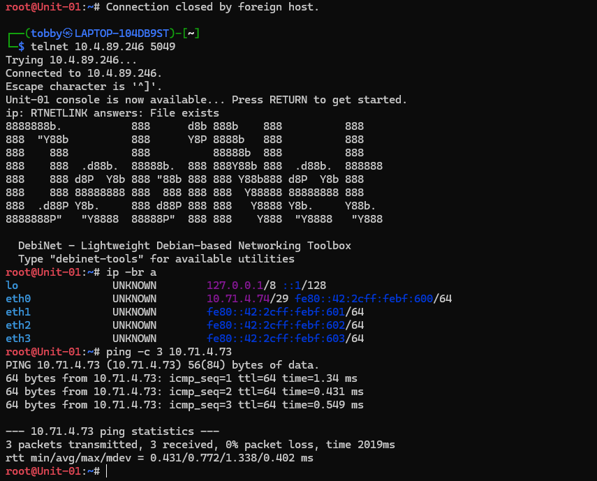

## Soal 7

### Tujuan

Menyiapkan layanan TCP pada node MAGI menggunakan `netcat-traditional`. Magi-Casper dan Magi-Melchior menerima koneksi pada port `5000`, sedangkan Magi-Balthasar menerima koneksi pada port `5000` dan `5001`. Setiap listener dijalankan di latar belakang dan menyimpan pesan yang diterima ke log di `/root/`.

### Skrip listener MAGI

Jalankan skrip pada masing-masing container MAGI terlebih dahulu. Skrip memeriksa apakah `iptables` dan `nc` sudah tersedia. Jika belum, skrip mengambil waktu dari header HTTP `Date` di `deb.debian.org`, menyetel waktu container sebelum `apt-get update`, lalu memasang `iptables` dan `netcat-traditional`. Setelah itu, listener lama pada port terkait dihentikan dan listener baru dijalankan.

**Magi-Casper** — `script/soal-7/magi-casper.sh`:

```sh
#!/bin/sh
if ! command -v iptables >/dev/null 2>&1 || ! command -v nc >/dev/null 2>&1; then
    DATE_STR=$(wget -S --spider http://deb.debian.org 2>&1 | awk -F': ' '/^  Date:/{print $2; exit}')
    [ -n "$DATE_STR" ] && date -s "$DATE_STR"
    apt-get update -qq && DEBIAN_FRONTEND=noninteractive apt-get install -y -qq iptables netcat-traditional
fi

pkill -f "[n]c -l -p 5000" 2>/dev/null || true
nohup nc -l -p 5000 >/root/casper-5000.log 2>&1 &
```

**Magi-Balthasar** — `script/soal-7/magi-balthasar.sh`:

```sh
#!/bin/sh
if ! command -v iptables >/dev/null 2>&1 || ! command -v nc >/dev/null 2>&1; then
    DATE_STR=$(wget -S --spider http://deb.debian.org 2>&1 | awk -F': ' '/^  Date:/{print $2; exit}')
    [ -n "$DATE_STR" ] && date -s "$DATE_STR"
    apt-get update -qq && DEBIAN_FRONTEND=noninteractive apt-get install -y -qq iptables netcat-traditional
fi

pkill -f "[n]c -l -p 5000" 2>/dev/null || true
pkill -f "[n]c -l -p 5001" 2>/dev/null || true
nohup nc -l -p 5000 >/root/balthasar-5000.log 2>&1 &
nohup nc -l -p 5001 >/root/balthasar-5001.log 2>&1 &
```

**Magi-Melchior** — `script/soal-7/magi-melchior.sh`:

```sh
#!/bin/sh
if ! command -v iptables >/dev/null 2>&1 || ! command -v nc >/dev/null 2>&1; then
    DATE_STR=$(wget -S --spider http://deb.debian.org 2>&1 | awk -F': ' '/^  Date:/{print $2; exit}')
    [ -n "$DATE_STR" ] && date -s "$DATE_STR"
    apt-get update -qq && DEBIAN_FRONTEND=noninteractive apt-get install -y -qq iptables netcat-traditional
fi

pkill -f "[n]c -l -p 5000" 2>/dev/null || true
nohup nc -l -p 5000 >/root/melchior-5000.log 2>&1 &
```

Salin dan jalankan setiap skrip sebagai root di container MAGI yang sesuai. Pastikan skrip dijalankan pada ketiga node sebelum mengirim pesan dari Lilith.

```sh
# Di Magi-Casper
chmod +x /root/magi-casper.sh && /root/magi-casper.sh

# Di Magi-Balthasar
chmod +x /root/magi-balthasar.sh && /root/magi-balthasar.sh

# Di Magi-Melchior
chmod +x /root/magi-melchior.sh && /root/magi-melchior.sh
```

Setelah listener aktif, kirim pesan dari Lilith (`10.71.4.82`):

```sh
echo "Pesan dari Lilith ke Magi-Casper (5000)" | nc -w 2 10.71.4.66 5000
echo "Pesan dari Lilith ke Magi-Balthasar (5000)" | nc -w 2 10.71.4.67 5000
echo "Pesan dari Lilith ke Magi-Balthasar (5001)" | nc -w 2 10.71.4.67 5001
echo "Pesan dari Lilith ke Magi-Melchior (5000)" | nc -w 2 10.71.4.68 5000
```

### Bukti pesan diterima

Pesan diterima dan tersimpan di log listener masing-masing node:

**Magi-Casper** — `/root/casper-5000.log`:

```sh
cat /root/casper-5000.log
```

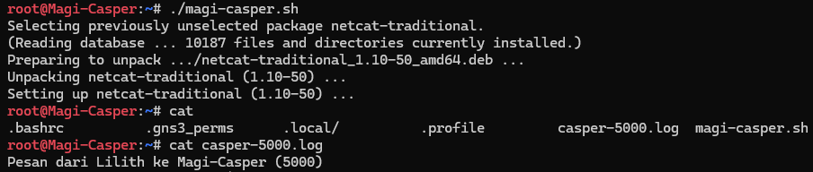

**Magi-Balthasar** — `/root/balthasar-5000.log` dan `/root/balthasar-5001.log`:

```sh
cat /root/balthasar-5000.log
cat /root/balthasar-5001.log
```


**Magi-Melchior** — `/root/melchior-5000.log`:

```sh
cat /root/melchior-5000.log
```


**Pengiriman dari Lilith:**


## Soal 8

### Tujuan

Menjalankan layanan TCP pada Pen-Pen dan Tokyo3-Core. Pen-Pen menjawab koneksi pada port `80` dengan `Welcome to {hostname}`. Tokyo3-Core menggunakan jawaban yang sama pada port `80` dan mengirim `syifa imutz` pada port `8080`. Pengujian dari Lilith juga memastikan koneksi ke port `22` yang tidak dilayani gagal dalam batas waktu, bukan menunggu tanpa akhir.

### Skrip listener

Kedua skrip memeriksa ketersediaan `iptables` dan `nc`. Jika salah satunya belum tersedia, waktu container diselaraskan menggunakan header HTTP `Date`, lalu `iptables` dan `netcat-openbsd` dipasang. Listener dijalankan berulang agar siap menerima koneksi berikutnya, dan output disimpan ke log di `/root/`.

**Pen-Pen** — `script/soal-8/pen-pen.sh`:

```sh
#!/bin/sh
if ! command -v iptables >/dev/null 2>&1 || ! command -v nc >/dev/null 2>&1; then
    DATE_STR=$(wget -S --spider http://deb.debian.org 2>&1 | awk -F': ' '/^  Date:/{print $2; exit}')
    [ -n "$DATE_STR" ] && date -s "$DATE_STR"
    apt-get update -qq && DEBIAN_FRONTEND=noninteractive apt-get install -y -qq iptables netcat-openbsd
fi

pkill -f "[n]c -l 80" 2>/dev/null || true

while true; do
    printf "Welcome to %s\n" "$(hostname)" | nc -l 80 >>/root/penpen-80.log 2>&1 || sleep 1
done &
```

**Tokyo3-Core** — `script/soal-8/tokyo3-core.sh`:

```sh
#!/bin/sh
if ! command -v iptables >/dev/null 2>&1 || ! command -v nc >/dev/null 2>&1; then
    DATE_STR=$(wget -S --spider http://deb.debian.org 2>&1 | awk -F': ' '/^  Date:/{print $2; exit}')
    [ -n "$DATE_STR" ] && date -s "$DATE_STR"
    apt-get update -qq && DEBIAN_FRONTEND=noninteractive apt-get install -y -qq iptables netcat-openbsd
fi

pkill -f "[n]c -l 80" 2>/dev/null || true
pkill -f "[n]c -l 8080" 2>/dev/null || true

while true; do
    printf "Welcome to %s\n" "$(hostname)" | nc -l 80 >>/root/tokyo3-80.log 2>&1 || sleep 1
done &

while true; do
    printf "syifa imutz\n" | nc -l 8080 >>/root/tokyo3-8080.log 2>&1 || sleep 1
done &
```

Salin dan jalankan masing-masing skrip sebagai root di container yang sesuai:

```sh
# Di Pen-Pen
chmod +x /root/pen-pen.sh && /root/pen-pen.sh

# Di Tokyo3-Core
chmod +x /root/tokyo3-core.sh && /root/tokyo3-core.sh
```

### Pengujian

Pastikan listener aktif. Pen-Pen seharusnya menampilkan port `80` berstatus `LISTEN`; Tokyo3-Core menampilkan port `80` dan `8080`.

```sh
ss -tulpn
```

Dari Lilith, uji ketiga layanan:

```sh
nc -w 2 10.71.3.194 80
nc -w 2 10.71.4.106 80
nc -w 2 10.71.4.106 8080
```

Jawaban yang diharapkan adalah `Welcome to Pen-Pen`, `Welcome to Tokyo3-Core`, dan `syifa imutz`.

Port `22` tidak memiliki listener. Uji dengan verbose mode dan batas waktu dua detik agar kegagalan koneksi terlihat langsung:

```sh
nc -v -w 2 10.71.3.194 22
nc -v -w 2 10.71.4.106 22
```

### Bukti pengujian

Di Pen-Pen, `ss -tulpn` menunjukkan listener pada port `80`:

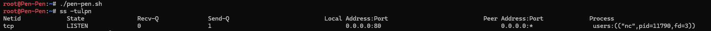

Di Tokyo3-Core, listener aktif pada port `80` dan `8080`:


Pengujian dari Lilith menerima respons yang diharapkan pada ketiga port layanan. Koneksi ke port `22` pada kedua host ditolak dengan `Connection refused`:


### Menghentikan listener

Untuk menghentikan loop dan proses `nc` di Pen-Pen:

```sh
pkill -f "pen-pen.sh" 2>/dev/null || true
pkill -f "[n]c -l 80" 2>/dev/null || true
pkill -f "sleep 1" 2>/dev/null || true
```

Untuk menghentikan listener di Tokyo3-Core:

```sh
pkill -f "tokyo3-core.sh" 2>/dev/null || true
pkill -f "[n]c -l 80" 2>/dev/null || true
pkill -f "[n]c -l 8080" 2>/dev/null || true
pkill -f "sleep 1" 2>/dev/null || true
```

## Soal 9

### Analisis sabotase routing

Setelah `break_routing.sh` dijalankan di Shigeru, empat perubahan mengganggu forwarding dan pemilihan rute. Armisael masih dapat ping gateway `10.71.4.89` karena alamat itu dimiliki langsung oleh Shigeru. Paket yang harus diteruskan melewati Shigeru terkena konfigurasi forwarding, policy routing, dan rute yang telah disabotase.

| No. | Perubahan sabotase | Dampak | Hubungan dengan gejala |
|---:|---|---|---|
| 1 | `echo 0 > /proc/sys/net/ipv4/ip_forward` | IP forwarding di Shigeru dimatikan. | Paket yang ditujukan ke alamat Shigeru sendiri tetap dapat dijawab, tetapi paket transit antara LAN Monolith dan jaringan lain tidak diteruskan. |
| 2 | `ip route replace default via 10.71.4.146 dev eth2` | Default route diarahkan ke Makoto, bukan ke Gendo (`10.71.4.113` melalui `eth0`). | Paket yang membutuhkan rute default dikirim ke arah cabang Radar, bukan menuju core router. |
| 3 | `ip route add blackhole 10.71.4.72/29` | Subnet Cage dibuang diam-diam oleh tabel routing utama. | Tujuan pada prefix tersebut tidak dapat dicapai dari Shigeru. |
| 4 | `ip route add unreachable default table 100` dan `ip rule add iif eth1 lookup 100 priority 90` | Paket yang masuk dari `eth1` (Switch-Monolith) dipilihkan tabel 100, yang hanya memiliki rute `unreachable default`. | Paket dari Armisael gagal sebelum memakai tabel utama, sehingga trafik menuju Lilith tidak dapat diteruskan. |

Untuk gejala ping Lilith ke Armisael, permintaan dari Lilith masuk ke Shigeru lewat `eth0`; `ip_forward=0` menghentikan paket sebelum diteruskan ke `eth1`. Jika balasan Armisael masuk ke Shigeru lewat `eth1`, rule PBR prioritas 90 memilih tabel 100 dan menghasilkan `unreachable`. Default route yang salah juga akan mengirim trafik tanpa rute yang lebih spesifik ke Makoto, bukan Gendo. Blackhole `10.71.4.72/29` adalah sabotase tambahan pada subnet Cage, tetapi bukan penyebab langsung ping antara Lilith dan Armisael karena Lilith berada di subnet Dogma `10.71.4.80/29`.

### Gejala saat kondisi rusak

Jalankan sabotase, lalu periksa forwarding dan tabel routing di Shigeru. Perintah pertama berikut adalah skrip yang dijalankan pada bukti:

```bash
./break_routing.sh
sysctl net.ipv4.ip_forward
ip rule show
ip route show
ip route show table 100
```


Di Armisael, ping pertama menguji gateway Shigeru dan ping kedua menguji Lilith:

```bash
ping -c 3 10.71.4.89
ping -c 3 10.71.4.82
```


Di Lilith, jalankan ping berikut untuk menguji jalur balik ke Armisael:

```bash
ping -c 3 10.71.4.91
```

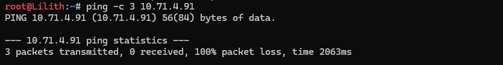

### Perbaikan di Shigeru

Skrip berikut mengaktifkan kembali forwarding, menghapus rule dan tabel policy routing, menghapus rute blackhole, serta memulihkan default route ke Gendo dan rute Radar melalui Makoto.

```bash
#!/bin/sh

sysctl -w net.ipv4.ip_forward=1

ip rule del iif eth1 lookup 100 priority 90 2>/dev/null || true
ip route flush table 100 2>/dev/null || true
ip route del blackhole 10.71.4.72/29 2>/dev/null || true

ip route replace default via 10.71.4.113 dev eth0
ip route replace 10.71.4.56/29 via 10.71.4.146 dev eth2
```

Skrip tersedia di `script/soal-9/repair-shigeru.sh`. Salin ke Shigeru dan jalankan sebagai root:

```bash
chmod +x /root/repair-shigeru.sh
/root/repair-shigeru.sh
```

Pastikan konfigurasi persisten `/etc/network/interfaces` tetap mengikuti konfigurasi Soal 3 agar rute normal kembali setelah restart.

### Verifikasi setelah perbaikan

Periksa forwarding, policy rule, dan tabel routing di Shigeru:

```bash
sysctl net.ipv4.ip_forward
ip rule show
ip route show
```

Pastikan forwarding bernilai `1`, rule `lookup 100` serta rute `blackhole` sudah tidak ada, dan default route mengarah ke Gendo melalui `eth0`. Setelah itu, ping Lilith ke Armisael harus kembali menerima balasan:

```bash
ping -c 3 10.71.4.91
```


## Soal 10

### Tujuan Soal

Soal ini meminta kita menemukan seluruh penyebab gangguan NAT setelah `break_nat.sh` dijalankan, menjelaskan hubungan setiap aturan yang rusak dengan gejala jaringan, lalu memperbaikinya dan menguji kembali konektivitas. Pemeriksaan mencakup akses internet dari jaringan Cage, pembanding dari Spy di jaringan Intel, serta komunikasi internal dari Unit-01 ke Lilith. Dengan membandingkan hasil tersebut dan aturan `POSTROUTING` di Misato serta Gendou, kita dapat menentukan aturan sabotase mana yang memengaruhi tiap jalur.

### Jalankan sabotase

Jalankan skrip `break_nat.sh` pada **Misato** dan **Gendou** untuk menerapkan kondisi yang diuji:

```bash
# Di Misato
./break_nat.sh

# Di Gendou
./break_nat.sh
```

### Pemeriksaan sebelum perbaikan

Di Unit-01, jalankan ping berikut untuk merekam gagalnya akses internet:

```bash
ping -c 2 8.8.8.8
```

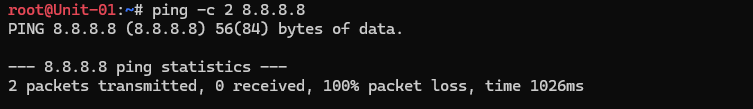

Di Spy pada subnet Intel, jalankan perintah yang sama sebagai pembanding:

```bash
ping -c 2 8.8.8.8
```


Di Unit-01, uji tujuan internet dan Lilith secara berurutan:

```bash
ping -c 2 8.8.8.8
ping -c 2 10.71.4.82
```


Periksa rantai `POSTROUTING` pada kedua router:

```bash
# Di Misato
iptables -t nat -L POSTROUTING -n -v --line-numbers

# Di Gendou
iptables -t nat -L POSTROUTING -n -v --line-numbers
```

Di Misato, bukti menunjukkan rule berikut pada baris pertama:

```text
SNAT  source 10.71.4.72/29  destination !10.71.0.0/16  out eth0  to:172.31.99.1
```

Rule ini mengubah sumber paket Cage menjadi `172.31.99.1` ketika tujuan berada di luar jaringan internal. Alamat tersebut bukan alamat sumber WAN Gendou yang dapat dipakai untuk menerima balasan internet. Karena itu, balasan dari `8.8.8.8` tidak kembali ke Unit-01.


Di Gendou, bukti menunjukkan `RETURN` di baris pertama, sebelum rule `MASQUERADE`:

```text
RETURN      source 10.71.4.64/29  out eth0
MASQUERADE  source 10.71.0.0/16   out eth0
```

`RETURN` menghentikan pemrosesan lebih lanjut pada chain `POSTROUTING` untuk sumber `10.71.4.64/29`. **Rentang tersebut adalah Switch-Terminal, bukan Cage**; alamat Cage adalah `10.71.4.72/29`. Jadi berdasarkan output yang terekam, rule Gendou mengganggu NAT untuk Terminal, tetapi tidak mencocokkan paket Unit-01. Penyebab langsung kegagalan ping Cage yang terlihat adalah rule SNAT di Misato.


### Mengapa Intel dan komunikasi internal tetap berjalan

- Rule SNAT Misato mencocokkan sumber Cage (`10.71.4.72/29`), sehingga tidak mengenai Spy di subnet Intel (`10.71.4.100/30`). Spy tetap keluar melalui rule `MASQUERADE` Gendou.
- Ping dari Cage ke Lilith tetap berjalan karena Lilith (`10.71.4.82`) berada di dalam jaringan internal `10.71.0.0/16`; kondisi tujuan `! -d 10.71.0.0/16` pada rule SNAT tidak terpenuhi.

### Perbaikan

Hapus rule sabotase pada kedua router. Berdasarkan bukti, rule yang perlu dihapus berada di nomor baris pertama pada masing-masing chain:

**Di Gendou**, hapus `RETURN` dan biarkan `MASQUERADE`:

```bash
iptables -t nat -D POSTROUTING 1
iptables -t nat -L POSTROUTING -n -v --line-numbers
```


**Di Misato**, hapus rule `SNAT` menuju alamat bogus:

```bash
iptables -t nat -D POSTROUTING 1
iptables -t nat -L POSTROUTING -n -v --line-numbers
```

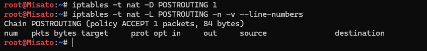

### Verifikasi setelah perbaikan

Periksa kembali tabel NAT pada kedua router:

```bash
iptables -t nat -L POSTROUTING -n -v --line-numbers
```

Pada Gendou, rule `MASQUERADE` internal melalui `eth0` kembali menjadi satu-satunya rule yang diperlukan. Pada Misato, rantai `POSTROUTING` sudah kosong.

Uji kembali Unit-01 menuju Seele (`8.8.8.8`):

```bash
ping -c 3 8.8.8.8
```

Ping berhasil setelah perbaikan. Alamat sumber diterjemahkan di **Gendou** oleh rule `MASQUERADE` pada chain `POSTROUTING` tabel `nat`, saat paket keluar melalui `eth0` ke NAT1.


## Soal 11

### Tujuan Soal

Soal ini meminta Magi-Casper (`10.71.4.66/29`) dibuat tidak membalas ping dari node lain, baik dari Magi-Balthasar yang satu switch maupun dari Lilith di subnet berbeda. Pada saat yang sama, Casper harus tetap dapat memulai ping ke node lain dan menerima balasannya, serta tetap menyediakan layanan TCP port `5000`.

Solusinya adalah menjalankan skrip `script/soal-11/magi-casper.sh` langsung di Magi-Casper. Ini penting karena trafik Balthasar ke Casper pada Switch-Terminal tidak melewati router. Skrip membersihkan rule `INPUT` lama, menerima paket `ESTABLISHED,RELATED` agar balasan koneksi yang dimulai Casper bisa masuk, lalu membuang ICMP `echo-request` yang ditujukan ke Casper. Skrip juga menyalakan kembali listener `nc` port `5000`, sehingga pengujian TCP tetap berhasil walaupun ping masuk gagal.

### Skrip Magi-Casper

Skrip tersedia di `script/soal-11/magi-casper.sh`. Jalankan sebagai root di Magi-Casper:

```bash
#!/bin/sh
if ! command -v iptables >/dev/null 2>&1 || ! command -v nc >/dev/null 2>&1; then
    DATE_STR=$(wget -S --spider http://deb.debian.org 2>&1 | awk -F': ' '/^  Date:/{print $2; exit}')
    [ -n "$DATE_STR" ] && date -s "$DATE_STR"
    apt-get update -qq && DEBIAN_FRONTEND=noninteractive apt-get install -y -qq iptables netcat-openbsd
fi

# Bersihkan aturan INPUT lama agar tidak menumpuk saat skrip dijalankan ulang.
iptables -F INPUT

# Izinkan balasan untuk koneksi yang dimulai Casper.
iptables -A INPUT -m conntrack --ctstate ESTABLISHED,RELATED -j ACCEPT

# Buang semua ping masuk.
iptables -A INPUT -p icmp --icmp-type echo-request -j DROP

# Jalankan kembali listener TCP 5000.
pkill -f "[n]c -l 5000" 2>/dev/null || true
pkill -f "[n]c -l -p 5000" 2>/dev/null || true
nohup nc -l 5000 >/root/casper-5000.log 2>&1 &
```

```bash
chmod +x /root/magi-casper.sh
/root/magi-casper.sh
```

### Verifikasi firewall dan ping

Periksa rule `INPUT` dan pastikan listener TCP port `5000` aktif:

```bash
./magi-casper.sh
iptables -L INPUT -n -v
ss -tulpn | grep 5000
```

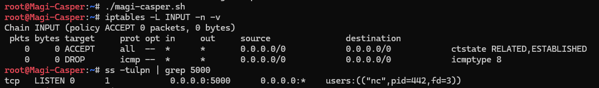

Di Magi-Balthasar, ping ke Casper harus gagal meskipun keduanya terhubung ke switch yang sama:

```bash
ping -c 3 10.71.4.66
```


Di Lilith, ulangi pengujian dari subnet lain:

```bash
ping -c 3 10.71.4.66
```

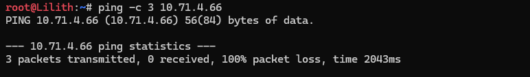

Sebaliknya, ping yang dimulai dari Casper ke Magi-Balthasar dan Lilith harus berhasil. Balasan echo-reply diterima karena rule `ESTABLISHED,RELATED` berada sebelum rule DROP:

```bash
# Dari Magi-Casper
ping -c 3 10.71.4.67
ping -c 3 10.71.4.82
```


### Verifikasi TCP 5000

Di Lilith, ping ke Casper tetap gagal, tetapi koneksi TCP ke port `5000` berhasil:

```bash
ping -c 3 10.71.4.66
echo "Cek TCP 5000 Casper" | nc -w 2 10.71.4.66 5000
```


Periksa pesan pada Casper:

```bash
cat /root/casper-5000.log
```

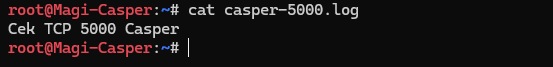

## Soal 12

### Tujuan Soal

Soal ini meminta kita menemukan **semua penyebab** gangguan setelah `break_fw.sh` dijalankan di Magi-Casper, menghubungkan setiap rule yang rusak dengan gejalanya, lalu memperbaiki firewall tanpa menghilangkan perilaku “hantu” dari Soal 11. Target akhirnya: Casper dapat ping ke internet dan menjalankan `apt-get update`, Unit-00 dapat terhubung ke layanan TCP port `5000`, tetapi ping masuk ke Casper tetap ditolak.

Karena gangguan dapat berasal dari beberapa chain sekaligus, pemeriksaan harus mencakup rule `INPUT` dan `OUTPUT`, bukan hanya mengubah satu rule berdasarkan satu gejala. Rule `INPUT` yang di-flush menghilangkan izin untuk balasan koneksi dan layanan TCP `5000`; rule DROP UDP port `53` di `OUTPUT` memutus kueri DNS; dan rule DROP ICMP di `INPUT` tanpa pengecualian `ESTABLISHED,RELATED` juga membuang echo-reply untuk ping yang dimulai Casper. Perbaikan di bawah mempertahankan policy `INPUT DROP` dan penolakan echo-request, sambil memulihkan trafik balasan, DNS/akses keluar, dan layanan TCP.

### Pemeriksaan kondisi rusak

Pemeriksaan sebelum perbaikan:

```bash
./break_fw.sh
iptables -L INPUT -n -v --line-numbers
iptables -L OUTPUT -n -v --line-numbers
ping -c 3 8.8.8.8
apt-get update
```


### Penyebab yang ditemukan

| Penyebab | Efek | Gejala |
|---|---|---|
| Rule `INPUT` lama dihapus oleh `iptables -F INPUT`, sementara policy `INPUT` tetap `DROP`. Rule `ESTABLISHED,RELATED` dan izin TCP port `5000` ikut hilang. | Balasan koneksi Casper sendiri dan koneksi masuk ke port layanan tidak memiliki rule `ACCEPT`. | Echo-reply dari `8.8.8.8`, balasan layanan apt, dan SYN ke TCP 5000 dibuang di `INPUT`. |
| `iptables -A OUTPUT -p udp --dport 53 -j DROP`. | Kueri DNS UDP keluar dibuang. | `apt-get update` gagal me-resolve `deb.debian.org`. |
| `iptables -A INPUT -p icmp -j DROP` tanpa rule `ESTABLISHED,RELATED` yang lebih dahulu menerima balasan. | Semua ICMP masuk dibuang, termasuk echo-reply untuk ping yang dimulai Casper. | Ping masuk tetap ditolak sesuai tujuan Casper sebagai “hantu”; ping keluar Casper juga tidak menerima balasan. |

Di Unit-00, ping ke Casper gagal dan percobaan koneksi ke TCP port `5000` mengalami timeout:

```bash
ping -c 3 10.71.4.66
echo "Tes sebelum fix" | nc -v -w 2 10.71.4.66 5000
```

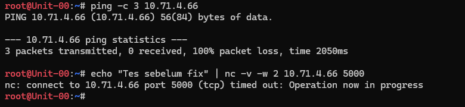

### Perbaikan di Magi-Casper

Perintah berikut memulihkan koneksi yang dimulai Casper dan layanan port `5000`, sambil mempertahankan policy `INPUT DROP` serta penolakan ping masuk. `OUTPUT ACCEPT` juga menghapus blokir DNS keluar setelah chain `OUTPUT` dibersihkan.

```bash
# Pertahankan policy ketat untuk trafik masuk; izinkan trafik keluar.
iptables -P INPUT DROP
iptables -P OUTPUT ACCEPT

# Bersihkan rule yang rusak.
iptables -F INPUT
iptables -F OUTPUT

# Izinkan loopback dan balasan koneksi yang sudah dimulai.
iptables -A INPUT -i lo -j ACCEPT
iptables -A INPUT -m conntrack --ctstate ESTABLISHED,RELATED -j ACCEPT

# Izinkan layanan Casper, lalu tetap tolak ping masuk.
iptables -A INPUT -p tcp --dport 5000 -m conntrack --ctstate NEW,ESTABLISHED -j ACCEPT
iptables -A INPUT -p icmp --icmp-type echo-request -j DROP
```

Pastikan listener TCP port `5000` berjalan. Jika belum aktif, mulai ulang:

```bash
ss -tulpn | grep 5000
nohup nc -l 5000 >/root/casper-5000.log 2>&1 &
```

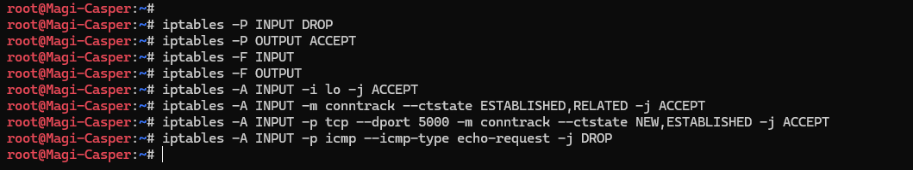

### Verifikasi setelah perbaikan

Pastikan policy `INPUT` tetap `DROP` dan rule pemulihan terpasang:

```bash
ss -tulpn | grep 5000
nohup nc -l 5000 >/root/casper-5000.log 2>&1 &
ss -tulpn | grep 5000
iptables -L INPUT -n -v --line-numbers
```


Jalankan `apt-get update` di Casper. Ini menguji resolusi DNS dan komunikasi keluar beserta balasannya:

```bash
apt-get update
```

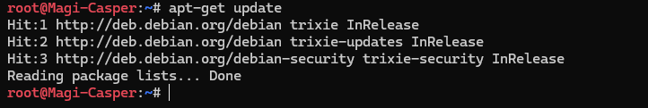

Dari Unit-00, ping ke Casper harus tetap gagal karena echo-request masuk masih dibuang:

```bash
ping -c 3 10.71.4.66
```

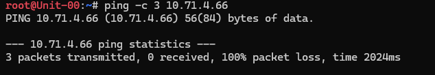

TCP port `5000` dari Unit-00 harus berhasil. Gambar berikut juga menampilkan ping masuk yang tetap ditolak:

```bash
ping -c 3 10.71.4.66
echo "Halo dari Unit-00 ke Casper 5000" | nc -w 2 10.71.4.66 5000
```

Di Magi-Casper, periksa payload yang diterima:

```bash
cat /root/casper-5000.log
```

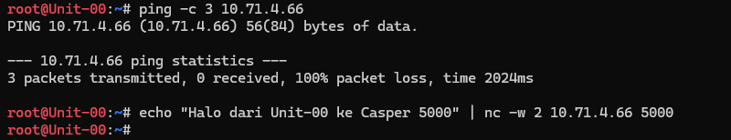


## Soal 13